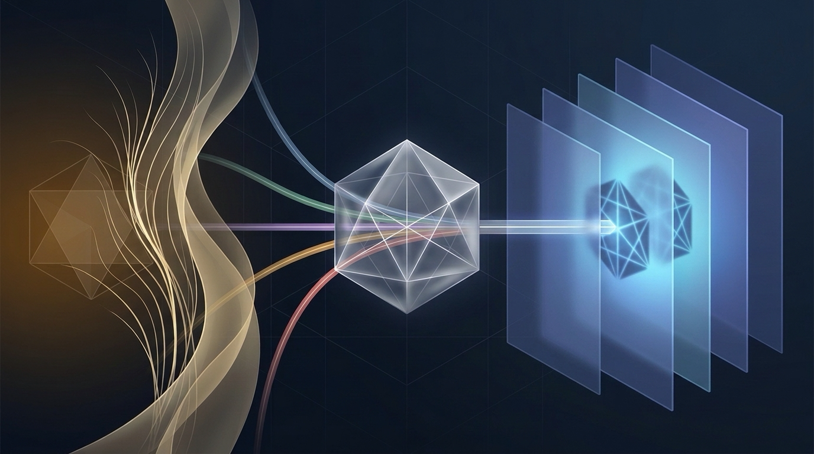
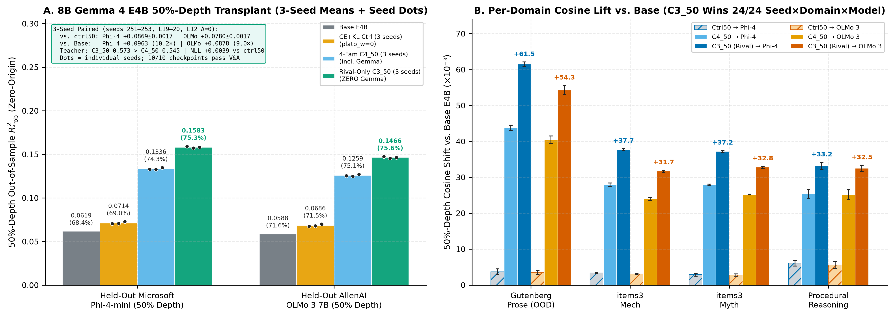

<div align="center">

# The Jung–Plato Lattice

### Multi-Family Representation Denoising, Compositional Probing, and Cross-Tokenizer Distillation

[](https://doi.org/10.5281/zenodo.24572076)
[](https://orcid.org/0009-0004-1919-3209)
[](paper/paper.md)
[](paper/The_Jung_Plato_Lattice_v6.docx)
[](paper/arxiv/README_ARXIV.md)
[](LICENSE)
[](requirements.txt)

*Preprint (`v6` / Zenodo v3.0 candidate), dual-audience Microsoft Word review copy (`.docx`), IEEEtran arXiv LaTeX bundle, 9 JSON-driven figures plus 2 TikZ diagrams, sanitized runner scripts, public benchmarks, verified JSON outputs, and zero-GPU cross-verifier.*



</div>

---

## Plain-English overview: what we did and what we found

We gave five independently trained open-weight language models (from Google, Alibaba, Meta, Mistral, and Thinking Machines) the same public passages and recorded their middle-layer internal activations at matching clause endings. Rotating their coordinate systems into alignment with 10-iteration Generalized Procrustes Analysis (GPA) and averaging them produces one 256-dimensional consensus space (`C5`). On two target families excluded from consensus construction (Microsoft `Phi-4-mini` 3.8B and AllenAI `OLMo 3` 7B), after fitting each target's top-256 PCA basis on the training corpus and calibrating one 2-fold Procrustes map on held-out folds, `C5` improves activation prediction by `+8.3` and `+7.8` strict $R^2_{\text{opt}}$ points (`+11.3` and `+10.4` norm-matched Frobenius $R^2_{\text{frob}}$ points) above every single 7B–9B teacher.

> **For ML and AI engineers:** Supervising one middle layer through a temporary linear projection head (dropped after training) transfers 256-dim cross-family geometry across unrelated tokenizers with zero added inference parameters. In Experiment 251 (3 paired seeds on 8B multimodal `google/gemma-4-E4B-it`), a rival-only 50%-depth consensus (`C3_50`: Qwen3.5 + Llama 3.1 + Mistral, zero Gemma 4) beats matched `CE+KL` control by `+0.0869 ± 0.0017` (Phi-4) and `+0.0780 ± 0.0017` (OLMo 3) $R^2_{\text{frob}}$ with exact `0.0` layer-12 drift, passing vision/audio fixtures, a slight `+0.0039` Gutenberg NLL cost, and zero observed mean MCQ change (`0.00 ± 0.50 pp`).

> **For psychologists and analytical psychology readers:** We tested whether Carl Jung's narrative archetypes appear as privileged structures inside these shared language-model spaces. On 480 cleaned historical folktales indexed to the Aarne–Thompson–Uther (ATU) catalog, predicted archetype-to-folktale pairings fail (`cos = -0.106, p = 0.952`), unlabeled statistical clustering (PCA) matches or outperforms labeled Jungian categories, and ordinary workplace roles transfer higher than Jung-inspired roles across modern micro-stories (`94.3%–98.1%` vs. `85.9%–92.7%`). Making no claim about machine consciousness or psyche, we analyze aligned subspaces strictly as statistical projections of human cultural data.

Four main findings and three explicitly dropped audits summarize the release:

1. **Mid-depth actor-intent readout (`30%` to `50%` depth, Sec. 4.8.1):** On 240 exact identical-bag-of-words actor-intent swaps (`bm_actor2x2_247`, where all seven fitted linear lexical and polarity baselines sit at `50.0%` and raw zero-shot sentiment sits at `51.5%/52.0%`, though a frozen actor-lexicon × polarity rule hits `95.5%–96.3%` and an unfitted gap-4 skip-bigram scores `59.2%`), mean-pooled cross-family readout (`cv2 ⊥ VAL5`) rises from `30%` to its observed peak at `50%` depth: `73.01%` (Gemma→5) and `73.09%` (Qwen→5) overall, `81.6%/87.8%` benign, `64.4%` Gemma / `58.3%` Qwen adverse, and `26.0%/28.2%` all-four-pairs-right vs. `6.25%` chance (clearing cross-pool Bonferroni-8 on mean pool). Last-token curves are weaker (`33.7%–41.2%` adverse at `50%`), within-model `50%–70%` spans zero on reflected basic, rank-5 `VAL5` leaves `83%` sentiment decodable, and single-layer causal steering gave a null effect (Exp 241, dropped), limiting this result to a linear representational readout.
2. **Rival-only `50%`-depth 8B transplant (Exp 251, 3 seeds, Sec. 4.8.3):** Updating only full-rank MLPs `19–20` (`PLATO50_LAYER = 20`) on official multimodal `google/gemma-4-E4B-it` across three paired seeds (`251–253`) with rival-only `C3_50` (zero Gemma 4 in the teacher) raises held-out-family `Phi-4-mini` and `OLMo 3` 50%-depth $R^2_{\text{frob}}$ by `+0.0869 ± 0.0017` and `+0.0780 ± 0.0017` over matched `CE+KL` control (`ctrl50`, 3/3 seeds, 3-seed $t$-interval `±0.0042`) and beats Gemma-including `C4_50` across all `24/24` dependent seed×domain×model cells. Layer 12 stays mathematically invariant (`0.0` across all 9 trained checkpoints on the 16-passage probe by construction), the transplant adds `0` inference parameters, and all 10/10 checkpoints pass both color and speech verification fixtures. Relative to `ctrl50`, `C3_50` incurs a small Gutenberg NLL penalty (`+0.0039 ± 0.0024`), shows a zero observed mean procedural MCQ difference (`0.00 ± 0.50 pp`; per-seed `+0.50, 0.00, -0.50 pp`), and produces mixed or slightly negative downstream probing deltas.
3. **Historical ATU folktales (`480 / 476 / 477 / 473` excerpts, Sec. 4.8.2) and dropped audits (Sec. 4.8.4):** Five predicted Jung-to-ATU diagonal pairings fail (`mean cos = -0.106, p = 0.952`), type-preserving effective rank is null (`p = 0.277`), and unlabeled PCA on the same Jung corpus matches or beats labeled Jungian centroids on ATU mean squared directional projection $v_{\text{dir}}$ (`PCA7_setcent 0.15729 > Q_jung7 0.13803`, fixed-source Holm-7 `p = 0.007 / 0.008`, spanning zero under joint basic resampling). Jungian labels do outscore Workplace labels on ATU $v_{\text{dir}}$ (`0.13803` vs. `0.07300`, Holm-7 `0.007`) and modestly exceed within-setting shuffles (`0.13803` vs. `0.09631`, 10k Holm-3 `p = 0.0417`; `0.0405` at `n=477`, `0.0414` at `n=473`), while showing no reliable advantage over Family roles (`0.11332`). Three follow-up audits are explicitly dropped: Exp 241 (single-layer steering null `-0.0070`), Exp 243 (14-text external systems-archetype replication trailing BoW `0.493` vs. `0.625`), and Exp 244 (120-pair epistemic scaling failing admissibility `rand500_p95 = 0.759–0.980`).
4. **Methodological scope (Sec. 5.1b):** Making no claim either way about machine consciousness, subjective experience, or biological inheritance, we discuss cultural-transmission, cognitive-attractor, and developmental-emergentist accounts alongside frontier consciousness indicator work, note the conditional implication of an organismic reading of Jung versus substrate-independent functionalism, and specify a falsifiable stateful Word Association Test protocol for future test-time-training systems.



> **Companion live system:** The always-on local multimodal assistant built on this 8B foundation (Aion, named after Jung's CW 9.II volume) lives in its own private repository (`syn-ack-ai/aion`). This MIT repository holds only the public paper, Word review copy, arXiv LaTeX bundle, sanitized runner scripts, benchmarks, figures, and verification code.

---

## Key verified results (`v6` / Zenodo v3.0 candidate)

| Pillar | Protocol & Controls | Verified Headline Result |
| :--- | :--- | :--- |
| **1. Five-Family Consensus (`C5`)** *(Sec. 4.1)* | 5-family GPA (`Gemma 4`, `Qwen3.5`, `Llama 3.1`, `Mistral 7B`, looped `Inkling 2 Mini`) → excluded targets `Phi-4-mini` (3.8B) & `OLMo 3` (7B) (`20,339` train / `3,192` eval clauses) | `+8.3 / +7.8` strict $R^2_{\text{opt}}$ pts (`0.557 / 0.564` vs. `0.474 / 0.486`) and `+11.3 / +10.4` $R^2_{\text{frob}}$ pts (`0.491 / 0.506` vs. `0.379 / 0.403`, T1 `95.3% / 89.9%`; `C4` edges OLMo 3 at `0.509 / 90.5%`); unchanged without myth pool |
| **2. Five-Depth Trajectory & 2×2 Actor Readout** *(Sec. 4.8.1, Claims A & B)* | `bm_actor2x2_247` (`240` pairs; 7 fitted linear lexical/polarity baselines `= 50.0%`; actor×polarity rule `95.5%–96.3%` disclosed), 5 depths (`15%–85%`), Bonf-8, NLL strata | Mean-pool `cv2 ⊥ VAL5` rises `30%→50%` (`73.01%` G4→5, `73.09%` Qw→5; benign `81.6%/87.8%`, adverse `64.4%` G4 / `58.3%` Qw, all-4-right `26.0%/28.2%` vs. `6.25%` chance); all 4 mean Bonf-8 basic LBs `≥ +2.19 pp`; Qw last `d50−d30` spans zero on basic (`[-1.58, +9.50]`); Exp 241 steering null limits to readout |
| **3. Rival-Only `50%`-Depth 8B Transplant (`Exp 251`, 3 Seeds)** *(Sec. 4.8.3)* | 3-seed (`251–253`) 4-arm paired study on `google/gemma-4-E4B-it` (`L19–20`, neutral text, `0` extra transplant params, `L12` diff `= 0.0` across 9 trained ckpts by construction): `base`, `ctrl50`, `c4_50`, rival-only `c3_50` (zero Gemma) | `c3_50` lifts held-out `Phi-4` $R^2_{\text{frob}}$ `+0.0869 ± 0.0017` over `ctrl50` (`+0.0963` over Base, ratio of mean lifts `10.2×`, Top-1 `+6.30 pp` vs. `ctrl50`) & `OLMo 3` `+0.0780 ± 0.0017` over `ctrl50` (`+0.0878` over Base, ratio of mean lifts `9.0×`, Top-1 `+4.14 pp`); wins `24/24` dependent seed×domain×model cells over `c4_50`; small NLL cost (`+0.0039 ± 0.0024`); zero mean MCQ diff (`0.00 ± 0.50 pp`) & mixed probing vs. `ctrl50` |
| **4. Historical ATU Folktales (`480 / 476 / 477 / 473`) & Role Controls** *(Sec. 4.8.2, Claim C)* | `480` cleaned (`476` audit-motivated framing-excl., `477/473` overlap-excl.) ATU excerpts from Hagedorn & Darányi (2022) in neutral-only `C5` + `8` study Jung vs. `8` workplace & `8` family roles | No uniquely Jungian privilege: 5 predicted Jung–ATU pairs fail (`cos = -0.106, p = 0.952`); unlabeled `PCA7_setcent` (`0.15729`) beats `Q_jung7` (`0.13803`, Holm-7 `0.007/0.008`, joint basic spans zero); `Q_jung7` beats Workplace (`0.07300`, Holm-7 `0.007`), ties Family (`0.11332`), and slightly beats 10k shuffles (`0.0417`, `477: 0.0405`, `473: 0.0414`); true-9 refit (`84/135`, maj. `30.4%`) clears chance `8/8` & lex `6/8` (`480`) / `5/8` (`476`); workplace roles (`94.3%–98.1%`) beat Jung (`85.9%–92.7%`) on modern stories |
| **5. 5M Cross-Tokenizer Distillation & LORO** *(Secs. 4.5–4.6)* | 24 equal-param `4.72M` non-embed (`8.92M` total) `bpe8k` runs (`P0`–`P3`, `M0`–`M3`) + 1-seed 25M `d50` screen (`D0`–`D3`) + 199-family LORO | Held-out `Phi-4` $R^2_{\text{frob}}$ `-0.029 → +0.132`, `OLMo 3` `-0.073 → +0.130–+0.154` (zero seed overlap; downstream mixed/null); `M2` vs. `M3` lifts `HOUSE` cos `0.200 → 0.619` while `mcq_gain` drops `0.172 → 0.119`; LORO beats TF-IDF on `beat_0–1` (qualified by Exp 243 external null) |
| **6. 30% Stage A, Epistemic Probing, & Dropped Audits** *(Secs. 4.7, 4.8.4)* | 8B `L11–12` Stage A control + 24-pair native epistemic audit + Exps 241, 243, 244 adversarial follow-ups | 30% Stage A lifts `Phi-4`/`OLMo 3` `+0.0216/+0.0202` over control (`88.2%/86.0%` of total lift over Base); 24-pair `Combined_Perp` clears `11/12` nominal (`6/12` Holm; sentiment matches under Aion). Explicitly dropped: Exp 244 (inadmissible `rand500_p95 = 0.759–0.980`, `0/4` Holm), Exp 241 (causal null `-0.0070`), Exp 243 (trailed BoW `0.493` vs. `0.625` EN-12) |


---

## Quickstart: CPU verification (< 20 seconds)

```bash
python3 -m venv .venv && source .venv/bin/activate
pip install -r requirements.txt

# Verify privacy firewall, forbidden upstream-text guard, in-memory Python syntax check,
# all 9 figures + hero art, 82 references, every verified table body cell + headline prose
# values across BOTH paper.md and main.tex, arXiv tarball cleanliness, a table-corruption
# regression self-test, and zero-GPU unit tests:
python scripts/verify_repro.py

# Regenerate all 9 publication figures (300 DPI PNG + vector PDF) directly from JSONs:
python paper/make_figures.py

# Optional: rebuild the dual-audience Microsoft Word (.docx) review copy (requires python-docx):
python scripts/build_docx.py

# Optional: fetch commit-pinned Hagedorn & Darányi (2022) data/aft.csv locally and verify
# 500/500 Claim C excerpt SHA-256 digests (git-ignored directory; never commit aft.csv):
python scripts/v6/fetch_trilogy_aft.py --out-dir ./folklore_local_data
```

*(CPU verification checks all committed tables, figures, unit tests, and sanitized scripts directly; full from-scratch regeneration of multi-gigabyte activation caches and 8B checkpoints requires open-weight downloads and GPU/MLX hardware using the runners in `bench/archetypes/` and `scripts/v6/`.)*

---

## Repository layout

```text
jung-plato-lattice/
├── paper/
│   ├── paper.md                         # Full dual-audience Markdown manuscript (synced to v6 / Zenodo v3.0)
│   ├── The_Jung_Plato_Lattice_v6.docx   # Formatted Microsoft Word review copy (Track Changes ready, embedded PNGs)
│   ├── make_figures.py                  # Regenerates all 9 JSON-driven figures (300 DPI PNG + vector PDF)
│   ├── figures/                         # hero_jung_plato_lattice.png + fig1..fig9 (.png + .pdf)
│   └── arxiv/                           # Self-contained IEEEtran arXiv LaTeX + TikZ + PDF + clean arxiv_submission.tar.gz
├── bench/archetypes/
│   ├── fluent/                          # 5-family GPA, neutral rotations, valence/BoW/8-role/LORO, 5M distillation
│   │   ├── plato/                       # Verified v5 + all v6 JSONs (Claims A/B/C, overlap audit, 5M d50, drops)
│   │   └── runs/                        # All 24 5M student training & eval JSONs (P0-P3, M0-M3)
│   ├── aion_8b/                         # 8B Gemma 4 E4B causal controls (Stage A 30% & Exp 251 50%) + epistemic audit
│   │   ├── assets/test_speech_16k.wav
│   │   └── runs/                        # e4b_base, stage_a, stage_a_ctrl, e4b_transplant50_exp251, epistemic JSONs
│   ├── items3/ & items7/                # Public ARN-style narrative quartets (myths + matched mechanisms)
│   ├── archstory/ & selfshape/          # HOUSE, SELF2, valence/BoW/actor2x2/role benchmarks & ATU SHA-256 manifest
│   └── crosslang/                       # Public 4-language (EN / EL / JA / ZH) causal story pairs
├── scripts/
│   ├── verify_repro.py                  # Table + headline cross-verifier, license/privacy guard, tarball & unit tests
│   ├── build_docx.py                    # Builds paper/The_Jung_Plato_Lattice_v6.docx from paper/paper.md
│   └── v6/                              # All 29 sanitized v6 experiment/audit runners + fetch_trilogy_aft.py
├── LICENSES/Apache-2.0.txt              # Apache-2.0 text for included OpenAssistant OASST2 dialogue excerpts
├── THIRD_PARTY_LICENSES.md              # Complete attribution, data provenance & licensing boundaries
├── requirements.txt
├── CITATION.cff
└── LICENSE
```

*(Licensing and data provenance: see [THIRD_PARTY_LICENSES.md](THIRD_PARTY_LICENSES.md). Zero text from Hagedorn & Darányi's `aft.csv` compilation is redistributed; 599 OpenAssistant OASST2 dialogues in `passages.jsonl` carry their Apache-2.0 notice in `LICENSES/Apache-2.0.txt`.)*

---

## Citation

If you build on this paper, datasets, or code, please cite [CITATION.cff](CITATION.cff):

```bibtex
@misc{babeshkin2026jungplatolattice,
  author       = {Babeshkin, Benjamin},
  title        = {The Jung--Plato Lattice: Multi-Family Representation Denoising, Compositional Probing, and Cross-Tokenizer Distillation},
  year         = {2026},
  publisher    = {Zenodo},
  doi          = {10.5281/zenodo.24572076},
  url          = {https://doi.org/10.5281/zenodo.24572076},
  howpublished = {\url{https://github.com/syn-ack-ai/jung-plato-lattice}}
}
```

## License

Original code and benchmarks authored in this repository are released under the [MIT License](LICENSE). Third-party datasets (including OASST2 under Apache-2.0 and BLiMP under CC BY 4.0) and open-weight models remain subject to their respective licenses documented in [THIRD_PARTY_LICENSES.md](THIRD_PARTY_LICENSES.md).
