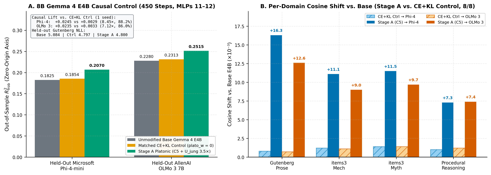

<div align="center">

# The Jung–Plato Lattice

### Multi-Family Representation Denoising, Compositional Probing, and Cross-Tokenizer Distillation

[](https://doi.org/10.5281/zenodo.24572076)
[](https://orcid.org/0009-0004-1919-3209)
[](paper/paper.md)
[](paper/arxiv/README_ARXIV.md)
[](LICENSE)
[](requirements.txt)

*Audit-verified manuscript, arXiv LaTeX bundle, publication figures, public benchmarks, verified JSON artifacts, and reproduction code.*

</div>

---

## Plain-English Overview: What We Did and What We Found

We gave **five independently trained open-weight language models** the same passages and recorded their internal hidden-state activations at matching clause endings. We rotated their coordinate systems into alignment and averaged the resulting 256-dimensional vectors into a single consensus space (**`C5`**). After calibrating a linear rotation on half of a **sixth** (Microsoft `Phi-4-mini`, 3.8B) or **seventh** (AllenAI `OLMo 3`, 7B) model's held-out passages—neither of which took part in building `C5`—this five-family consensus predicted that held-out model's internal activations on the remaining passages substantially better than any single 7B–9B teacher (seven model families in total).

This experiment sits at the intersection of two structural ideas separated by millennia—used here strictly as an interpretive analogy for statistical patterns in human text (making **zero claim** about biological inheritance, Platonic ontology, or machine consciousness):

> **Plato (*Republic* VII, 515c; *Phaedo*, 78d; trans. Jowett, 1892):** *"To them, I said, the truth would be literally nothing but the shadows of the images."* Asking about the underlying Forms (*eidos*—the intelligible, stable objects of inquiry), Socrates asks: *"...are these essences, I say, liable at times to some degree of change? or are they each of them always what they are, having the same simple, self-existent and unchanging forms, and not admitting of variation at all, or in any way, or at any time?"*

> **Carl G. Jung (*The Archetypes and the Collective Unconscious*, CW 9.I, ¶155; trans. R. F. C. Hull):** *"Its form, however, as I have explained elsewhere, might perhaps be compared to the axial system of a crystal, which, as it were, preforms the crystalline structure in the mother liquid, although it has no material existence of its own... The archetype in itself is empty and purely formal, nothing but a facultas praeformandi, a possibility of representation which is given a priori."*

**How to read the two lenses together:**
- **For an AI/ML engineer:** Different tokenizers split the same sentence into different token pieces, so we compare models at identical clause endings (~30% depth). Extending orthogonal Procrustes alignment from pairs of models to five families yields a cleaner, tokenizer-agnostic 256-dim training target (`C5`) that transfers into 5M and 8B models via a temporary training-only linear layer (discarded after training for zero extra inference parameters). Separately, in two models' native ~40–60%-depth residual streams, combining a factual truth probe (`CORRECTNESS`) with a Gram-Schmidt orthogonalized narrative coherence probe (`HOUSE_PERP`) ranks known vs. unknown prompts far above chance even when an assistant system prompt collapses first-token output entropy ranking toward chance (`0.50` AUROC).
- **For a Platonic / Jungian scholar:** Averaging five models yields a *statistical invariant* across observers—an operational extension of Plato's Cave metaphor rather than an ontological Form. Similarly, we borrow Jung's distinction between an empty organizing axis (*archetype-as-such*, CW 9.I ¶5, ¶155) and concrete cultural images to design text experiments: testing a shared narrative completion/coherence axis (`HOUSE`, loosely echoing Jung's house-as-psyche image) alongside an integration contrast (`SELF2`) against 58 discrete named labels, cultural motifs, and strict bag-of-words baselines.

---

## Context: What Prior Work Established vs. What Is New Here

To keep credit and scope unambiguous, this project builds on established alignment methods and three foundational Platonic ML papers, and contributes four original empirical extensions:

**Prior Foundations *(Context — Not New Here)*:**
- **Classical Procrustes & multi-subject alignment:** Orthogonal Procrustes rotation (Schönemann, 1966), Generalized Procrustes Analysis (Gower, 1975), fMRI hyperalignment across brains (Haxby et al., 2011), and relative latent communication (Moschella et al., 2023).
- **Huh, Cheung, Wang, & Isola (2024)** — [*The Platonic Representation Hypothesis*](https://arxiv.org/abs/2405.07987) (`arXiv:2405.07987`): measured neighbor-graph alignment (`mKNN`) showing that independently trained vision and language models converge toward shared representations.
- **Balestriero & LeCun (2026)** — [*Proving and Improving the Platonic Representation Hypothesis with JEPAs*](https://arxiv.org/abs/2610.39302) (`arXiv:2610.39302`): proved representational identifiability up to rotation/linear transforms under stated multi-view joint-embedding assumptions.
- **Cheng, Liu, Yau, & Ré (2026)** — [*Plato's Key*](https://hazyresearch.stanford.edu/blog/2026-11-25-platos-key) (Stanford Hazy Research Report): showed closed-form Orthogonal Procrustes rotation plus global Frobenius scaling transfers factual-recall activations directly between frozen pairs of LLMs at 22–38% depth (top-256 PCs) and revealed "dark memories."

**What Is New in This Paper *(Our Original Contributions)*:**
1. **Five-Family Consensus Tested on Two Further Held-Out Families (`C5`, 7 Companies Total):** Rotating and averaging five unrelated families (Google `Gemma 4 E4B`, Alibaba `Qwen3.5 9B`, Meta `Llama 3.1 8B`, Mistral `Mistral 7B`, and Thinking Machines' looped `Inkling 2 Mini`) via 10-iteration GPA improves out-of-sample prediction of two unseen target families (**Microsoft `Phi-4-mini` 3.8B** and **AllenAI `OLMo 3` 7B**) by **`+10.4` to `+11.3` Frobenius $R^2$ points** above the strongest single teacher (with `C4` edging `C5` slightly on `OLMo 3`; top-1 clause retrieval reaches `95.3%` / `89.9%` vs. best single `95.1%` / `89.2%`), consistent with multi-family noise reduction and unchanged when the dedicated Gutenberg myth pool is excluded (`0.491` / `0.506`).
2. **Cross-Tokenizer Alignment Distillation at 5M & 8B (Zero Inference Overhead):** During training, a temporary linear head asks one intermediate layer to match `C5` at matching clause endings and is discarded afterward. Across 24 runs at 5M scale (`4.72M` non-embedding / `8.92M` total parameters, 8,192-token byte-pair vocabulary `bpe8k`, 3 seeds), held-out Frobenius $R^2$ (`R²_frob`, norm-matched scale) jumps `+15` to `+23` points over plain training with zero seed overlap—while downstream 5M reading/syntax metrics remain mixed/null. Increasing training weight on the 2D `U_jung` span (spanned by teacher `HOUSE` and `SELF2` contrasts) raises student-to-teacher `HOUSE` cosine from `+0.200` to `+0.619` (`3.1×`) on the benchmark defining those contrasts, while reading-comprehension gain (`mcq_gain`, accuracy with passage minus without) falls from `0.172` to `0.119`. On 8B multimodal `google/gemma-4-E4B-it` (1 paired seed, full-rank MLPs `11–12`, where Gemma itself is one of the 5 `C5` teachers), adding `C5 + U_jung` raises held-out `Phi-4` $R^2_{\text{frob}}$ by `+0.0245` and `OLMo 3` by `+0.0235`, versus `+0.0029` / `+0.0033` for a matched `plato_w = 0` `CE+KL` control (a `7.12×–8.45×` gain ratio over base, Gutenberg NLL `+0.0027` higher at `4.8001` vs. `4.7974`, with Vision `"Red"` and spoken Audio `"blue pelican"` fixtures passing; broader 8B downstream tasks remain untested).
3. **Forensic Jungian, Order-Mirrored Binding, Output-Probability, & Non-Jungian Role Audits (`valence_ctrl234.json`, `bow_swap236.json`, `named_arch235.json`, `referee_ctrl237.json`, `bow_mirror238.json`):** Neutral-text Procrustes rotations transfer Gemma 4's `HOUSE` direction zero-shot into all 6 rival families at **`97.4%–98.9%`** (`120/120` paired split wins over BoW `95.5% ± 0.8%`; `cos(u_house_c5, u_self2_c5) = +0.9539`). **`46.8%`** of `HOUSE` in `C5` is shared with evaluative valence (`VAL2` erases held-out sentiment to `cos +0.02–+0.04`). On **120 clause-order-mirrored exact identical-BoW swap pairs** (`bow_mirror_120`: 60 settings × 2 mirrored orders, canceling both mean-pooling primacy and last-token recency; Uni/Bi BoW `50.0%/49.1%`), setting-disjoint 2-fold transfer `⊥ VAL2` reaches **`67.8%–77.0%`** `mean` (**`6/6` Holm `p_holm <= 0.010`**, `42.2%–58.8%` both-mirrors-right vs. `25.0%` no-signal chance and `0.0%` order-only; `65.1%–77.7%` `⊥ VAL5`) and **`60.5%–75.3%`** `last` (`5/6` Holm, Inkling `60.5%` n.s.), zero-shot `HOUSE ⊥ VAL2 → bm120` clears `p_holm <= 0.014` in `6/6` labs (`61.7%–67.5%`, modest `31.7%–40.0%` both-mirrors-right), and OLS intercepts at equal output probability (`ΔNLL = 0`) stay strictly positive in **`5/5` MLX targets** (`67%–101%` `mean`, `78%–107%` `last`; target `ΔNLL` `60.8%–72.5%`, `r = -0.010` to `+0.277`). Giving **8 canonical Jungian archetypes** a fair trial (`320` stories, zero ban-list words) yields `48/48` `p = 0.001` transfer (`85.9%–92.7%` Top-1), **yet 8 ordinary workplace roles** in the same 40 settings transfer higher (`94.3%–98.1%` raw / `93.4%–98.5%` `⊥ VAL3`, TF-IDF Ridge `99.4%`), and apparent `PR` compression (`5.01` / `4.38`) is non-significant vs. shuffled labels in `C5` (`p = 0.116` / `0.108`). Zero-proper-name old-story register persists on 1 of 2 held-out models (`OLMo 3 +0.0454/+0.0369`, reversing on `Phi-4 -0.0167`), and disguised plots remain null (`+0.074 → +0.006` once `fpos` is matched).
4. **Native-Layer Epistemic Probing (`CORRECTNESS` + `HOUSE_PERP` vs. Pure `SENTIMENT_PERP`):** Measured separately in two models' native 40%/60%-depth residual streams (Google `Gemma 4 E4B` L17/L25: raw cosines `+0.223` / `+0.089`; Alibaba `Qwen3.5-9B` L12/L19: raw cosines `+0.157` / `-0.003`), we construct `u_house_perp` orthogonal to `u_corr` (`cos == 0.000` by Gram-Schmidt construction; orthogonal input vectors can still yield correlated prompt scores). On 24 zero-entity-overlap minimal pairs across 12 matched cells (8 Gemma + 4 Qwen), the `Aion` system prompt reduces pooled best-sign symmetric first-token entropy AUROC (`0.50` = chance) to `0.521–0.596`, while `Combined_Perp` clears nominal per-cell `p < 0.05` against 500 mirrored 2-direction random pairs in **11 of 12** cells (**6/12** Holm, **10/12** BH-FDR; solo `-HOUSE_PERP` `5/12` nominal, `0/12` Holm/BH; fails at Qwen L19 Neutral `0.573`). Crucially, our direct sentiment control (`valence_ctrl234.json`) shows that **under the Aion prompt**, pure `-SENTIMENT_PERP` matches or exceeds `-HOUSE_PERP` in all 4 Base cells (removing sentiment drops Qwen L19 Aion `-HOUSE_PERP_BOTH` to chance `0.519`), whereas **under Neutral prompting at Gemma L25**, `-SENTIMENT_PERP` fails (`0.602` n.s.) while valence-orthogonal `-HOUSE_PERP_BOTH` uniquely hits **`1.000` (`p = 0.002`)** and adds `+0.033 [+0.003, +0.076]` over `-CORRECTNESS`.


> **Companion Live System:** The always-on local multimodal assistant built on this 8B foundation (**Aion**—named after Jung's CW 9.II volume—with web UI, webcam/mic loop, episodic RAG, 3-Phase SDFT parametric dreaming, and `AV-LLM-JEPA`) lives in its own separate repository (`syn-ack-ai/aion`, currently private). This repository stays strictly focused on the research paper, arXiv bundle, benchmarks, figures, and reproduction code.

---

## Key Verified Results (Glossary Inline)

*Quick glossary:* `R²_frob` = target-vector $R^2$ with norm-matched Frobenius scale; strict `R²_opt` = $R^2$ with a single scalar fit on the calibration fold; `bpe8k` = 8,192-token byte-pair vocabulary; `LORO` = leave-one-retelling-out retrieval; `items3` = 200 four-story myth/mechanism quartets; `HOUSE` = 233 paired completion/coherence stories; `SELF2` = 79 paired integration stories; `U_jung` = 2D subspace spanned by `HOUSE` and `SELF2`; `Stage-B` = adapted Gemma 4 with trained Titans fast-weight branches enabled from an empty state without updates; `Dedup-10` = 10 invented-entity question pairs after verbatim overlap removal.

| Pillar | Protocol & Controls | Verified Headline Result |
| :--- | :--- | :--- |
| **1. Five-Family Consensus (`C5`)** *(Sec 4.1)* | 5-family GPA (`Gemma 4`, `Qwen3.5`, `Llama 3.1`, `Mistral 7B`, looped `Inkling 2 Mini`) → held-out **`Phi-4-mini`** (3.8B) & **`OLMo 3`** (7B) (`20,339` train / `3,192` eval clauses, target top-256 PCs) | **`+11.3` pts** `Phi-4` $R^2_{\text{frob}}$ (`0.379 → 0.491`, strict $R^2_{\text{opt}}$ `0.557`, Top-1 `95.3%` vs. best single `95.1%`) & **`+10.4` pts** `OLMo 3` (`0.403 → 0.506`, $R^2_{\text{opt}}$ `0.564`, Top-1 `89.9%`; `C4` edges `C5` at `0.509`/`90.5%`); unchanged without myth pool (`0.491 / 0.506`) |
| **2. Zero-Shot `HOUSE`, Order-Mirrored Binding, Output Prob., & Jung vs. Non-Jung Roles** *(Secs 4.2, 4.4.2–4.4.4)* | Neutral-text Procrustes + BoW/TF-IDF + **Exp 234–238 (`VM_60`, `bow_mirror_120` 60 settings × 2 mirrored orders, `ΔNLL` OLS intercept, `items3` `NO_PN`, `40` settings × `8` Jung vs. `8` workplace roles + shuffled `PR` null)** | Raw `HOUSE` `97.4%–98.9%` (`120/120` vs. BoW); `46.8%` is valence; mirrored **`bm120 ⊥ VAL2`** hits **`67.8%–77.0%` `mean` (`6/6` Holm)** & **`60.5%–75.3%` `last` (`5/6` Holm)**, zero-shot `HOUSE ⊥ VAL2` `61.7%–67.5%` (`6/6` Holm), `5/5` positive OLS intercepts at `ΔNLL = 0`; **8 ordinary roles** (`94.3%–98.1%`) outperform Jung's 8 (`85.9%–92.7%`) and `PR` is n.s. vs. shuffled null (`p = 0.116`/`0.108`); zero-PN register holds on `OLMo 3` only (`+0.045/+0.037`); disguised plots null |
| **3. Cross-Setting Narrative Retrieval** *(Sec 4.6.1)* | 199 modern pattern families (`975` stories: `182×5, 14×4, 3×3`), strict leave-query-out LORO in frozen `C5` vs. strict-LQO unigram TF-IDF | `C5` beats TF-IDF on early beats (`beat_0`: `12.4%` vs. `5.5%`, `2.24×`; `beat_1`: **`40.6%`** / `63.5%` Top-5 vs. `34.7%` / `55.5%`); cumulative TF-IDF overtakes on late beats (`beat_2–3`: `51.4% / 57.9%`) |
| **4. 7B → 5M Distillation & `U_jung` Weighting** *(Secs 4.5–4.6.2)* | 24 equal-param `4.72M` non-embed (`8.92M` total) `bpe8k` runs (3 seeds × 8 arms `P0`–`P3`, `M0`–`M3`), temporary layer-2 head dropped after training (**0 extra inference params**) | Held-out `Phi-4` $R^2_{\text{frob}}$ `-0.029 → +0.132` & `OLMo 3` `-0.073 → +0.154` (zero seed overlap; legacy scorer on archived 5M `R²_opt`/Top-1); `M2` vs. `M3` raises `HOUSE` alignment `+0.200 → +0.619` (`3.1×`, same defining benchmark) while `mcq_gain` drops `0.172 → 0.119`; 5M downstream tasks mixed/null |
| **5. Frontier 8B Causal Control** *(Sec 4.7.1)* | Official `google/gemma-4-E4B-it` full-rank MLPs `11–12` (`C5 + U_jung 3.5×`) vs. matched `plato_w = 0.0` `CE+KL` control (1 paired seed, 450 identical steps) | **`+0.0245`** `Phi-4` & **`+0.0235`** `OLMo 3` $R^2_{\text{frob}}$ vs. `+0.0029 / +0.0033` control (**`7.12×–8.45×` gain ratio**, `86%–88%` above control, `8/8` domain×model cells higher); Gutenberg NLL `4.8001` vs. `4.7974` (`+0.0027`); 2 multimodal fixtures (`"Red"`, `"blue pelican"`) pass; broader 8B tasks untested |
| **6. Native-Layer Epistemic Probing & Sentiment Control** *(Sec 4.7.2)* | 24 zero-entity-overlap minimal pairs + `Dedup-10`, Gram-Schmidt `u_house_perp ⊥ u_corr` vs. **`-SENTIMENT_PERP`** (`valence_ctrl234.json`), frozen scaling, symmetric entropy, 500 mirrored pairs across 12 cells | `Aion` prompt drops symmetric 1st-token entropy to `0.521–0.596`; **`Combined_Perp`** clears **11/12** nominal (**6/12** Holm, **10/12** BH-FDR; solo `-HOUSE_PERP` `5/12` nominal, `0/12` Holm/BH; Qwen L19 Neutral null `0.573`). Under **Aion**, pure `-SENTIMENT_PERP` matches/beats `-HOUSE_PERP` in 4/4 Base cells (Qwen L19 Aion `-HOUSE_PERP_BOTH` drops to `0.519`); under **Gemma L25 Neutral**, `-HOUSE_PERP_BOTH` uniquely hits **`1.000`** vs. `-SENTIMENT_PERP` `0.602` n.s. |




---

## Practical Uses: What This Enables for Both Fields

**For AI / ML Engineering:**
- **Tokenizer-agnostic multi-teacher distillation (`C5`):** Standard distillation requires shared vocabularies or logits. Supervising a single intermediate layer (~30% depth) at matching clause endings through a temporary linear head (discarded after training) transfers multi-family geometry across unrelated tokenizers with **zero extra inference parameters**—a recipe ready to test at 60M–7B pretraining scale.
- **Prompt-robust internal grounding probes (`CORRECTNESS` + `HOUSE_PERP` or simple `SENTIMENT_PERP`):** When an assistant prompt pushes different unknown types in opposite first-token entropy directions (dropping pooled entropy AUROC toward `0.50` chance), two lightweight native mid-layer linear probes require a single dot product per prompt—and our Experiment 234 sentiment control shows that **under conversational/Aion prompts, a simple good/bad sentiment probe works just as well as `HOUSE` alongside `CORRECTNESS`**, while valence-orthogonal `-HOUSE_PERP_BOTH` uniquely outperforms sentiment at Gemma L25 Neutral (`1.000` vs. `0.602` n.s.).
- **Write-once, rotate-anywhere linear probes:** Neutral-text Procrustes rotations transfer both general evaluative (`SENT`, `100%`) and valence-orthogonal (`HOUSE ⊥ VALENCE_2D`, `94.7%–98.1%`) linear probes zero-shot across six competing families, letting teams calibrate diagnostic probes once in a reference model and port them to new architectures using only neutral public text.
- **Minimal-edit interpretability auditing (`fpos`):** Our edit-position audit (`+0.074 → +0.006`) establishes a concrete safeguard for causal LLM benchmarks: whole-sequence mean pooling across minimal-edit pairs must match edit position (`fpos`) or pool strictly after the edit token.
- **Lightweight structural capability screening *(Sec 4.3, earlier 16-model / 9-model audit)*:** Across 16 open models (0.6B–31B), narrative pattern-matching accuracy tracks GPQA Diamond at Spearman $\rho = +0.943$ (beating total parameter count `+0.868`), MMLU-Pro at `+0.900`, and LiveCodeBench at `+0.839`—with myths (`+0.956`) and technical mechanisms (`+0.943`) tracking equally, reflecting a general reasoning factor rather than a myth-only effect—while a story-only right/wrong linear direction predicts unseen Python bug judgment above 200 random directions in `8/9` models (scaling with capability at $\rho = +0.63$, one-sided $p = 0.040$).

**For Jungian, Folklore, & Comparative Humanities Research:**
- **Multi-observer empirical testing of structural vs. cultural claims:** Treating independently trained LLM families as separate statistical readers of human text lets scholars test which narrative structures hold across labs and languages (cross-lingual causal form, cultural motif clusters, unified completion/coherence axes) versus which fail (58 isolated named labels on code fixes, stripped disguised plots once edit position is controlled, or human-like emotional disturbance on the Word Association Test).
- **Early-arc narrative pattern indexing (`LORO` retrieval):** Frozen `C5` consensus vectors retrieve matching cross-setting pattern families from just the opening setup (`beat_0`, `2.24×` TF-IDF) and catalyst (`beat_1`, `+5.9` pts over TF-IDF), helping comparative mythologists and narratologists cluster modern retellings before surface vocabulary accumulates.
- **Reproducible separation of formal axes from surface imagery:** Pairing rotation-invariant subspaces with explicit bag-of-words (`BoW`/`TF-IDF`) and edit-position baselines offers analytical psychology researchers an open, falsifiable benchmark for separating structural regularities in cultural text from surface tropes and outcome valence—without conflating text geometry with biological inheritance.

---

## Quickstart: Instant CPU Verification (< 20 Seconds)

Install dependencies (`Python 3.10+`):

```bash
python3 -m venv .venv && source .venv/bin/activate
pip install -r requirements.txt
```

Verify every committed JSON artifact, ordered table checks across BOTH `paper/paper.md` and `paper/arxiv/main.tex`, privacy firewall, syntax checks, zero-GPU scientific unit tests, and regenerate all 6 publication figures (`300 DPI PNG + vector PDF`):

```bash
python scripts/verify_repro.py
python paper/make_figures.py
```

---

## Reproducibility Scope & Repository Layout

- **Directly backed by committed per-run JSON outputs & reproducible via Stages 1–4 below:** Sections **4.1, 4.2.1, 4.4.2–4.4.4, 4.5, 4.6.1, 4.6.2, 4.7.1, and 4.7.2** (committed consensus, teleportation, 7-company valence control, exact-BoW swap audit, 8-archetype trial, LORO, 24 student training/eval JSONs, 8B causal control JSONs, and cross-company epistemic audit JSONs; raw multi-gigabyte teacher `.npz` caches and model checkpoints are gitignored and regenerated from open weights; an optional internal `jung.bpb` guardrail field in committed 5M logs evaluated a non-redistributed local text omitted here and is skipped cleanly without affecting any reported metric).
- **Summarized from earlier experiments (raw multi-gigabyte captures external to this compact repository):** Sections **4.2.2, 4.3, 4.4.1, and 4.4.5–4.4.7** (core public benchmarks and analysis scripts are included for transparency).

```text
jung-plato-lattice/
├── paper/
│   ├── paper.md                     # Full manuscript ("The Jung–Plato Lattice")
│   ├── make_figures.py              # Regenerates all 6 publication figures (300 DPI PNG + vector PDF)
│   ├── figures/                     # fig1..fig6 (.png + .pdf)
│   └── arxiv/                       # Self-contained IEEEtran arXiv LaTeX + PDF + arxiv_submission.tar.gz
├── bench/archetypes/
│   ├── fluent/                      # 5-family GPA, zero-shot rotation, valence/BoW/8-role audits, LORO, 5M P0-P3 & M0-M3
│   │   ├── plato_data.py            # 7-model extraction & 10-iteration GPA consensus (C5 + C4-only mode)
│   │   ├── arch_rot229.py           # Neutral-text-only 7-company zero-shot HOUSE/SELF2 transfer
│   │   ├── valence_ctrl234.py       # 7-company valence decomposition & native-layer epistemic sentiment control
│   │   ├── named_arch235.py         # Fair 7-company trial of 8 canonical named Jungian archetypes (320 stories)
│   │   ├── bow_swap236.py           # Exact identical-BoW swaps (bow_swap_60) & held-out valence erasure audit
│   │   ├── nonjung_roles237.py      # Referee controls: 8 non-Jungian workplace roles, order-balanced bs60, zero-PN items3
│   │   ├── bow_mirror238.py         # Mirrored 120-pair order-balanced swaps, output-prob ΔNLL baseline, shuffled PR null
│   │   ├── myth_proto229.py         # 199-family modernized workplace fables + LORO retrieval
│   │   ├── exp228.py / exp229.py    # 5M cross-tokenizer distillation (P0-P3) & annealed/U_jung (M0-M3)
│   │   ├── plato/                   # Verified JSONs (meta, arch229, valence_ctrl234, named_arch235, bow_swap236, referee_ctrl237, bow_mirror238, myth229, audit233_mac)
│   │   └── runs/                    # All 24 student training JSONs + runs/comp/ eval JSONs (P0-P3, M0-M3)
│   ├── aion_8b/                     # 8B Gemma 4 E4B Causal Control & Cross-Company Epistemic Audit
│   │   ├── e4b_living.py            # Zero-LoRA Gemma 4 E4B (Stage A Platonic MLPs 11-12 + Stage B O3 Titans)
│   │   ├── sceptic_ctrl230.py       # Matched plato_w=0.0 CE+KL control & common-English controls
│   │   ├── audit233_mac.py          # Myth-pool-excluded GPA, 20-split setting-disjoint HOUSE + BoW, strict-LQO TF-IDF
│   │   ├── audit233_epistemic.py    # Zero-overlap Gram-Schmidt epistemic audit (Gemma 4 & Qwen3.5)
│   │   ├── aion_data230.py          # Public dialogue dataset builder & verifier (591 train / 72 disjoint eval)
│   │   ├── assets/test_speech_16k.wav  # Committed synthetic 16 kHz spoken audio verification clip
│   │   └── runs/                    # Verified 8B causal control & cross-company epistemic audit JSONs
│   ├── items3/ & items7/            # Public ARN-style narrative quartets (myths + matched mechanisms)
│   ├── archstory/ & selfshape/      # Public HOUSE, SELF/SELF2, valence_ctrl234, named_arch235, bow_swap236, nonjung_roles237, & bow_mirror238 benchmarks
│   ├── crosslang/                   # Public 4-language (EN / EL / JA / ZH) causal story pairs
│   ├── transfer/tok/bpe8k.json      # Public 8,192-token BPE tokenizer for 5M runs
│   └── smallworld/                  # Public Project Gutenberg downloader & tokenizer
├── scripts/
│   └── verify_repro.py              # One-command verifier (privacy, py_compile, ordered MD+TeX table audit, unit tests)
├── requirements.txt
├── CITATION.cff
└── LICENSE
```

---

## Full End-to-End Reproduction Guide

All model weights and base corpora use strictly **public open-weight / open-license** resources (Hugging Face and Project Gutenberg). The **8B scripts** (`e4b_living.py`, `sceptic_ctrl230.py`, `audit233_epistemic.py`) write checkpoints to an isolated paper directory (`~/.jung_plato_lattice/ckpt`, override via `JPL_CKPT_DIR`, separate from Aion's `~/.aion/ckpt`), while the **5M scripts** (`exp228.py`, `exp229.py`) use `bench/archetypes/fluent/local_ckpt/` (override via `PLATONIC_CKPT_DIR`). Override local model paths with `GEMMA4_MLX_MODEL`, `QWEN35_MLX_MODEL`, `INKLING_GGUF_PATH`, and `LLAMA_SERVER_BIN`.

### Stage 1 — Public Base Corpus (Project Gutenberg + OASST2 + Procedural Reasoning)
```bash
cd bench/archetypes
mkdir -p fluent/chatdata
curl -L -o fluent/chatdata/oasst2_trees.jsonl.gz \
  "https://huggingface.co/datasets/OpenAssistant/oasst2/resolve/main/2023-11-05_oasst2_ready.trees.jsonl.gz"

python smallworld/fetch_gutenberg.py
python smallworld/gut_tokens.py 1500 gut_tok2 2
python fluent/middata.py
```

### Stage 2 — Five-Family Consensus, Zero-Shot Transfer & Strict Audits (Secs 4.1–4.4.2, 4.6.1)
*(Apple Silicon MLX; runs one model in RAM at a time. Full 7-model `C5` reproduction requires a local `llama.cpp` `llama-server` binary plus an `Inkling 2 Mini` GGUF download pointed to by `INKLING_GGUF_PATH`. The pure-MLX 6-model `C4` alternative below writes separate `meta_c4.json` / `targets_*_c4.npz` files without clobbering committed `C5` artifacts; downstream 7-model scripts `arch_rot229.py`, `myth_proto229.py`, and `audit233_mac.py` require the full 7-model extraction.)*
```bash
cd bench/archetypes
python fluent/plato_data.py test
python fluent/plato_data.py corpus

# Full 7-model C5 extraction (requires llama-server + INKLING_GGUF_PATH=/path/to/inkling2-mini.gguf):
python fluent/plato_data.py extract gemma4_e4b qwen35_9b llama31_8b mistral7b inkling2_mini phi4_mini olmo3_7b
python fluent/plato_data.py consensus c5

# Optional pure-MLX 6-model C4-only alternative (stops after consensus -> writes meta_c4.json & targets_*_c4.npz):
# python fluent/plato_data.py extract gemma4_e4b qwen35_9b llama31_8b mistral7b phi4_mini olmo3_7b
# python fluent/plato_data.py consensus c4

# Full 7-model downstream analyses & strict audits:
python fluent/arch_rot229.py
python fluent/valence_ctrl234.py all
python fluent/named_arch235.py all
python fluent/bow_swap236.py all
python fluent/nonjung_roles237.py all
python fluent/bow_mirror238.py all
python fluent/myth_proto229.py
python aion_8b/audit233_mac.py
```

### Stage 3 — 24-Run Cross-Tokenizer 5M Distillation (`P0`–`P3`, `M0`–`M3`, Secs 4.5–4.6.2)
*(Single 24 GB CUDA GPU; ~4.5 min per 100M-token seed.)*
```bash
cd bench/archetypes
for arm in P0 P1 P2 P3; do
  for seed in 1 2 3; do
    python fluent/exp228.py train $arm $seed
  done
done

for arm in M0 M1 M2 M3; do
  for seed in 1 2 3; do
    python fluent/exp229.py train $arm $seed
  done
done
```

### Stage 4 — Frontier 8B Causal Control & Cross-Company Epistemic Audit (Secs 4.7.1–4.7.2)
*(Single 24 GB CUDA GPU; requires Hugging Face access to `google/gemma-4-E4B-it` and `Qwen/Qwen3.5-9B`.)*
```bash
cd bench/archetypes
python aion_8b/e4b_living.py eval_base
python aion_8b/e4b_living.py stage_a
python aion_8b/sceptic_ctrl230.py stage_a_ctrl
python aion_8b/e4b_living.py stage_b

# Cross-company zero-overlap Gram-Schmidt epistemic audit (Gemma 4 E4B & Qwen3.5-9B):
python aion_8b/audit233_epistemic.py gemma
python aion_8b/audit233_epistemic.py qwen
```

---

## Citation

If you build on this paper, datasets, or code, please cite [CITATION.cff](CITATION.cff):

```bibtex
@misc{babeshkin2026jungplatolattice,
  author       = {Babeshkin, Benjamin},
  title        = {The Jung--Plato Lattice: Multi-Family Representation Denoising, Compositional Probing, and Cross-Tokenizer Distillation},
  year         = {2026},
  publisher    = {Zenodo},
  doi          = {10.5281/zenodo.24572076},
  url          = {https://doi.org/10.5281/zenodo.24572076},
  howpublished = {\url{https://github.com/syn-ack-ai/jung-plato-lattice}}
}
```

## License

Code and public benchmarks authored in this repository are released under the [MIT License](LICENSE). Third-party open-weight models and public datasets remain subject to their respective licenses.
