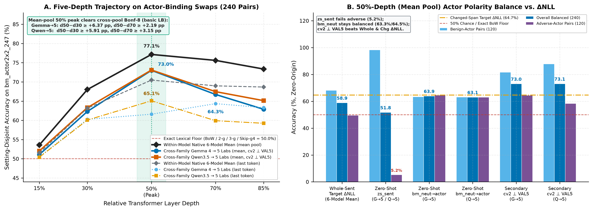
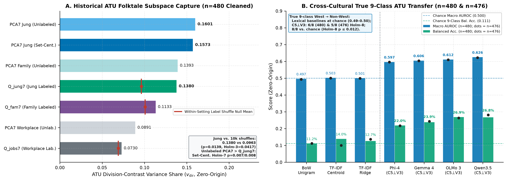

<div align="center">

# The Jung–Plato Lattice

### Multi-Family Representation Denoising, Compositional Probing, and Cross-Tokenizer Distillation

[](https://doi.org/10.5281/zenodo.24572076)
[](https://orcid.org/0009-0004-1919-3209)
[](paper/paper.md)
[](paper/arxiv/README_ARXIV.md)
[](LICENSE)
[](requirements.txt)

*Audit-verified `v6` (Zenodo v3.0) manuscript, IEEEtran arXiv LaTeX bundle, 9 JSON-driven publication figures + 2 vector TikZ diagrams, public benchmarks, verified JSON artifacts, and zero-GPU reproduction verifier.*


</div>

---

## Plain-English Overview: What We Did and What We Found

We gave **five independently trained open-weight language models** (from Google, Alibaba, Meta, Mistral, and Thinking Machines) the same public passages and recorded their internal hidden-state activations at matching clause endings. Rotating their coordinate frames into alignment via 10-iteration Generalized Procrustes Analysis (GPA) and averaging them produces a single 256-dimensional consensus space (**`C5`**). After calibrating one linear rotation on half of a **sixth** (Microsoft `Phi-4-mini`, 3.8B) or **seventh** (AllenAI `OLMo 3`, 7B) unseen model's held-out passages, `C5` predicts the remaining activations by **`+10.4` to `+11.3` Frobenius $R^2$ points** above the strongest single 7B–9B teacher.

Extending this audit across five depths (`15%–85%`), 240 actor-intent identical-bag-of-words swaps, 480 cleaned historical Aarne–Thompson–Uther (ATU) world folktales, and an 8B strictly rival-only 50%-depth transplant yields four major **`v6` / Zenodo v3.0** breakthroughs alongside transparent negative audits:

1. **Compositional Binding Peaks at `50%` Depth (Not `30%`):** On our 240-pair 2×2 actor-intent benchmark (`bm_actor2x2_247`, where benign vs. adverse actors flip action appropriateness while locking unigram, bigram, trigram, gap-4 skip-bigram, full-sentence polarity, predicate polarity, and local first-difference baselines at **`50.0%`**, and raw sentiment collapses to `51.5%/52.0%`), cross-family mean-pool transfer peaks sharply at **`50%` depth** (`73.01%` Gemma→5, `73.09%` Qwen→5; clearing simultaneous cross-pool Bonferroni-8 under both percentile and basic intervals, and beating both Whole-Sentence and Changed-Span target `ΔNLL`). Within-model native 6-model accuracy peaks numerically at `50%` across all five swap benchmarks (`77.15%` on `bm_actor2x2_247`).
2. **Strictly Rival-Only `50%`-Depth 8B Transplant Eliminates Self-Distillation (`Exp 251`):** Updating only full-rank MLPs `19–20` (`PLATO50_LAYER = 20`) on official multimodal `google/gemma-4-E4B-it` with a strictly rival-only 3-family consensus (**`C3_50`**: Qwen3.5 + Llama 3.1 + Mistral, **ZERO Gemma 4 in the teacher**) lifts unseen `Phi-4-mini` $R^2_{\text{frob}}$ by **`+0.0974`** (`+0.0619 → +0.1593`, **`11.5×`** matched `CE+KL` control, `+6.5 pp` Top-1) and unseen `OLMo 3` by **`+0.0887`** (`+0.0588 → +0.1475`, **`10.1×`** control, `+4.1 pp` Top-1), beating Gemma-including `C4_50` on all **`8/8`** domain×model cells with **exact `0.0` layer-12 drift**, `0` extra inference parameters, Gutenberg NLL `4.530` vs. `4.525`, and Vision (`"Red"`) + Audio (`"blue pelican"`) passing. Equally honestly, neutral-text alignment yields null zero-label deltas on `bm_actor2x2` probing (`80.98%` vs. `81.21%`) and procedural MCQ (`85.25%` vs. `84.75%`).
3. **Historical World Folktales (`480 / 476` Cleaned ATU Excerpts) & Honest Boundaries:** Jungian labels improve ATU division-contrast variance capture relative to within-setting shuffled labels (`0.13803` vs. `0.09631`, 10k Holm-3 `p = 0.0417`; `476`: `0.0444`), and Western→Non-Western true 9-class transfer clears chance on `8/8` cells (`p <= 0.012`) while all three lexical baselines sit near chance (AUROC `0.491–0.503`). Yet we find **no evidence that Jungian labels beat unlabeled PCA on the same Jung corpus** (setting-centered `PCA7` `0.15729` beats `Q_jung7` `0.13803`, Holm-7 `p = 0.007` pct / `0.008` basic), ordinary workplace roles (`94.3%–98.1%`) still outperform Jung's 8 archetypes (`85.9%–92.7%`), and three follow-up probes (**Exp 241** single-layer steering, **Exp 243** 14-text systems archetypes, and **Exp 244** 120-pair matched-pair epistemic generalization) failed strict audits and are **explicitly dropped**.
4. **Statistical Projection vs. *Psyche* (Jung CW 8 §§417, 420; CW 9.I §§136, 155):** Disembodied LLMs possess neither an organism nor a *psyche* or consciousness. Instead, multi-family mid-depth subspaces recover a **statistical projection** of culturally transmitted *archetypal images* and narrative schemas—bridging cultural transmission and biological predisposition as complementary hypotheses rather than overclaiming biological proof from text models, engaging frontier AI consciousness debates (Amodei 2026, Sutskever 2022, Chalmers 2023, Butlin/Bengio et al. 2023, Shanahan 2024), and proposing Jungian Word-Association dynamical attractor testing (CW 2) as a falsifiable future diagnostic for stateful adaptive architectures.


> **Companion Live System:** The always-on local multimodal assistant built on this 8B foundation (**Aion**—named after Jung's CW 9.II volume—with web UI, webcam/mic loop, episodic RAG, 3-Phase SDFT parametric dreaming, and `Titans-Momentum` fast-weight memory) lives in its own separate repository (`syn-ack-ai/aion`, currently private). This MIT repository stays strictly focused on the public research paper, arXiv LaTeX bundle, benchmarks, figures, and reproduction code.

---

## Key Verified Results (`v6` / Zenodo v3.0)

| Pillar | Protocol & Controls | Verified Headline Result |
| :--- | :--- | :--- |
| **1. Five-Family Consensus (`C5`)** *(Sec 4.1)* | 5-family GPA (`Gemma 4`, `Qwen3.5`, `Llama 3.1`, `Mistral 7B`, looped `Inkling 2 Mini`) → unseen **`Phi-4-mini`** (3.8B) & **`OLMo 3`** (7B) (`20,339` train / `3,192` eval clauses) | **`+11.3` pts** `Phi-4` $R^2_{\text{frob}}$ (`0.379 → 0.491`, strict $R^2_{\text{opt}}$ `0.557`, T1 `95.3%`) & **`+10.4` pts** `OLMo 3` (`0.403 → 0.506`, $R^2_{\text{opt}}$ `0.564`, T1 `89.9%`; `C4` edges OLMo 3 at `0.509`/`90.5%`); unchanged without myth pool |
| **2. `50%`-Depth Peak & 2×2 Actor Binding** *(Sec 4.4.4, Claims A & B)* | `bm_actor2x2_247` (`240` pairs, all 7 lexical/polarity baselines `= 50.0%`, `zs_sent = 51.5%/52.0%`), 5 depths (`15%–85%`), cross-pool Bonf-8, NLL strata, shortcuts disclosed | Mean-pool `cv2 ⊥ VAL5` peaks at **`50%` depth** (`73.01%` G4→5, `73.09%` Qw→5; all 4 Bonf-8 basic LBs `≥ +2.19` to `+6.37 pp`; beats Whole NLL `+15.4/+14.1 pp` & Chg NLL `+9.6/+8.5 pp`); zero-shot `bm_neut → actor` balanced `63.9%/63.1%`; `d50.last` mixed; native 6-model mean peaks at `d50` (`77.15%`) |
| **3. Rival-Only `50%`-Depth 8B Transplant (`Exp 251`)** *(Sec 4.6.2)* | 4-arm paired study on `google/gemma-4-E4B-it` (`L19–20`, neutral text, `0` extra params, `L12` diff `= 0.0`): `base`, `ctrl50`, `c4_50`, rival-only **`c3_50` (ZERO Gemma)** | **`c3_50`** lifts blind `Phi-4` $R^2_{\text{frob}}$ **`+0.0974` (`11.5×` ctrl, `+6.5 pp` T1)** & `OLMo 3` **`+0.0887` (`10.1×` ctrl, `+4.1 pp` T1)**; beats `c4_50` on **`8/8`** cells; gut NLL `4.530 vs 4.525`; Vision/Audio Pass; zero-label probing & MCQ deltas vs. `ctrl50` null |
| **4. Historical ATU Folktales (`480 / 476`) & Role Controls** *(Sec 4.4.5, Claim C)* | `480` cleaned (`476` framing-excl.) ATU excerpts in `C5` + `8` Jung vs. `8` workplace roles (`40` settings) + `bow_mirror_120` + `items3` zero-PN | Jung labels beat 10k shuffles (`0.13803 vs 0.09631`, Holm-3 **`0.0417`**), **no evidence over unlabeled Jung PCA** (`PCA7_setcent` `0.15729` beats `Q_jung7`, Holm-7 `0.007/0.008`); West→Non-West true-9 clears chance `8/8` (`≤ 0.012`) & lex `6/8` (`480`) / `5/8` (`476`); workplace roles (`94.3%–98.1%`) beat Jung (`85.9%–92.7%`) |
| **5. 5M Cross-Tokenizer Distillation & LORO** *(Sec 4.5)* | 24 equal-param `4.72M` non-embed (`8.92M` total) `bpe8k` runs (`P0`–`P3`, `M0`–`M3`) + 4-arm 50%-depth screen (`D0`–`D3`) + 199-family LORO | Blind `Phi-4` $R^2_{\text{frob}}$ `-0.029 → +0.132`, `OLMo 3` `-0.073 → +0.154` (zero seed overlap; 5M downstream mixed/null); `M2` vs. `M3` lifts `HOUSE` cos `0.200 → 0.619` while `mcq_gain` drops `0.172 → 0.119`; LORO beats TF-IDF on `beat_0` (`2.24×`) & `beat_1` (`40.6% vs 34.7%`) |
| **6. 30% Stage A, Epistemic Probing, & Dropped Audits** *(Secs 4.6.1, 4.6.3)* | 8B `L11–12` Stage A control + 24-pair native epistemic audit + **Exps 241, 243, 244** adversarial follow-ups | 30% Stage A lifts `Phi-4`/`OLMo 3` `+0.0245/+0.0235` (`7.1×–8.5×` ctrl); 24-pair `Combined_Perp` clears `11/12` nominal (`6/12` Holm; sentiment matches under Aion, `HOUSE⊥` hits `1.000` at Gemma L25 Neutral). **Explicitly DROPPED:** Exp 244 (120-pair matched epistemic failed admissibility, `0/4` Holm), Exp 241 (steering null `-0.0070`), Exp 243 (systems archetypes `0.493` < BoW `0.658`) |




---

## Quickstart: Instant CPU Verification (< 20 Seconds)

```bash
python3 -m venv .venv && source .venv/bin/activate
pip install -r requirements.txt

# Verify privacy firewall, py_compile, all 9 figures + hero art, 64 references,
# ordered cell-level cross-checks against BOTH paper.md and main.tex, and zero-GPU unit tests:
python scripts/verify_repro.py

# Regenerate all 9 publication figures (300 DPI PNG + vector PDF) directly from JSONs:
python paper/make_figures.py
```

---

## Repository Layout

```text
jung-plato-lattice/
├── paper/
│   ├── paper.md                     # Full Markdown manuscript (synced to v6 / Zenodo v3.0)
│   ├── make_figures.py              # Regenerates all 9 JSON-driven figures (300 DPI PNG + vector PDF)
│   ├── figures/                     # hero_jung_plato_lattice.png + fig1..fig9 (.png + .pdf)
│   └── arxiv/                       # Self-contained IEEEtran arXiv LaTeX + TikZ + PDF + arxiv_submission.tar.gz
├── bench/archetypes/
│   ├── fluent/                      # 5-family GPA, neutral rotations, valence/BoW/8-role/LORO, 5M distillation
│   │   ├── plato/                   # Verified v5 + all 12 sealed v6 JSONs (Claims A/B/C, 5M d50, drops)
│   │   └── runs/                    # All 24 5M student training & eval JSONs (P0-P3, M0-M3)
│   ├── aion_8b/                     # 8B Gemma 4 E4B causal controls (Stage A 30% & Exp 251 50%) + epistemic audit
│   │   ├── assets/test_speech_16k.wav
│   │   └── runs/                    # e4b_base, stage_a, stage_a_ctrl, e4b_transplant50_exp251, epistemic JSONs
│   ├── items3/ & items7/            # Public ARN-style narrative quartets (myths + matched mechanisms)
│   ├── archstory/ & selfshape/      # HOUSE, SELF2, valence/BoW/actor2x2/role benchmarks & ATU metadata manifest
│   └── crosslang/                   # Public 4-language (EN / EL / JA / ZH) causal story pairs
├── scripts/
│   └── verify_repro.py              # One-command zero-GPU integrity & table cross-verifier
├── requirements.txt
├── CITATION.cff
└── LICENSE
```

*(Note on licensing: `bench/archetypes/selfshape/aft_clean248_manifest.json` commits only cleaned record IDs, ATU divisions, and provenance metadata so third-party CC BY-NC-SA folktale texts are never redistributed inside this MIT repository.)*

---

## Citation

If you build on this paper, datasets, or code, please cite [CITATION.cff](CITATION.cff):

```bibtex
@misc{babeshkin2026jungplatolattice,
  author       = {Babeshkin, Benjamin},
  title        = {The Jung--Plato Lattice: Multi-Family Representation Denoising, Compositional Probing, and Cross-Tokenizer Distillation},
  year         = {2026},
  publisher    = {Zenodo},
  doi          = {10.5281/zenodo.24572076},
  url          = {https://doi.org/10.5281/zenodo.24572076},
  howpublished = {\url{https://github.com/syn-ack-ai/jung-plato-lattice}}
}
```

## License

Code and public benchmarks authored in this repository are released under the [MIT License](LICENSE). Third-party open-weight models and public datasets remain subject to their respective licenses.
