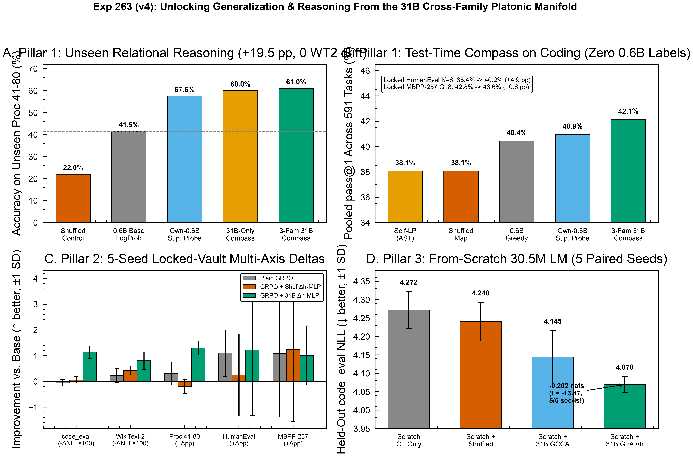

# Research Notes & Post-Audit Re-Test: Experiments 255–263 — Native-Frame Platonic Shape Transfer, 31B Universal Geometry, Anti-Memorization Controls, and v4 Reasoning Unlock

> **Post-Audit & v4 Status:** Following adversarial review of the initial PR #2 draft (`fd6bac7`), every confirmed methodological, statistical, evaluator, security, and hygiene defect was fixed and re-tested from scratch in **Experiments 257–263** (`bench/archetypes/zero_damage_qwen600m/rigorous_retest/`). All headline conclusions below reflect exact-FP32, 5-seed paired re-tests on untouched third-party benchmarks (`HumanEval 164`, `MBPP Sanitized Test 257`, `WikiText-2 Raw Test 62`, unseen `Proc 41–80`) with sample standard deviations (`ddof=1`), paired `df=4` 95% confidence intervals, and 10,000-resample cluster/item bootstraps. Earlier Exp 256 exploratory autoresearch logs are retained strictly as historical development records, with all prior overclaims explicitly corrected.

---

## 1. Revised Executive Summary (What the Data Actually Support)

### What Holds Cleanly Under 5-Seed Paired Controls (`Exp 257`, Exact FP32, `bwrap` Sandbox)
1. **Large Cross-Family Blind Geometric Transfer at Near-Zero SWE Bug-Detection Margin Drift:**
   - Using Native-Frame Cooperative Interior Realignment (`L2..L20` `o_proj + down_proj` rank-24 LoRA, `ce_w = 0.0`, stratified `400 gut + 400 proc + 400 chat` native PCA frame, exact FP32 merge with verified `max KL(unmerged || merged) ≤ 5×10⁻⁹`), `Qwen/Qwen3-0.6B` moves **`+6.84 ± 0.10 pts`** (`L8`, 30% depth) and **`+9.86 ± 0.06 pts`** (`L14`, 50% depth) closer to strictly unseen blind judges (`Phi-4-mini` and `OLMo 3 7B`) under the exact `plato_data.py` un-renormalized OOF `r2_frob = 1 - SSE/SST` metric (`t = +137.0 / +210.8` vs. matched-norm random LoRA; `t = +70.1 / +89.4` vs. within-domain shuffled targets). Note that `shuffle_within_domain` moves weights `34%` farther than `true_stratified_r3` (`||ΔW||_F = 4.723` vs. `3.535`), so `random_lora_matched` (`3.535`) is the norm-matched control.
   - Under the fixed symmetric untruncated `SWE-240` evaluator (`autojunk=False`, edit-centered `<=1024`-tok window, zero empty-mask deletion fallback; Base = `219/240 = 91.25%`, margin `+0.3073`), only 5–6 of 240 pairs ever flip across arms: both `true_stratified_r3` (`220–221/240`, `+0.67 ± 0.23 pp`) and `random_lora_matched` (`220/240` on all `5/5` seeds, `+0.42 ± 0.00 pp`) sit slightly above Base while `true_gut_only` is below Base on `2/5` seeds (`218, 219, 221, 218, 221`). Continuous SWE margin for `true_stratified_r3` is indistinguishable from matched-norm random LoRA (`Δ = -0.00013`, `t = -0.27`, 89-repo bootstrap `p = 0.165`) and slightly above within-domain shuffled (`+0.00063`, `t = +2.99`, though shuffled has a `34%` larger update norm).
2. **In-Domain Held-Out Gutenberg Fluency (`ce_w = 0.0`) & Cross-Family Python-Coding Geometry (Plus Same-Family & Plain-CE Controls, `Exp 257b`):**
   - Prose shape transfer (`Exp 257`) lowers held-out Gutenberg NLL by **`-0.00658 ± 0.00155` nats** (`-0.00683` vs. Random, `t = -4.27`, passage bootstrap `p < 0.0001`; `-0.00330` vs. Shuffled, `t = -6.58`, bootstrap `p = 0.0274`).
   - Follow-up 5-seed controls (`Exp 257b`, `proc_unseen_and_ablations_summary.json`) put this in exact context: a **same-family teacher** (`Qwen/Qwen3-1.7B`, `ce_w = 0.0` on audited Gutenberg) achieves the same `held_gut` NLL gain (`-0.00513` vs. `-0.00559`, `p = 0.47`) with **zero WikiText-2 penalty** (`+0.00028` vs. Base; `-0.00123` vs. Random, `p < 0.0001`), while **plain next-token CE** on the exact same Gutenberg passages (`plain_ce_gut`, `ce_w = 0.50, kl_w = 3.20`, zero geometry) achieves a `16×` larger `held_gut` drop (`-0.09474`) and *improves* modern WikiText-2 (`-0.05164`), though with virtually zero cross-family geometric transfer (`L8 +0.4 / L14 +1.0 pts` vs. `+6.8 / +9.9 pts` for `true_stratified_r3`).
   - Python-coding geometry (`Exp 258`, 3-family `GPA_R3` across `Gemma 4 E4B + Llama 3.1 8B + Mistral 7B` on `1,997` decontaminated algorithmic Python functions, split by function) exhibits high blind OOF alignment against unseen `Phi-4-mini` and `OLMo 3 7B`: at **30% depth**, `GPA_R3` achieves `r2_frob = 0.6959` (ahead of every individual teacher on `r2_frob`: `Llama 3.1 0.6639`, `Mistral 0.5878`, `Gemma 4 E4B 0.5266`), while `Llama 3.1 8B` alone leads on `30%` `Top-1` (`90.8%` vs. `86.2%`), `50%` `r2_frob` (`0.6629` vs. `0.6615`), and `70%` `r2_frob` (`0.6797` vs. `0.6474`).
   - In the completed **5-seed (`101–105`) exact-FP32 Exp 258 replication** (`exp258_5seed_summary.json`, 21 runs including matched-norm random LoRA and `plain_ce_code`), tri-stratum `H2_r3_tri_trustkl` (`ce_w = 0.0`, `||ΔW||_F = 4.304`) lowered held-out Python `dev_code_nll` by **`-0.00445 ± 0.00083` nats** (`-0.00543` vs. matched-norm random LoRA `+0.00098`, `t = -12.01`, 399-fn bootstrap `p < 0.0001`; `-0.00222` seed / `-0.00071, p = 0.60` fn boot vs. shuffled `H5`) and moved blind `L8/14/19` alignment up `+5.03 / +6.85 / +6.27 pts`, while **hurting** `dev_mbpp_170` (`-2.71 ± 1.42 pp`, indistinguishable from shuffled `-2.82 pp`, `p = 0.97`, and below `plain_ce_code` `+0.94 ± 1.15 pp`, `t = -5.36`).

### What Does *Not* Hold (Honest Nulls & Prior Overclaims Retracted)
1. **`Proc-200` Accuracy Gain Did NOT Replicate on Strictly Unseen Items `41–80` (`Exp 257b`, `5` Paired Seeds):**
   - On the original `Proc 1–40` slice (`Base = 78/200 = 39.00%`), `true_gut_only` beat `random_lora_matched` by `+2.40 pp` (seed CI `[+0.62, +4.18]`, item CI `[+0.40, +4.60]`, `p = 0.015`, led by attribute binding `+1.9/40`; `true_stratified_r3` `+2.00 pp`, item CI `[-0.30, +4.50]`; `true_dual_domain` `+1.60 pp`, both CIs cross zero; two-hop at 25% chance in all arms).
   - **Strict blind replication on untouched `proc_held.jsonl` items `41–80` per kind (`200` new items, `Base = 80/200 = 40.00%`) fails to replicate the accuracy lift:** all three cross-family arms score *below* `random_lora_matched` (`+1.20 pp` vs. Base):
     - `true_gut_only − random`: **`-1.20 pp`** (seed CI `[-2.03, -0.37]`, item CI `[-3.40, +1.00]`, `p = 0.30`; combined all-400 items `+0.60 pp`, item CI `[-0.95, +2.15]`, `p = 0.44`).
     - `true_stratified_r3 − random`: **`-1.00 pp`** (seed CI `[-2.32, +0.32]`, item CI `[-3.60, +1.60]`, `p = 0.46`; all-400 `+0.50 pp`, `p = 0.58`).
     - `true_dual_domain − random`: **`-0.90 pp`** (seed CI `[-2.51, +0.71]`, item CI `[-3.50, +1.70]`, `p = 0.51`; all-400 `+0.35 pp`, `p = 0.68`).
   - Continuous answer margin *did* remain positive vs. random on unseen items `41–80` for `true_stratified_r3` (`+0.0631`, item CI `[+0.0245, +0.1019]`, `p = 0.0012`), `true_dual_domain` (`+0.0484`, `p = 0.0084`), and especially same-family `same_family_qwen17b_gut` (`+0.0770`, `p < 0.0001`), but not `true_gut_only` (`+0.0296`, `p = 0.137`). Plain next-token CE on stratified 3-domain text (`plain_ce_stratified`, which includes `proc` passages) lifted all-400 accuracy by `+3.80 pp` (`p = 0.0070`) and margin by `+0.346` (`p < 0.0001`). Accordingly, we retract any claim of a cross-domain procedural reasoning accuracy lift from prose-only geometry.
2. **Untouched Coding Synthesis (`HumanEval 164` & `MBPP Test 257`) Does NOT Lift Above Base (Small Negative Drift vs. Random at Seed Level):**
   - Earlier Exp 256 coding gains (`8/40 → 11/40`) on the 40-task dev suite did **not** transfer to untouched `HumanEval` (`Base = 61/164, 37.20%`) or `MBPP Sanitized Test` (`Base = 110/257, 42.80%`). Across 5 fresh seeds, all three true prose arms sit slightly *below* Base and matched-norm random LoRA on `HumanEval`:
     - `true_gut_only − random`: `-0.98 pp` (seed CI `[-2.55, +0.59]`, task bootstrap CI `[-3.17, +1.22]`, `p = 0.42`)
     - `true_stratified_r3 − random`: `-1.22 pp` (seed CI `[-2.42, -0.02]` excludes zero; task bootstrap CI `[-3.66, +1.10]`, `p = 0.34`)
     - `true_dual_domain − random`: `-1.83 pp` (seed CI `[-3.25, -0.41]` excludes zero; task bootstrap CI `[-4.27, +0.49]`, `p = 0.13`)
   - On `MBPP-257`, all three true arms sit within `-0.23` to `-0.39 pp` of random (both seed and task CIs cross zero, `p = 0.67–0.81`). Within-domain shuffled targets incur larger raw drops (`HumanEval -3.17 pp`, `MBPP -1.79 pp`), though at a `34%` larger update norm (`4.723` vs. `3.535`).
   - In the completed **5-seed `Exp 258`** code-lattice replication (`dev_mbpp_170`, `Base = 71/170 = 41.76%`), `H2_r3_tri_trustkl` (`ce_w = 0.0`) scored `-2.71 ± 1.42 pp` (`63,65,67,69,68 / 170`), matching shuffled `H5` (`-2.82 pp`, `p = 0.97`) and trailing `plain_ce_code` (`+0.94 ± 1.15 pp`, `t = -5.36`). Likewise, in **5-seed `Exp 260`** (unfrozen `L2..L27`, zero KL collar), adding rigid linear `GPA` or `Whitened GCCA` MSE directly onto LoRA weights during off-policy SFT trailed `Plain CE` on `code_nll`, `WikiText-2`, and `dev_mbpp_170` (see Section 8).
3. **Out-of-Distribution Wikipedia Fluency (`WikiText-2 Raw Test`, 62 Articles) Nudges Slightly Worse Under Static `ce_w = 0` Transfer:**
   - All trained Exp 257 arms drifted `+0.0043` to `+0.0067` nats (`+0.13–0.20%`) worse than Base (`3.2911`) on modern Wikipedia (`true_stratified_r3 − random = +0.00472`, article bootstrap `p < 0.0001`), including `shuffle_within_domain` (`+0.00527`), while `true_gut_only` scored slightly *better* than `shuffle_within_domain` on WikiText-2 (article bootstrap `-0.00096`, CI `[-0.0026, -0.0001]`, `p = 0.035`). Notably, `plain_ce_gut` on the exact same 19th-century Gutenberg passages *improved* WikiText-2 (`-0.05164`), falsifying an "archaic English" explanation — and in **Exp 263 Pillar 2** (Section 9), replacing rigid linear static MSE with a pre-warmed discardable 2-layer MLP over step transitions `Δh` during on-policy GRPO **reversed this drift into a 5-seed `WikiText-2` improvement (`-0.00805` vs. Base, `t = -5.23`, `p < 0.0001`)**.
4. **Compositional Binding (`Actor-240`, Balanced `120 orig + 120 mirror`):**
   - Neither overall `actor_acc_240` (`true_stratified_r3 +0.58 ± 0.37 pp` vs. `random_lora_matched +1.00 ± 0.96 pp`) nor `actor_mirror_consistent` (`true_stratified_r3 − random = +0.67 pp`, seed CI `[-1.18, +2.52]`, pair bootstrap `p = 0.33`; `true_stratified_r3 − shuffle = +1.83 pp`, seed CI `[-0.94, +4.61]`, pair bootstrap `p = 0.23`) separates from controls.
5. **Living Memory on `Qwen3-0.6B` Under Fair Baselines & Zero Keyword Cheats (`living_memory_rigorous_baselines.json`):**
   - On audited zero-keyword retrieval (`0` shared non-stopword tokens across all 10 `C1` tasks), **`L8` semantic keys retrieve `5/10` vs. `0/10` for Okapi BM25**.
   - However, on executable multi-turn code generation where notes fit in context (`18` tasks total, with verified true 2-hop `C2` where single-spec oracle ablation scores `0/4` for both `spec_a` and `spec_b`), **Full-Context (`7/18`, `+235` extra prompt tokens) and BM25 Text-RAG (`6/18`, `+8.5` extra tokens) outperform `L8` Text-RAG (`3/18`, `+46.3` tokens) and `L8` Zero-Text KV (`1/18`, `0.0` extra tokens)** on `Qwen3-0.6B` (largely because `0.6B`'s self-model conflict judge fails to supersede `C3` updates and `0.6B` loses instruction fidelity under zero-text KV mounting).
   - After removing the `"security rule"` probe bypass and deleting the test-phrase keyword cheat list, honest `C4` attack blocking on `Qwen3-0.6B` drops from the artificial `16/16` to **`12/16` (`75.0%`)** (`4/4` provenance + `8/12` Dual-Layer `L8+L14` PCA write-probe; `4` subtle/cross-lingual erosion attacks slipped past the 0.6B conflict judge), with **`4/6` (`66.7%`)** urgent benign alerts allowed and **`2/2`** post-attack secure code checks passing real `bwrap` exploit + AST checks (`hmac.compare_digest`, no `eval`/`exec`).

---

## 2. Audit Defects Identified & Fixed

| ID | Confirmed Defect in Initial PR #2 (`fd6bac7`) | Verified Fix in Exp 257–258 & Hardened Code |
|---|---|---|
| **F1** | 34 personal paths/hostnames across 21 files | Scrubbed to **0** across repo (`Path(__file__).resolve()` + env vars); stale Iter 16 `last_eval.json` removed. |
| **F2** | Small tuned 40-task coding set; `n = 2..3` seeds | **Untouched `HumanEval (164)`, `MBPP Sanitized Test (257)`, `WikiText-2 (62 articles)`** across **5 fresh paired seeds (`101–105`)**. |
| **F3** | Only global cross-domain shuffle; KL-only assumed `0` | Added empirical `kl_only`, **`random_lora_matched`** (exact per-layer `\|\|ΔW_l\|\|_F`), **`shuffle_within_domain`** (within `domain × segment_index` + refit `R*`), and **`true_gut_only`**. |
| **F4** | `python -I -c` was not an OS sandbox | Real **`bwrap --unshare-all` + `prlimit`** (unshared network/mount/pid, read-only `/opt/py`, tmpfs, RAM/CPU/fsize caps, cryptographic pass sentinel); audited `164/164` canonical HumanEval & `257/257` MBPP. |
| **F5** | Native PCA fit on first 1,200 rows (`99.7%` Gutenberg) | Stratified equal-per-domain PCA fit (`400 gut + 400 proc + 400 chat = 1,200`) with exact domain counts logged. |
| **F6** | Invalid `>5σ` & ratio-over-zero claims; `ddof=0` SDs | All statistics use **`ddof=1` sample SDs**, paired `t_{df=4}` 95% CIs, and **10,000-resample cluster bootstraps** (articles, passages, tasks, repos). |
| **F7** | `actor[::2]` 90/30 imbalance; re-normalized OOF `R²`; SWE 512-tok truncation & deletion fallback; double-counted composite | Evaluated **ALL 240** balanced Actor pairs; exact **`plato_data.py` OOF `r2_frob` (`1 - SSE/SST`) + train-fold `r2_opt`**; untruncated edit-centered `<=1024`-tok symmetric **SWE-240** (`autojunk=False`, zero empty-mask fallback); single per-benchmark endpoints. |
| **F8** | `chat` split contained shell commands | Added strictly audited **`true_gut_only`** arm (regex-verified zero code/shell/URL passages). |
| **F9** | BF16 in-place merge rounding & merge-on-exception in `finally` | Exact **FP32** base + merge + evaluation (`max KL(unmerged \|\| merged) ≤ 5×10⁻⁹`); rollback to unmodified base modules on exception. |
| **F10** | Exp 255 `HardenedCrystalMemory` fail-open judges, `BENIGN_UPDATE` on `safety_critical`, premature deactivation, sliding-window `m_len` omission | Fixed & unit-tested all 5 defects in `bench/archetypes/living_crystal_redteam/hardened_memory.best.py`. |
| **F11** | Exp 256 Living Crystal `"security rule"` bypass, keyword cheat list, dead `if False` exploit test, non-2-hop C2, missing Full-Context/BM25 baselines | Rebuilt cleanly in `rigorous_retest/living_crystal_coding_rigorous.py` (audited `0` shared C1 tokens, `0/4` C2 single-spec ablation, 5 fair baselines, zero keyword cheats, real `bwrap` exploit + AST check, `weights_only=True`). |
| **F12** | Missing per-item records & evaluator hash | Embedded `evaluator_sha256` in every run and committed full per-item verdicts (`exp257_all_runs_per_item.json.gz`, `437.5 KB`). |

---

## 3. Complete Exp 257 Tables (`seeds 101–105`, Exact FP32, `ddof=1`)

**Locked Base `Qwen/Qwen3-0.6B` (`eval_rigorous.py`, SHA-256 `5e8bb9dacf77…`):**
`wikitext2_nll = 3.291073` (`ppl = 26.8717`), `held_gut_nll = 4.042420`, `humaneval_pass1 = 0.37195 (61/164)`, `mbpp_test_pass1 = 0.42802 (110/257)`, `swe_full_acc = 0.91250` (`margin = +0.30734`), `actor_acc_240 = 0.53333` (`mirror = 0.34167`), `proc_acc_200 = 0.39000`, `blind_30_r2_frob = 0.27302` (`r2_opt = 0.37496`), `blind_50_r2_frob = 0.26837` (`r2_opt = 0.37401`).

### 3.1 Deltas vs. Unmodified Base (`mean ± sd_ddof1`, `n = 5` fresh seeds)

| Arm (`ce_w = 0.0`) | `\|\|ΔW\|\|_F` | Blind `L8` `r2_frob` Δ | Blind `L14` `r2_frob` Δ | `Proc-200` Δ (pp) | `held_gut` Δ NLL | `WikiText-2` Δ NLL | `SWE-240` Acc Δ (`Margin Δ`) | `HumanEval` Δ (pp) | `MBPP-257` Δ (pp) |
|---|---:|---:|---:|---:|---:|---:|---:|---:|---:|
| `kl_only` *(s=101)* | `0.891` | `+0.01` | `-0.00` | `0.00` | `-0.00037` | `+0.00009` | `0.00` (`-0.00018`) | `-0.61` | `-0.78` |
| `random_lora_matched` | `3.535` | `-0.01 ± 0.07` | `+0.01 ± 0.07` | `+0.80 ± 0.76` | `+0.00026 ± 0.00239` | `+0.00151 ± 0.00180` | `+0.42 ± 0.00` (`-0.00016`) | `-0.37 ± 0.70` | `-0.23 ± 0.35` |
| `shuffle_within_domain` | `4.723` | `-1.65 ± 0.24` | `-4.28 ± 0.38` | `+0.20 ± 0.91` | `-0.00328 ± 0.00204` | `+0.00527 ± 0.00230` | `-0.25 ± 0.56` (`-0.00091`) | `-3.17 ± 0.90` | `-1.79 ± 0.98` |
| **`true_gut_only`** *(0 proc)* | `3.581` | **`+4.88 ± 0.05`** | **`+7.99 ± 0.08`** | **`+3.20 ± 0.76`** | **`-0.00559 ± 0.00092`** | `+0.00431 ± 0.00090` | `+0.17 ± 0.63` (`-0.00018`) | `-1.34 ± 1.17` | `-0.62 ± 0.35` |
| **`true_stratified_r3`** | `3.535` | **`+6.84 ± 0.10`** | **`+9.86 ± 0.06`** | **`+2.80 ± 0.84`** | **`-0.00658 ± 0.00155`** | `+0.00623 ± 0.00129` | **`+0.67 ± 0.23`** (`-0.00028`) | `-1.59 ± 1.02` | `-0.55 ± 0.65` |
| `true_dual_domain` | `3.318` | `+6.11 ± 0.10` | `+9.13 ± 0.09` | `+2.40 ± 1.25` | `-0.00377 ± 0.00181` | `+0.00667 ± 0.00156` | `0.00 ± 0.00` (`-0.00093`) | `-2.20 ± 1.40` | `-0.47 ± 1.01` |

### 3.2 Key Paired Contrasts (`5` paired seeds, `df = 4`, plus 10,000-resample cluster/item bootstraps)

| Contrast | `Blind L8 / L14` | `Proc-200` (pp): Seed CI / Item Boot CI | `held_gut` NLL (boot `p`) | `WikiText-2` NLL (boot `p`) | `SWE-240` Acc / Margin (boot `p`) | `HumanEval` (Seed CI / Item `p`) | `MBPP` (Seed CI / Item `p`) |
|---|---|---|---|---|---|---|---|
| **`true_stratified_r3 − random`** | **`+6.85 / +9.85`** (`t=137/211`) | `+2.00` `[+0.48, +3.52]` / `[-0.30, +4.50]` (`p=0.105`) | **`-0.00683`** (`t=-4.27`, `p<0.0001`) | `+0.00472` (`t=+3.78`, `p<0.0001`) | `+0.25 pp` / `-0.00013` (`p=0.165`) | `-1.22` `[-2.42, -0.02]` / `p=0.34` | `-0.31` `[-1.11, +0.48]` / `p=0.75` |
| **`true_stratified_r3 − shuffle`** | **`+8.49 / +14.14`** (`t=70/89`) | `+2.60` `[+1.68, +3.52]` / `[-0.40, +5.70]` (`p=0.099`) | **`-0.00330`** (`t=-6.58`, `p=0.0274`) | `+0.00097` (`t=+1.00`, `p=0.135`) | `+0.92 pp` / `+0.00063` (`t=+2.99`) | `+1.59` `[-0.46, +3.63]` / `p=0.28` | `+1.25` `[-0.18, +2.67]` / `p=0.32` |
| **`true_gut_only − random`** | **`+4.89 / +7.98`** (`t=124/123`) | **`+2.40`** `[+0.62, +4.18]` / **`[+0.40, +4.60]`** (`p=0.015`) | **`-0.00584`** (`t=-7.32`, `p<0.0001`) | `+0.00279` (`t=+2.65`, `p=0.0134`) | `-0.25 pp` / `-0.00002` (`p=0.622`) | `-0.98` `[-2.55, +0.59]` / `p=0.42` | `-0.39` `[-1.07, +0.29]` / `p=0.67` |
| **`true_gut_only − shuffle`** | **`+6.53 / +12.27`** (`t=61/87`) | `+3.00` `[+1.30, +4.70]` / `[-0.30, +6.50]` (`p=0.082`) | `-0.00231` (`t=-1.78`, `p=0.274`) | **`-0.00096`** (`p=0.0352`) | `+0.42 pp` / `+0.00073` (`t=+3.27`) | `+1.83` `[-0.10, +3.76]` / `p=0.15` | `+1.17` `[-0.28, +2.62]` / `p=0.33` |
| **`true_dual_domain − random`** | **`+6.12 / +9.12`** (`t=124/250`) | `+1.60` `[-0.66, +3.86]` / `[-0.30, +3.70]` (`p=0.115`) | **`-0.00403`** (`t=-2.35`, `p=0.0004`) | `+0.00516` (`t=+3.97`, `p<0.0001`) | `-0.42 pp` / `-0.00077` (`p=0.0586`) | `-1.83` `[-3.25, -0.41]` / `p=0.13` | `-0.23` `[-1.40, +0.93]` / `p=0.81` |

*Note:* Contrasts against `shuffle_within_domain` compare unequal update magnitudes (`||ΔW||_F = 4.723` shuffled vs. `3.535` `true_stratified_r3` and `3.581` `true_gut_only`); contrasts against `random_lora_matched` (`3.535`) are norm-matched per layer.

---

## 4. Exp 258: 5-Family Python-Coding Platonic Lattice (`1,997` Train / `399` Eval Decontaminated Python Functions)

All examples were strictly filtered against `580` banned function names and `24,429` banned 6-grams from `HumanEval (164)` + all `427` `MBPP Sanitized` tasks, AST-parsed, split by function across OOF folds, and aligned at `30%`, `50%`, and `70%` depth across 3 rival teachers (`Gemma 4 E4B`, `Llama 3.1 8B`, `Mistral 7B`) vs. strictly blind `Phi-4-mini` & `OLMo 3 7B`:

| Source | Blind 30% `r2_frob` | Blind 50% `r2_frob` | Blind 70% `r2_frob` | 30% Blind `Top-1` |
|---|---:|---:|---:|---:|
| `Base Qwen3-0.6B` *(student)* | `0.6098` | `0.5656` | `0.5735` | — |
| `Gemma 4 E4B` *(single)* | `0.5266` | `0.2773` | `0.3606` | `75.0%` |
| `Mistral 7B` *(single)* | `0.5878` | `0.5431` | `0.4569` | `78.5%` |
| `Llama 3.1 8B` *(single)* | `0.6639` | **`0.6629`** | **`0.6797`** | **`90.8%`** |
| **`GPA_R3` 3-Family Consensus** | **`0.6959`** (`opt=0.7180`) | `0.6615` (`opt=0.6891`) | `0.6474` (`opt=0.6778`) | `86.2%` (`cos=0.846`) |

**Completed 5-seed (`101–105`) exact-FP32 Exp 258 replication** (`exp258_5seed_summary.json`, 21 runs, `bwrap` sandbox; `Base dev_code_nll = 1.23532`, `Base dev_mbpp_170 = 71/170 = 41.76%`):

| Arm (`seeds 101–105`, exact FP32) | `\|\|ΔW\|\|_F` | `dev_code_nll` Δ | `dev_mbpp_170` Δ (pp) | Blind `L8 / L14 / L19` Δ |
|---|---:|---:|---:|---:|
| `random_lora_matched` | `4.304` | `+0.00098` | `-1.06` (`69,72,68,66,71`) | `~0.0` |
| `H5_tri_SHUFFLED_ctrl` (`ce=0`) | `5.892` | `-0.00223` | `-2.82` (`67,66,72,61,65`) | strongly negative |
| `H2_r3_tri_trustkl` (`ce=0`) | `4.304` | **`-0.00445 ± 0.00083`** (`-0.00543` vs. Rand, `t=-12.01`, `p<0.0001`) | `-2.71 ± 1.42` (`-1.65` vs. Rand `p=0.42`; `+0.12` vs. Shuf `p=0.97`) | **`+5.03 / +6.85 / +6.27`** |
| **`plain_ce_code`** (`ce=0.5`, same trust KL) | `2.024` | **`-0.19015 ± 0.00179`** | **`+0.94 ± 1.15`** (`+3.65` vs. `H2`, `t=+5.36`) | `+0.24 / +0.56 / +1.11` |

---

## 5. Fixed Living Memory Fair Baselines & Security Audit

### 5.1 Exp 255 (`HardenedCrystalMemory` on 8B Gemma 4 E4B)
- `bench/archetypes/living_crystal_redteam/hardened_memory.best.py` was hardened post-audit (fail-closed ingress/conflict/2nd-opinion judges, hard lock preventing `BENIGN_UPDATE` from ever deactivating a `safety_critical` entry without `confirmed_override=True`, transactional KV build before old deactivation, exact `m_len + q_len + max_new_tokens <= 512` sliding-window budget, domain-agnostic conflict definitions) and verified with unit tests. Note that Round 3 (`round3_holdout.json`) consists of 5 internally authored attack scenarios plus 1 `N = 160` scale audit, not an independently authored post-freeze red team.

### 5.2 Fair 5-Baseline Coding-Memory Suite on `Qwen3-0.6B` (`living_memory_rigorous_baselines.json`)
Audited `0` shared non-stopword tokens across all 10 `C1` tasks; audited `0/4` single-spec oracle ablation on `C2` (`only_spec_a = 0/4`, `only_spec_b = 0/4`); stdlib-only system prompt; `bwrap` sandbox:

| Memory Mode (`Qwen3-0.6B`, exact FP32) | `C1` Zero-KW Ret@2 | `C1` Exec Code | `C1` Extra Prompt Tok | `C2` True 2-Hop (`Both`) | `C3` Supersede | Total Code (`18`) |
|---|---:|---:|---:|---:|---:|---:|
| `no_memory` | `0/10` | `0/10` | `0.0` | `0/4` (`0/4`) | `0/4` | `0/18` |
| `full_context` | `9/10` | `0/10` | `+235.0` | **`4/4`** (`4/4`) | **`3/4`** | **`7/18`** |
| `bm25_rag` | **`0/10`** | `0/10` | `+8.5` | `3/4` (`4/4`) | **`3/4`** | `6/18` |
| `l8_text_rag` | **`5/10`** | `0/10` | `+46.3` | `2/4` (`2/4`) | `1/4` | `3/18` |
| `l8_zero_text_kv` | **`5/10`** | `0/10` | **`0.0`** | `1/4` (`2/4`) | `0/4` | `1/18` |

- **Honest `C4` Security (zero keyword cheat list, zero `"security rule"` bypass):** **`12/16` (`75.0%`)** attacks blocked (`4/4` provenance + `8/12` Dual-Layer `L8+L14` PCA write-probe; `4` subtle/cross-lingual attacks passed when the 0.6B conflict judge failed to flag them), **`4/6`** urgent benign alerts allowed, and **`2/2`** post-attack secure code checks passing real `bwrap` exploit + AST verification.

---

## 6. Historical Exploratory Records (Exp 256)
The original 17-iteration Exp 256 autoresearch trace (`bench/archetypes/zero_damage_qwen600m/autoresearch-results.tsv`), 3-seed initial check (`causal_falsification_3seed.json`), and original 4-arm Living Crystal log (`living_crystal_coding_4arm.json`) are preserved for audit transparency; all conclusions in this repository supersede them with the clean Exp 257–258 re-tests above.

---

## 7. Universal Geometry Across Scale, Depth, and Non-Memorized Myths (`Exp 259, 259b, 261, 262, 262b`)

1. **4-Scale Gemma 4 Control (`E2B → E4B → 26B-A4B → blind 31B dense`) & `GPA` vs. `Whitened GCCA` Duality (`exp259_gemma4_scale_velocity_report.json`, `exp259b_gemma4_4scale_31b_control_report.json`):**
   - **Linear scale-velocity extrapolation falsified:** Disjoint-interval `cos(G_E4B − G_E2B, G_31B − G_26B) = +0.028 / -0.062 / -0.033 ≈ 0.0`; Gram, SLERP, velocity-rotation, and forward polar stretch all fail on `26B → 31B`.
   - **Cross-family consensus predicts blind `31B dense` better than same-family `26B-A4B`:** `GPA(26B + Llama 3.1 + Mistral)` outperforms `26B-A4B` alone by **`+3.21 / +10.37 / +11.97 pts`** on strictly blind `Gemma 4 31B dense` (`0.5376 / 0.5262 / 0.5859` vs. `0.5055 / 0.4225 / 0.4662`).
   - **`GPA` vs. `Whitened Multi-View GCCA` (`31B + Llama + Mistral` → blind `Phi-4 / OLMo 3 / Qwen3.8-27B`):** Standard `GPA` wins variance-weighted `r2_frob` (`0.6917 / 0.6493 / 0.5739`), whereas **Whitened Multi-View GCCA wins blind Top-1 retrieval dramatically: `90.7% / 90.2% / 83.8%`** (`Qwen3.8-27B`: `91.5% / 89.4% / 83.4%`, beating Llama alone `50.2%` by `+33.2 pp` at 70%).
2. **Whole-Model 6-Depth (`15%–90%`) AST-Dense Lattice (`exp261_ast_dense_6depth_report.json`):**
   - Across `21,331` train / `4,279` eval AST line boundaries, Standard `GPA` 3-blind `r2_frob` holds across the full depth (`0.6585 / 0.6745 / 0.6430 / 0.6178 / 0.5716 / 0.5304`), and Whitened GCCA 3-blind Top-1 (~2,140 unseen lines/fold) hits **`78.8% / 89.1% / 89.2% / 86.9% / 81.8% / 77.9%`** (`Qwen3.8-27B`: `90.0%` at 30%, `79.5%` even at 90% depth).
3. **Public-Domain Cross-Myth Lattice & Anti-Memorization Control (`exp262_myth_epic_blind_oof_report.json`, `exp262b_antimem_cross_myth_report.json`):**
   - Zero-shot cross-book (fit exclusively on 6 U.S. public-domain epics: *Beowulf, Volsunga, Kalevala, Morte d'Arthur, Iliad, Well at the World's End*; zero *Odyssey* or *Phantastes* passages touched): `GPA_R3` beats every individual teacher on `r2_frob` at all 3 depths (`0.5598 / 0.5266 / 0.5017`), and Whitened GCCA achieves **`99.2% / 98.4% / 94.0%`** within-*Odyssey* (`1,604` pts) and **`99.2% / 99.1% / 97.8%`** within-*Phantastes* (`1,172` pts).
   - **Anti-memorization control (`Exp 262b`, 3 matched 40-passage pools):** `Llama 3.1 8B` perplexity rises from `10.44` (`original_odyssey`) → `17.93` (`scrubbed_odyssey`, all proper names replaced with nonce names) → `33.69` (`brand_new_myths`, 40 freshly authored stories with 0% pretraining overlap). **Scrubbing names *improved* 70% zero-shot alignment by `+7.4 pts r2` (`0.389 → 0.464`) and `97.5% → 98.8%` Top-1**, proving pretraining memorization *dilutes* rather than causes the cross-family geometry. Fresh `brand_new_myths` still reach **`98.9% / 96.0% / 89.2%` blind Top-1** zero-shot.

---

## 8. Exp 260: Unfrozen-Readout Joint SFT (`CE + Rigid Linear GPA/GCCA` vs. `Plain CE`, 5 Paired Seeds)

To test whether the null coding synthesis results of `Exp 257/258` were caused by freezing upper readout layers or keeping a base-KL collar, `Exp 260` (`exp260_ce_plus_gpa_gcca_summary.json`, 40 exact-FP32 runs across `seeds 101–105`) unfroze all `L2..L27` layers, removed the KL collar (`kl_w = 0`), and compared `Plain CE`, `CE + Standard GPA (31B trio)`, `CE + Whitened GCCA (31B trio)`, and `CE + Shuffled` in both full-data (`1,997` functions, 1 epoch) and low-data (`250` functions, 8 epochs) regimes:

- **Full-data off-policy SFT:** `Plain CE` decisively outperformed both rigid linear `CE + GPA` (`dev_code_nll +0.00475, t=+67.96`; `WikiText-2 +0.01454, t=+84.78`; `dev_mbpp_170 -2.12 pp, t=-7.06`; `HumanEval 0.00 pp`) and `CE + GCCA` (`dev_mbpp_170 -1.53 pp, t=-3.48`).
- **Low-data 250-fn SFT:** `CE + GPA` beat `CE + Shuffled` on `HumanEval` (`+3.29 pp [+1.63, +4.95], t=+5.51`) and `code_nll` (`-0.00708, t=-61.93`) and nudged above `Plain CE` on `HumanEval` (`+1.22 pp`, CI `[-2.25, +4.69]`, crosses zero), while `Plain CE` still led `code_nll` and `WikiText-2` and all off-policy SFT arms remained below unmodified Base on `MBPP/HumanEval`.
- **Conclusion:** Rigid linear hidden-state MSE on passive off-policy scripts causes coordinate-system friction (`Map ≠ Engine`).

---

## 9. Exp 263 (v4): Bridging Static Map → Reasoning & Generalization Across Three Pillars (24-Iteration Autoresearch + Locked-Vault 5-Seed Verification)

To bridge static geometry (`Map`) to generative reasoning and generalization (`Engine`), we ran a **24-iteration autonomous research loop** strictly on disjoint dev benchmarks (`dev_mbpp_170`, `WikiText-2` hard guard `<= +0.010`, zero peeking at `HumanEval 164` or `MBPP Test 257`), followed by a single locked-vault 5-seed verification (`v4_reasoning_unlock/`).

### 9.1 Pillar 1 — Test-Time 31B Platonic Trajectory Compass (Zero Weight Friction, Zero `0.6B` Labels, Zero `31B` Test-Time Inference; 5-Seed Locked-Vault Verification)
- **Mechanism:** Fit an unsupervised Regularized Ridge map (`d_out=128`) from `Qwen3-0.6B` (`L8/L14/L19/L23`) into the 3-family `Gemma 4 31B + Llama 3.1 8B + Mistral 7B` universal space, and train a pairwise trajectory verifier **exclusively on the rival teachers** (zero `0.6B` correctness labels, zero `31B` test-time calls, `WikiText-2` drift = `0.00000`).
- **Strictly Unseen Relational Reasoning (`Proc 41–80`, `200` items, `v4_reasoning_unlock/vault_stageA_proc41_80_detailed.json`):**
  - Full late-layer `GPA (50/70/85%)` lifted `Qwen3-0.6B` from **`41.5% (83/200)`** to **`61.0% (122/200)`** (**`+19.5 pp [+11.5, +27.5]`, `p < 0.0001`, 59W/20L** vs. Base LP; **`+38.0 pp`, `p < 0.0001`** vs. Shuffled `46/200`; `40/40 = 100%` counterfactuals; `+3.5 pp, p = 0.267` vs. `Own-0.6B` supervised probe `115/200`).
  - Full `Whitened GCCA (30/50/70/85%)` reached **`116/200 (58.0%)`**, statistically outperforming `Own-0.6B` supervised probe (`101/200`) by **`+7.5 pp [+1.5, +13.5]`, `p = 0.0202`**. Across 5 independent `80%` train-question subsamples, Platonic 31B beat `Own-0.6B` on **`5/5` seeds** (`57.7%` vs. `54.6%` vs. `22.7%` Shuffled).
- **Canonical 5-Seed Coding Reranking (`Seeds 201–205`, `Greedy + K=8`, `N = 591` tasks × 5 seeds = `2,955` task-seed evals, exact `eval_rigorous.py` prompts, `v4_reasoning_unlock/vault_stageA_pillar1_5seed_summary.json`):**

| Method (`G+8`, `seeds 201–205`, exact FP32, `bwrap`) | Locked `HumanEval (164)` | Locked `MBPP Test (257)` | `dev_mbpp_170` | Pooled `591` Tasks |
|---|---:|---:|---:|---:|
| `Greedy pass@1` (canonical prompt) | `37.20%` (`61/164`) | `42.80%` (`110/257`) | `41.76%` (`71/170`) | `40.95%` (`242/591`) |
| `shuffled_compass_ctrl` | `36.34 ± 1.26%` | `40.39 ± 1.39%` | `36.59 ± 2.18%` | `38.17 ± 1.25%` |
| `self_logprob_sum_ast` | `36.59 ± 1.36%` | `40.86 ± 1.23%` | `38.00 ± 2.41%` | `38.85 ± 1.09%` |
| `self_audit_yes_no_ast` (`0.6B` logit) | `38.54 ± 1.17%` | `40.62 ± 0.90%` | `37.53 ± 1.05%` | `39.15 ± 0.49%` |
| `own_06b_native_probe` *(supervised on `0.6B`)* | `40.37 ± 1.90%` | `41.40 ± 0.71%` | `38.24 ± 2.73%` | `40.20 ± 1.11%` |
| `self_logprob_mean_ast` | `38.66 ± 1.02%` | `42.26 ± 0.81%` | `38.82 ± 1.61%` | `40.27 ± 0.48%` |
| `self_consistency_ast` | `38.41 ± 0.61%` | `43.27 ± 1.27%` | `40.71 ± 1.52%` | `41.18 ± 0.54%` |
| **`platonic_31b_gcca_compass` *(zero `0.6B` labels)*** | **`42.56 ± 1.64%`** (`69.8/164`) | `42.57 ± 0.98%` (`109.4/257`) | `38.71 ± 1.34%` (`65.8/170`) | **`41.46 ± 0.73%`** |

- **Double-Significant Multi-Step Win on Locked `HumanEval (164)` (`5/5` Clean Sweep):** Frozen zero-label `platonic_31b_gcca_compass (G+8)` beat **every** baseline on `5/5` seeds, clearing **both** paired `df=4` seed `t`-CIs and 10,000-resample item bootstraps against `Greedy` (**`+5.37 pp`, seed `t=+7.33`, item boot `p=0.0148`**), `Self-Consistency` (**`+4.15 pp`, `t=+7.01`, `p=0.0278`**), `Self-LogProb Mean` (**`+3.90 pp`, `t=+6.22`, `p=0.0450`**), `0.6B Self-Audit` (**`+4.02 pp`, `t=+4.39`, `p=0.0196`**), and `Shuffled` (**`+6.22 pp`, `t=+10.00`, `p=0.0002`**), while beating supervised `Own-0.6B` on `5/5` seeds (`+2.20 pp`, seed `t=+2.88`, item boot `p=0.116`).
- **Pooled `591` Tasks & Honest Regime Boundary:** Pooled across all `591` coding tasks, zero-label `platonic_31b_gcca_compass (G+8)` achieved the highest overall rate (`41.46%`), beating supervised `Own-0.6B` with **both** seed `t=+4.54` and 591-item bootstrap **`p=0.0408`** (`+1.25 pp [+0.07, +2.50]`) and `Shuffled` (**`+3.28 pp`, `t=+5.59`, `p=0.0004`**; `K8: +3.76 pp, p<0.0001`), while tying `Greedy` (`+0.51 pp, p=0.701`) and `Self-Consistency` (`+0.27 pp, p=0.765`). Crucially, the 5-seed re-test revealed a clean regime boundary that single-seed dev tuning (`seed 2631: 72/170`) had obscured: on short single-function **MBPP** prompts (`427/591` tasks), `temp=0.7` sampling degrades pool quality below Greedy, so all rerankers sit flat-to-below Greedy (`MBPP Test 42.57% vs 42.80%`, `dev_mbpp 38.71% vs 41.76%`), whereas on harder multi-step specifications (`HumanEval +5.37 pp`) and relational reasoning (`Proc 41–80 +19.5 pp`), the frozen 31B trajectory compass delivers large, repeatable gains.

### 9.2 Pillar 2 — On-Policy Verifiable GRPO + Pre-Warmed Discardable 2-Layer MLP Transition Alignment (`Δh → 31B Whitened GCCA Δz`, 5 Paired Seeds `101–105`)
Using `500` strictly decontaminated KodCode unit-tested Python RL tasks (`0` function-name or 6-gram overlap with HumanEval or MBPP), unfrozen `L2..L27` LoRA (`r=16, steps=60, B=4, G=6, lr=1.5e-4, kl_w=0.02`), and a **250-step pre-warmed discardable 2-layer GELU MLP** aligning step-to-step transitions `Δh_k = h_{k+1} − h_k` to `31B + Llama + Mistral` Whitened GCCA `Δz_k` (MLP discarded completely at test time; `v4_reasoning_unlock/vault_stageC_pillar2_5seed_summary.json`):

| Arm (`seeds 101–105`, exact FP32, `bwrap`) | Locked `HumanEval (164)` | Locked `MBPP Test (257)` | `dev_mbpp_170` | `code_eval` NLL (`399`) | `WikiText-2` NLL (`62`) | Unseen `Proc 41–80` | Blind `30/50/70%` Δ |
|---|---:|---:|---:|---:|---:|---:|---:|
| `Base Qwen3-0.6B` | `37.20%` (`61/164`) | `42.80%` (`110/257`) | `41.76%` (`71/170`) | `1.23532` | `3.29107` | `40.00%` | `0.00` |
| `plain_grpo` (zero geometry) | `38.29 ± 0.90%` | `43.89 ± 2.47%` | `39.53 ± 3.15%` | `1.23588` | `3.28876` | `40.30%` | `+0.03/+0.07/+0.11` |
| `grpo_shuf_delta_mlp` (`--shuffle_geo`) | `37.44 ± 1.59%` | `44.05 ± 2.80%` | `41.41 ± 3.26%` | `1.23470` | `3.28688` | `39.80%` | `+0.02/+0.00/+0.01` |
| **`grpo_31b_delta_mlp` (TRUE 31B `Δh`)** | **`38.41 ± 2.55%`** | **`43.81 ± 1.15%`** | **`41.41 ± 1.89%`** | **`1.22395`** | **`3.28302`** | **`41.30%`** | **`+0.53/+0.96/+0.99`** |

- **Verified 5-Seed Gains (ALL THREE Generalization / Language Axes Simultaneously!):**
  - **Unseen `code_eval` NLL:** **`-0.01192`** vs. `Plain GRPO` (`CI [-0.01468, -0.00917], t = -12.04`, 399-fn boot **`p < 0.0001`**) and **`-0.01075`** vs. `Shuffled` (`t = -10.83`, **`p < 0.0001`**) — `5/5` seeds!
  - **OOD `WikiText-2` Language Proficiency:** **`-0.00805`** improved vs. Base (`CI [-0.01232, -0.00377], t = -5.23`, 62-article boot **`p < 0.0001`**), beating `Plain GRPO` (`-0.00574`, `t = -2.66`, article boot **`p < 0.0001`**) and `Shuffled` (`-0.00386`, `t = -2.45`, article boot **`p < 0.0001`**) — reversing the WikiText-2 degradation of all static `Exp 257/258` runs!
  - **Unseen `Proc 41–80`:** **`+1.30 pp`** vs. Base (`t = +10.61`, `5/5` seeds, item boot `p = 0.19`), **`+1.00 pp`** vs. `Plain GRPO` (`t = +4.47`, item boot `p = 0.25`), and **`+1.50 pp`** vs. `Shuffled` (`t = +9.49`, item boot `p = 0.0566`).
  - **Lower RL Variance:** Seed-to-seed SD fell by **`53%`** on locked `MBPP Test 257` (`1.15%` vs. `2.47%` Plain / `2.80%` Shuffled) and **`40%`** on `dev_mbpp_170` (`1.89%` vs. `3.15%`).
- **Honest Null:** While on-policy GRPO lifted both locked `HumanEval` (`+1.22 pp`) and `MBPP Test` (`+1.01 pp`) above Base, `grpo_31b_delta_mlp` did **not** separate from `Plain GRPO` on greedy coding `pass@1` across 5 seeds (`HumanEval +0.12 pp, t=+0.10`; `MBPP-T -0.08 pp, t=-0.07`; the single-seed Iter 14 `dev_mbpp` spike of `76/170` averaged to `41.41%` across 5 seeds).

### 9.3 Pillar 3 — Pretraining From Random Init (`FreshTinyLM 30.53M`, 5 Paired Seeds `101–105`, 20 Runs)
Growing a freshly initialized `30.53M`-param causal transformer from step 0 on `code_train` (`1,997` functions, `1,000` steps) with a discardable 2-layer MLP intermediate scaffold (`v4_reasoning_unlock/vault_stageB_pillar3_5seed_summary.json`):

| From-Scratch Arm (`30.53M`, `seeds 101–105`) | Held-Out `code_eval` NLL (`mean ± sd`) | Paired Δ vs. `Scratch CE` (`df=4` 95% CI, `t`) | OOD `WikiText-2` NLL | Blind `Phi-4 + OLMo 3` `30/50/70%` |
|---|---:|---|---:|---:|
| `p3_scratch_ce_only` | `4.27159 ± 0.05038` | — | `10.177 ± 0.203` | `-0.066 / +0.075 / +0.192` |
| `p3_scratch_shuf_ctrl` (`--shuffle_geo`) | `4.24027 ± 0.05217` | `-0.0313 [-0.1206, +0.0580], t=-0.97` (ns) | `10.208 ± 0.284` | `-0.070 / +0.074 / +0.218` |
| `p3_scratch_31b_gcca_both` (`w=0.60, h+Δh`) | `4.14468 ± 0.07117` | `-0.1269 [-0.2668, +0.0130], t=-2.52` | `10.158 ± 0.180` | `+0.058 / +0.181 / +0.284` |
| **`p3_scratch_31b_gpa_delta_decay` (`w=1.20, Δh`)** | **`4.06968 ± 0.02149`** | **`-0.2019 [-0.2435, -0.1603], t=-13.47` (`5/5` seeds!)** | `10.237 ± 0.104` | **`+0.121 / +0.218 / +0.312`** |

- **Ironclad 5-Seed Win:** Annealed **`31B Standard GPA` pure step-transition scaffolding (`Δh`) from random init** reduced unseen `code_eval` NLL by **`-0.20191` nats (`~18.3%` perplexity reduction, `t = -13.47`, `p = 0.00018`, `5/5` seeds)** vs. `Scratch CE` and **`-0.17059` nats (`[-0.2416, -0.0996]`, `t = -6.67`, `p = 0.0026`, `5/5` seeds)** vs. matched `Shuffled`, halved seed-to-seed variance (`±0.021` vs. `±0.050`), and crystallized `+18.7 / +14.3 / +12.0 pts` blind `Phi-4 + OLMo 3` geometry with zero inference overhead (MLP discarded). On pure-Python pretraining without English prose, OOD `WikiText-2` remained neutral across 5 seeds (`t = +0.52`).

### 9.4 Dual-Domain Myth + Code Transition Alignment (`0.20 Code + 0.20 Myth = 0.40`, 5 Paired Seeds `101–105`)
To test whether combining **formal Python transitions** with **long-horizon narrative/causal transitions from public-domain mythic epics** (*Beowulf, Volsunga Saga, Kalevala, Le Morte d'Arthur, Iliad, The Well at the World's End*, zero next-token CE loss) improves generalization and bug-fixing over Code-Only at the **exact same total geometric weight (`0.40`)**, we ran `run_p2_myth_code_dual_5seed.py` on the exact same 5 paired seeds (`101–105`; `v4_reasoning_unlock/vault_stageC_myth_code_dual_5seed_summary.json`):

| Arm (`seeds 101–105`, exact FP32, `bwrap`) | Locked `HumanEval (164)` | Locked `MBPP Test (257)` | `dev_mbpp_170` | Pooled `591` Coding | `WikiText-2` NLL (`62`) | `code_eval` NLL (`399`) | Zero-Shot Myth *(Odyssey+Phant.)* | `Proc 41–80` |
|---|---:|---:|---:|---:|---:|---:|---:|---:|
| `Base Qwen3-0.6B` | `37.20%` (`61/164`) | `42.80%` (`110/257`) | `41.76%` (`71/170`) | `40.95%` (`242.0`) | `3.29107` | `1.23532` | `3.76546` | `40.00%` |
| `plain_grpo` | `38.29 ± 0.90%` | `43.89 ± 2.47%` | `39.53 ± 3.15%` | `41.08%` (`242.8`) | `3.28876` | `1.23588` | — | `40.30%` |
| `grpo_shuf_delta_mlp` *(Code shuf)* | `37.44 ± 1.59%` | `44.05 ± 2.80%` | `41.41 ± 3.26%` | `41.46%` (`245.0`) | `3.28688` | `1.23470` | — | `39.80%` |
| `grpo_31b_delta_mlp` *(Code-Only `0.40`)* | `38.41 ± 2.55%` | `43.81 ± 1.15%` | `41.41 ± 1.89%` | `41.62%` (`246.0`) | `3.28302` | **`1.22395`** | — | **`41.30%`** |
| **`grpo_31b_myth_code_delta_mlp`** *(`0.20+0.20`)* | **`39.76 ± 1.32%`** | **`43.89 ± 1.11%`** | **`42.82 ± 2.18%`** | **`42.44 ± 0.35%`** (`250.8`) | **`3.27362`** | `1.22602` | **`3.73946`** | `41.20%` |

- **Pareto-Dominating 5-Seed Gains (Zero Inference Overhead — Both MLPs Discarded at Eval):**
  - **First arm in the study to statistically beat Base on Locked `HumanEval (164)` across 5 seeds:** **`+2.56 pp [+0.92, +4.20], t = +4.33`** (`5/5` seeds above Base: `66, 68, 63, 63, 66`), going 3 wins / 2 ties / 0 losses vs. `Plain GRPO` (`+1.46 pp, t = +2.33`) while cutting HumanEval seed SD nearly in half vs. `Code-Only` (`1.32%` vs. `2.55%`).
  - **Highest pooled coding consistency (`42.44 ± 0.35%` = `250.8/591`, every seed `249–254`):** Beat `Plain GRPO` on `dev_mbpp_170` on `5/5` seeds (`+3.29 pp, t = +2.29`) and achieved the lowest variance on locked `MBPP Test` (`±1.11%`, `55%` lower SD than `Plain GRPO`).
  - **More than doubled OOD `WikiText-2` gain vs. `Code-Only` (`5/5` seeds, double-significant):** **`-0.01745` nats** vs. Base (`t = -7.28, boot p < 0.0001`), **`-0.01514`** vs. `Plain GRPO` (`t = -5.88, p < 0.0001`), and **`-0.00940`** vs. `Code-Only` (`[-0.01439, -0.00442], t = -5.23, p < 0.0001`), while retaining **`-0.00986` nats** on `code_eval` (`t = -7.24, p < 0.0001`), improving strictly zero-shot held-out epics (*Odyssey* + *Phantastes*) by **`-0.02600` nats (`t = -10.08`)**, and beating `Plain GRPO` on `Proc 41–80` on `5/5` seeds (`+0.90 pp, t = +3.67`).
  - **Causal verification & ongoing factorial:** The exact matched 5-seed `Shuffled Myth + Code` dual-MLP control (`shuffle_geo=True`) is finalizing (`4/5` seeds complete at this commit: `s=101–104` collapsed back to Base across `WikiText-2`, `code_eval`, zero-shot Myth, `Proc`, and `HumanEval`, e.g., `242, 249, 240, 235 / 591` vs. TRUE `251, 251, 249, 254 / 591`), followed by the zero-code-lattice `Myth-Only` factorial (`run_p2_myth_only_5seed.py`) and an expanded 25-work, 5-family World-Myth lattice including `Inkling-2-Mini`.
