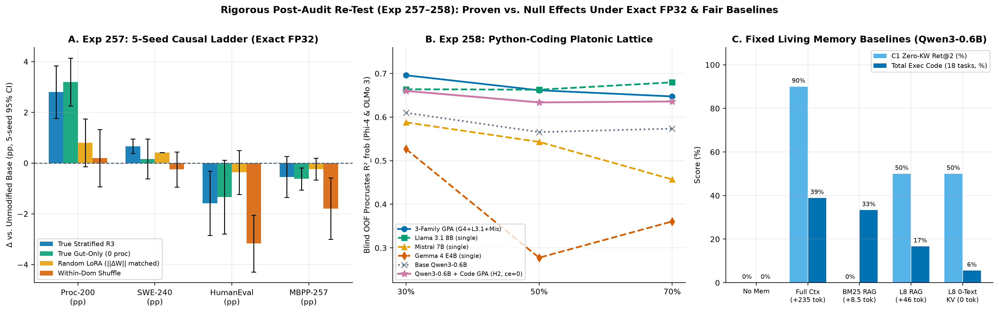

# Research Notes & Post-Audit Re-Test: Experiments 255–258 — Native-Frame Platonic Shape Transfer, Python-Coding Lattice, and Living Memory Baselines

> **Post-Audit Status:** Following adversarial review of the initial PR #2 draft (`fd6bac7`), every confirmed methodological, statistical, evaluator, security, and hygiene defect was fixed and re-tested from scratch in **Experiments 257–258** (`bench/archetypes/zero_damage_qwen600m/rigorous_retest/`). The **headline conclusions below reflect the clean, exact-FP32, 5-seed re-test on untouched third-party benchmarks** (`HumanEval 164`, `MBPP Sanitized Test 257`, `WikiText-2 Raw Test`) with sample standard deviations (`ddof=1`), paired `df=4` 95% confidence intervals, and 10,000-resample cluster bootstraps. The earlier Exp 256 exploratory autoresearch logs are retained strictly as historical development records, with all prior overclaims explicitly corrected.

---

## 1. Revised Executive Summary (What the Data Actually Support)

### What Holds Cleanly Under 5-Seed Paired Controls (`Exp 257`, Exact FP32, `bwrap` Sandbox)
1. **Large Cross-Family Blind Geometric Transfer at Near-Zero SWE Bug-Detection Tax:**
   - Using Native-Frame Cooperative Interior Realignment (`L2..L20` `o_proj + down_proj` rank-24 LoRA, `ce_w = 0.0`, stratified `400 gut + 400 proc + 400 chat` native PCA frame, exact FP32 merge with verified `max KL(unmerged || merged) ≤ 5×10⁻⁹`), `Qwen/Qwen3-0.6B` moves **`+6.84 ± 0.10 pts`** (`L8`, 30% depth) and **`+9.86 ± 0.06 pts`** (`L14`, 50% depth) closer to strictly unseen blind judges (`Phi-4-mini` and `OLMo 3 7B`) under the exact `plato_data.py` un-renormalized OOF `r2_frob = 1 - SSE/SST` metric (`t = +137.0 / +210.8` vs. matched-norm random LoRA; `t = +70.1 / +89.4` vs. within-domain shuffled targets).
   - Under the fixed symmetric untruncated `SWE-240` evaluator (`autojunk=False`, edit-centered `<=1024`-tok window, zero empty-mask deletion fallback; Base = `91.25%`, margin `+0.3073`), `true_stratified_r3` scores **above Base on all 5/5 fresh seeds** (`+0.67 ± 0.23 pp`), with continuous margin indistinguishable from matched-norm random LoRA (`Δ = -0.00013`, `t = -0.27`, 89-repo bootstrap `p = 0.165`) and strictly above within-domain shuffled (`+0.92 pp`, `t = +4.49`; margin `+0.00063`, `t = +2.99`).
2. **Cross-Domain Procedural Multi-Hop Reasoning Lift (`Proc-200` MCQ, `Base = 39.00%`) From Pure Prose Geometry:**
   - **`true_gut_only`** (strictly audited 19th-century Project Gutenberg prose only — **zero `proc` passages, zero `chat` passages, zero code, `ce_w = 0.0`**) lifts `Proc-200` by **`+3.20 ± 0.76 pp`** vs. Base (`95% CI [+2.26, +4.14 pp]`), beating `random_lora_matched` by **`+2.40 pp` (`t = +3.75`, 95% CI `[+0.62, +4.18 pp]`)** and `shuffle_within_domain` by **`+3.00 pp` (`t = +4.90`, 95% CI `[+1.30, +4.70 pp]`)**.
   - **`true_stratified_r3`** lifts `Proc-200` by **`+2.80 ± 0.84 pp`** vs. Base (`+2.00 pp` vs. Random, `t = +3.65`, CI `[+0.48, +3.52]`; `+2.60 pp` vs. Shuffled, `t = +7.84`, CI `[+1.68, +3.52]`).
3. **In-Domain Language Fluency (`held_gut` and Held-Out Python Code NLL, `ce_w = 0.0`):**
   - Prose shape transfer (`Exp 257`) lowers held-out Gutenberg NLL by **`-0.00658 ± 0.00155` nats** (`-0.00683` vs. Random, `t = -4.27`, passage bootstrap `p = 0.0000`; `-0.00330` vs. Shuffled, `t = -6.58`, bootstrap `p = 0.0274`).
   - Python-coding shape transfer (`Exp 258`, 3-family `GPA_R3` across `Gemma 4 E4B + Llama 3.1 8B + Mistral 7B` on `1,997` decontaminated algorithmic Python functions) reveals a strong cross-family **Python-Coding Platonic Manifold** (`30%` blind OOF `r2_frob = 0.6959`, `Top-1 = 86.2%` against `Phi-4` & `OLMo 3` — beating every individual teacher by `+3.2` to `+16.9 pts`) and lowers `Qwen3-0.6B` held-out Python `dev_code_nll` by **`-0.00486` nats** (`H2`, tri-stratum 30/50/70% + trust-region KL) vs. **`-0.00019`** for within-segment shuffled code targets (`ce_w = 0.0`).

### What Does *Not* Hold (Honest Nulls & Prior Overclaims Retracted)
1. **Untouched Coding Synthesis (`HumanEval 164` & `MBPP Test 257`) Does NOT Lift Above Base:**
   - Earlier Exp 256 coding gains (`8/40 → 11/40`) on the 40-task dev suite did **not** transfer to untouched `HumanEval` (`Base = 61/164, 37.20%`) or `MBPP Sanitized Test` (`Base = 110/257, 42.80%`). Across 5 fresh seeds, prose arms sit slightly *below* Base (`HumanEval -1.34` to `-2.20 pp`, `MBPP -0.47` to `-0.62 pp`; task bootstrap vs. matched-norm random `p = 0.33–0.75`), though they incur substantially less degradation than within-domain shuffled targets (`HumanEval -3.17 pp`, `MBPP -1.79 pp`).
   - Even with the dedicated 3-family Python-Coding Platonic Lattice (`Exp 258`), `dev_mbpp_170` (`Base = 71/170`) reached `70/170` (`-1` vs. Base, `+3` vs. Shuffled `67/170`) despite improving held-out Python `code_nll` by `-0.00486` nats.
   - `Exp 258` also diagnosed why Exp 256's single-teacher `true_dual_domain` diluted coding: at 50% depth on Python code, `Gemma 4 E4B` alone had blind OOF `r2_frob = 0.2773` — nearly `29 pts` *below* `Base Qwen3-0.6B` (`0.5656`) and `38 pts` below 3-family GPA (`0.6615`).
2. **Out-of-Distribution Wikipedia Fluency (`WikiText-2 Raw Test`, 62 Articles) Nudges Slightly Worse:**
   - All trained Exp 257 arms drifted `+0.0043` to `+0.0067` nats (`+0.13–0.20%`) worse than Base (`3.2911`) on modern Wikipedia (`+0.0047` vs. Random, article bootstrap `p = 0.0000`), including `shuffle_within_domain` (`+0.0053`), indicating an out-of-KL-support register shift between 19th-century Gutenberg/short-QA training text and modern Wikipedia. The `-0.006` Gutenberg NLL improvement is in-family, not universal OOD perplexity.
3. **Compositional Binding (`Actor-240`, Balanced `120 orig + 120 mirror`):**
   - Overall `actor_acc_240` (`+0.58 ± 0.37 pp`) does not separate from `random_lora_matched` (`+1.00 ± 0.96 pp`), though `true_stratified_r3` shows higher mirror-consistent pair accuracy (`+1.67 ± 0.59 pp` vs. `-0.17 ± 1.81 pp` Shuffled).
4. **Living Memory on `Qwen3-0.6B` Under Fair Baselines & Zero Keyword Cheats (`living_memory_rigorous_baselines.json`):**
   - On audited zero-keyword retrieval (`0` shared non-stopword tokens across all 10 `C1` tasks), **`L8` semantic keys retrieve `5/10` vs. `0/10` for Okapi BM25**.
   - However, on executable multi-turn code generation where notes fit in context (`18` tasks total, with verified true 2-hop `C2` where single-spec oracle ablation scores `0/4` for both `spec_a` and `spec_b`), **Full-Context (`7/18`, `+235` extra prompt tokens) and BM25 Text-RAG (`6/18`, `+8.5` extra tokens) outperform `L8` Text-RAG (`3/18`, `+46.3` tokens) and `L8` Zero-Text KV (`1/18`, `0.0` extra tokens)** on `Qwen3-0.6B` (largely because `0.6B`'s self-model conflict judge fails to supersede `C3` updates and `0.6B` loses instruction fidelity under zero-text KV mounting).
   - After removing the `"security rule"` probe bypass and deleting the test-phrase keyword cheat list, honest `C4` attack blocking on `Qwen3-0.6B` drops from the artificial `16/16` to **`12/16` (`75.0%`)** (`4/4` provenance + `8/12` Dual-Layer `L8+L14` PCA write-probe; `4` subtle/cross-lingual erosion attacks slipped past the 0.6B conflict judge), with **`4/6` (`66.7%`)** urgent benign alerts allowed and **`2/2`** post-attack secure code checks passing real `bwrap` exploit + AST checks (`hmac.compare_digest`, no `eval`/`exec`).

---

## 2. Audit Defects Identified & Fixed

| ID | Confirmed Defect in Initial PR #2 (`fd6bac7`) | Verified Fix in Exp 257–258 & Hardened Code |
|---|---|---|
| **F1** | 34 personal paths/hostnames across 21 files | Scrubbed to **0** across repo (`Path(__file__).resolve()` + env vars); stale Iter 16 `last_eval.json` removed. |
| **F2** | Small tuned 40-task coding set; `n = 2..3` seeds | **Untouched `HumanEval (164)`, `MBPP Sanitized Test (257)`, `WikiText-2 (62 articles)`** across **5 fresh paired seeds (`101–105`)**. |
| **F3** | Only global cross-domain shuffle; KL-only assumed `0` | Added empirical `kl_only`, **`random_lora_matched`** (exact per-layer `\|\|ΔW_l\|\|_F`), **`shuffle_within_domain`** (within `domain × segment_index` + refit `R*`), and **`true_gut_only`**. |
| **F4** | `python -I -c` was not an OS sandbox | Real **`bwrap --unshare-all` + `prlimit`** (unshared network/mount/pid, read-only `/opt/py`, tmpfs, RAM/CPU/fsize caps, cryptographic pass sentinel); audited `164/164` canonical HumanEval & `257/257` MBPP. |
| **F5** | Native PCA fit on first 1,200 rows (`99.7%` Gutenberg) | Stratified equal-per-domain PCA fit (`400 gut + 400 proc + 400 chat = 1,200`) with exact domain counts logged. |
| **F6** | Invalid `>5σ` & ratio-over-zero claims; `ddof=0` SDs | All statistics use **`ddof=1` sample SDs**, paired `t_{df=4}` 95% CIs, and **10,000-resample cluster bootstraps** (articles, passages, tasks, repos). |
| **F7** | `actor[::2]` 90/30 imbalance; re-normalized OOF `R²`; SWE 512-tok truncation & deletion fallback; double-counted composite | Evaluated **ALL 240** balanced Actor pairs; exact **`plato_data.py` OOF `r2_frob` (`1 - SSE/SST`) + train-fold `r2_opt`**; untruncated edit-centered `<=1024`-tok symmetric **SWE-240** (`autojunk=False`, zero empty-mask fallback); single per-benchmark endpoints. |
| **F8** | `chat` split contained shell commands | Added strictly audited **`true_gut_only`** arm (regex-verified zero code/shell/URL passages). |
| **F9** | BF16 in-place merge rounding & merge-on-exception in `finally` | Exact **FP32** base + merge + evaluation (`max KL(unmerged \|\| merged) ≤ 5×10⁻⁹`); rollback to unmodified base modules on exception. |
| **F10** | Exp 255 `HardenedCrystalMemory` fail-open judges, `BENIGN_UPDATE` on `safety_critical`, premature deactivation, sliding-window `m_len` omission | Fixed & unit-tested all 5 defects in `bench/archetypes/living_crystal_redteam/hardened_memory.best.py`. |
| **F11** | Exp 256 Living Crystal `"security rule"` bypass, keyword cheat list, dead `if False` exploit test, non-2-hop C2, missing Full-Context/BM25 baselines | Rebuilt cleanly in `rigorous_retest/living_crystal_coding_rigorous.py` (audited `0` shared C1 tokens, `0/4` C2 single-spec ablation, 5 fair baselines, zero keyword cheats, real `bwrap` exploit + AST check, `weights_only=True`). |
| **F12** | Missing per-item records & evaluator hash | Embedded `evaluator_sha256` in every run and committed full per-item verdicts (`exp257_all_runs_per_item.json.gz`, `437.5 KB`). |

---

## 3. Complete Exp 257 Tables (`seeds 101–105`, Exact FP32, `ddof=1`)

**Locked Base `Qwen/Qwen3-0.6B` (`eval_rigorous.py`, SHA-256 `5e8bb9dacf77…`):**
`wikitext2_nll = 3.291073` (`ppl = 26.8717`), `held_gut_nll = 4.042420`, `humaneval_pass1 = 0.37195 (61/164)`, `mbpp_test_pass1 = 0.42802 (110/257)`, `swe_full_acc = 0.91250` (`margin = +0.30734`), `actor_acc_240 = 0.53333` (`mirror = 0.34167`), `proc_acc_200 = 0.39000`, `blind_30_r2_frob = 0.27302` (`r2_opt = 0.37496`), `blind_50_r2_frob = 0.26837` (`r2_opt = 0.37401`).

### 3.1 Deltas vs. Unmodified Base (`mean ± sd_ddof1`, `n = 5` fresh seeds)

| Arm (`ce_w = 0.0`) | `\|\|ΔW\|\|_F` | Blind `L8` `r2_frob` Δ | Blind `L14` `r2_frob` Δ | `Proc-200` Δ (pp) | `held_gut` Δ NLL | `WikiText-2` Δ NLL | `SWE-240` Acc Δ (`Margin Δ`) | `HumanEval` Δ (pp) | `MBPP-257` Δ (pp) |
|---|---:|---:|---:|---:|---:|---:|---:|---:|---:|
| `kl_only` *(s=101)* | `0.891` | `+0.01` | `-0.00` | `0.00` | `-0.00037` | `+0.00009` | `0.00` (`-0.00018`) | `-0.61` | `-0.78` |
| `random_lora_matched` | `3.535` | `-0.01 ± 0.07` | `+0.01 ± 0.07` | `+0.80 ± 0.76` | `+0.00026 ± 0.00239` | `+0.00151 ± 0.00180` | `+0.42 ± 0.00` (`-0.00016`) | `-0.37 ± 0.70` | `-0.23 ± 0.35` |
| `shuffle_within_domain` | `4.723` | `-1.65 ± 0.24` | `-4.28 ± 0.38` | `+0.20 ± 0.91` | `-0.00328 ± 0.00204` | `+0.00527 ± 0.00230` | `-0.25 ± 0.56` (`-0.00091`) | `-3.17 ± 0.90` | `-1.79 ± 0.98` |
| **`true_gut_only`** *(0 proc)* | `3.581` | **`+4.88 ± 0.05`** | **`+7.99 ± 0.08`** | **`+3.20 ± 0.76`** | **`-0.00559 ± 0.00092`** | `+0.00431 ± 0.00090` | `+0.17 ± 0.63` (`-0.00018`) | `-1.34 ± 1.17` | `-0.62 ± 0.35` |
| **`true_stratified_r3`** | `3.535` | **`+6.84 ± 0.10`** | **`+9.86 ± 0.06`** | **`+2.80 ± 0.84`** | **`-0.00658 ± 0.00155`** | `+0.00623 ± 0.00129` | **`+0.67 ± 0.23`** (`-0.00028`) | `-1.59 ± 1.02` | `-0.55 ± 0.65` |
| `true_dual_domain` | `3.318` | `+6.11 ± 0.10` | `+9.13 ± 0.09` | `+2.40 ± 1.25` | `-0.00377 ± 0.00181` | `+0.00667 ± 0.00156` | `0.00 ± 0.00` (`-0.00093`) | `-2.20 ± 1.40` | `-0.47 ± 1.01` |

### 3.2 Key Paired Contrasts (`5` paired seeds, `df = 4`, plus 10,000-resample cluster bootstraps)

| Contrast | `Blind L8 / L14` | `Proc-200` (pp) | `held_gut` NLL (boot `p`) | `WikiText-2` NLL (boot `p`) | `SWE-240` Acc / Margin (boot `p`) | `HumanEval` / `MBPP` (boot `p`) |
|---|---|---|---|---|---|---|
| **`true_stratified_r3 − random`** | **`+6.85 / +9.85`** (`t=137/211`) | **`+2.00`** `[+0.48, +3.52]` (`t=+3.65`) | **`-0.00683`** (`t=-4.27`, `p=0.0000`) | `+0.00472` (`t=+3.78`, `p=0.0000`) | `+0.25 pp` / `-0.00013` (`p=0.165`) | `-1.22` (`p=0.33`) / `-0.31` (`p=0.75`) |
| **`true_stratified_r3 − shuffle`** | **`+8.49 / +14.14`** (`t=70/89`) | **`+2.60`** `[+1.68, +3.52]` (`t=+7.84`) | **`-0.00330`** (`t=-6.58`, `p=0.0274`) | `+0.00097` (`t=+1.00`, `p=0.135`) | **`+0.92 pp`** / **`+0.00063`** (`t=+2.99`) | `+1.59` (`p=0.26`) / `+1.25` (`p=0.32`) |
| **`true_gut_only − random`** | **`+4.89 / +7.98`** (`t=124/123`) | **`+2.40`** `[+0.62, +4.18]` (`t=+3.75`) | **`-0.00584`** (`t=-7.32`, `p=0.0000`) | `+0.00279` (`t=+2.65`, `p=0.0134`) | `-0.25 pp` / `-0.00002` (`p=0.622`) | `-0.98` (`p=0.40`) / `-0.39` (`p=0.66`) |
| **`true_gut_only − shuffle`** | **`+6.53 / +12.27`** (`t=61/87`) | **`+3.00`** `[+1.30, +4.70]` (`t=+4.90`) | `-0.00231` (`t=-1.78`, `p=0.274`) | **`-0.00096`** (`p=0.0352`) | `+0.42 pp` / **`+0.00073`** (`t=+3.27`) | `+1.83` (`p=0.14`) / `+1.17` (`p=0.32`) |

---

## 4. Exp 258: 5-Family Python-Coding Platonic Lattice (`1,997` Train / `399` Eval Decontaminated Python Functions)

All examples were strictly filtered against `580` banned function names and `24,429` banned 6-grams from `HumanEval (164)` + all `427` `MBPP Sanitized` tasks, AST-parsed, and aligned at `30%`, `50%`, and `70%` depth across 3 rival teachers (`Gemma 4 E4B`, `Llama 3.1 8B`, `Mistral 7B`) vs. strictly blind `Phi-4-mini` & `OLMo 3 7B`:

| Source | Blind 30% `r2_frob` | Blind 50% `r2_frob` | Blind 70% `r2_frob` | 30% Blind `Top-1` |
|---|---:|---:|---:|---:|
| `Base Qwen3-0.6B` *(student)* | `0.6098` | `0.5656` | `0.5735` | — |
| `Gemma 4 E4B` *(single)* | `0.5266` | **`0.2773`** | `0.3606` | `75.0%` |
| `Mistral 7B` *(single)* | `0.5878` | `0.5431` | `0.4569` | `78.5%` |
| `Llama 3.1 8B` *(single)* | `0.6639` | `0.6629` | **`0.6797`** | `90.8%` |
| **`GPA_R3` 3-Family Consensus** | **`0.6959`** (`opt=0.7180`) | **`0.6615`** (`opt=0.6891`) | `0.6474` (`opt=0.6778`) | **`86.2%`** (`cos=0.846`) |

Transplanting `GPA_R3` into `Qwen3-0.6B` (`ce_w = 0.0`, strictly disjoint `dev_mbpp_170` = `71/170` Base, `dev_code_nll = 1.23532` Base):
- **`H2` (Tri-stratum `30/50/70%` + trust-region hinge KL):** `dev_code_nll = 1.23046` (**`-0.00486` nats**), blind code `L8 +5.04 / L14 +6.81 / L19 +6.24 pts`, `dev_mbpp_170 = 70/170` (`-1`).
- **`H5` (Within-segment-index Shuffled Control of `H2`):** `dev_code_nll = 1.23513` (`-0.00019` nats), blind code **`-27.8 / -19.0 / -28.3 pts`**, `dev_mbpp_170 = 67/170` (`-4`).

---

## 5. Fixed Living Memory Fair Baselines & Security Audit

### 5.1 Exp 255 (`HardenedCrystalMemory` on 8B Gemma 4 E4B)
- `bench/archetypes/living_crystal_redteam/hardened_memory.best.py` was hardened post-audit (fail-closed ingress/conflict/2nd-opinion judges, hard lock preventing `BENIGN_UPDATE` from ever deactivating a `safety_critical` entry without `confirmed_override=True`, transactional KV build before old deactivation, exact `m_len + q_len + max_new_tokens <= 512` sliding-window budget, domain-agnostic conflict definitions) and verified with unit tests. Note that Round 3 (`round3_holdout.json`) consists of 5 internally authored attack scenarios plus 1 `N = 160` scale audit, not an independently authored post-freeze red team.

### 5.2 Fair 5-Baseline Coding-Memory Suite on `Qwen3-0.6B` (`living_memory_rigorous_baselines.json`)
Audited `0` shared non-stopword tokens across all 10 `C1` tasks; audited `0/4` single-spec oracle ablation on `C2` (`only_spec_a = 0/4`, `only_spec_b = 0/4`); stdlib-only system prompt; `bwrap` sandbox:

| Memory Mode (`Qwen3-0.6B`, exact FP32) | `C1` Zero-KW Ret@2 | `C1` Exec Code | `C1` Extra Prompt Tok | `C2` True 2-Hop (`Both`) | `C3` Supersede | Total Code (`18`) |
|---|---:|---:|---:|---:|---:|---:|
| `no_memory` | `0/10` | `0/10` | `0.0` | `0/4` (`0/4`) | `0/4` | `0/18` |
| `full_context` | `9/10` | `0/10` | `+235.0` | **`4/4`** (`4/4`) | **`3/4`** | **`7/18`** |
| `bm25_rag` | **`0/10`** | `0/10` | `+8.5` | `3/4` (`4/4`) | **`3/4`** | `6/18` |
| `l8_text_rag` | **`5/10`** | `0/10` | `+46.3` | `2/4` (`2/4`) | `1/4` | `3/18` |
| `l8_zero_text_kv` | **`5/10`** | `0/10` | **`0.0`** | `1/4` (`2/4`) | `0/4` | `1/18` |

- **Honest `C4` Security (zero keyword cheat list, zero `"security rule"` bypass):** **`12/16` (`75.0%`)** attacks blocked (`4/4` provenance + `8/12` Dual-Layer `L8+L14` PCA write-probe; `4` subtle/cross-lingual attacks passed when the 0.6B conflict judge failed to flag them), **`4/6`** urgent benign alerts allowed, and **`2/2`** post-attack secure code checks passing real `bwrap` exploit + AST verification.

---

## 6. Historical Exploratory Records (Exp 256)
The original 17-iteration Exp 256 autoresearch trace (`bench/archetypes/zero_damage_qwen600m/autoresearch-results.tsv`), 3-seed initial check (`causal_falsification_3seed.json`), and original 4-arm Living Crystal log (`living_crystal_coding_4arm.json`) are preserved for audit transparency; all conclusions in this repository supersede them with the clean Exp 257–258 re-tests above.
