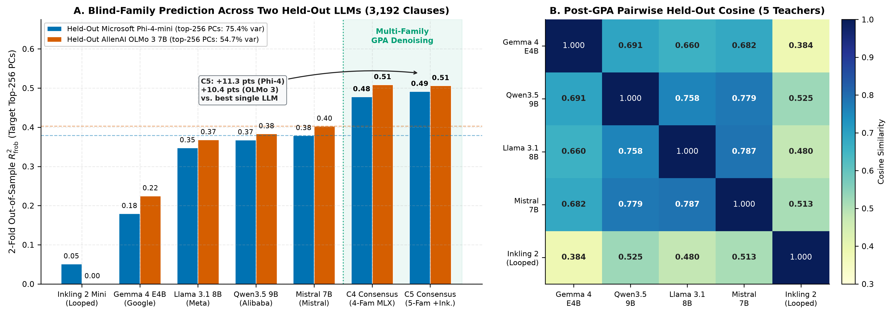
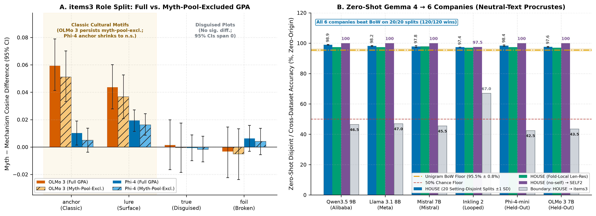
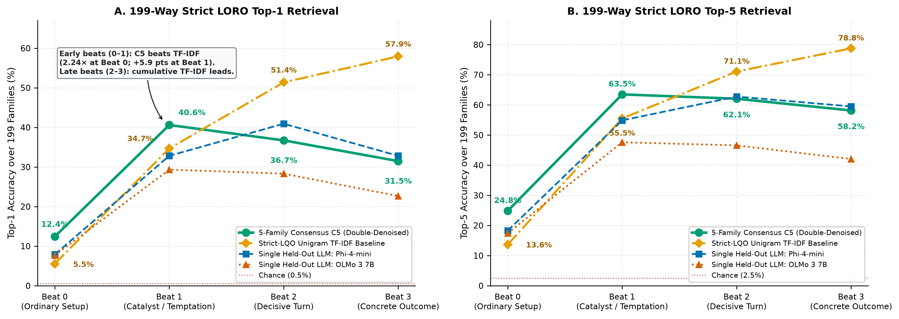
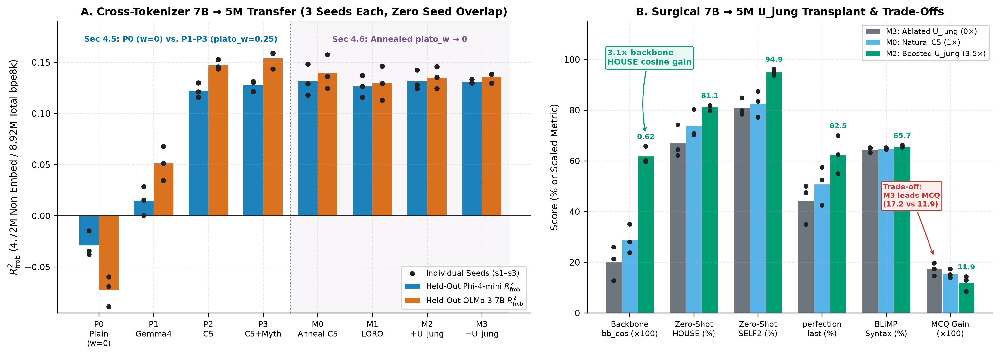
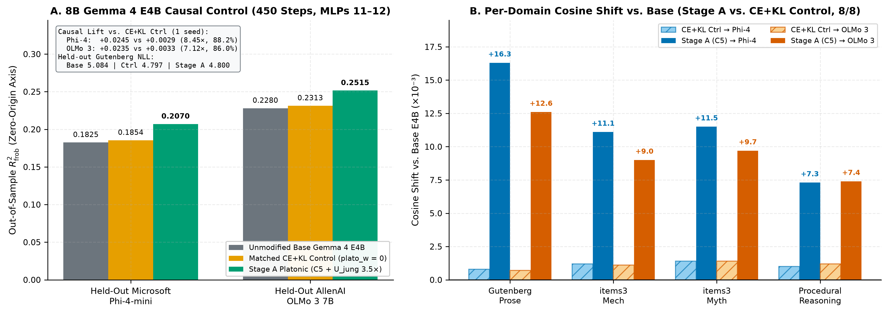
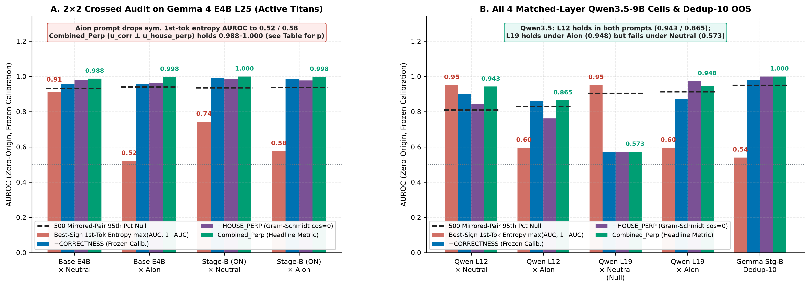
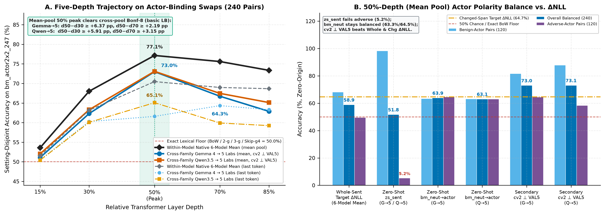
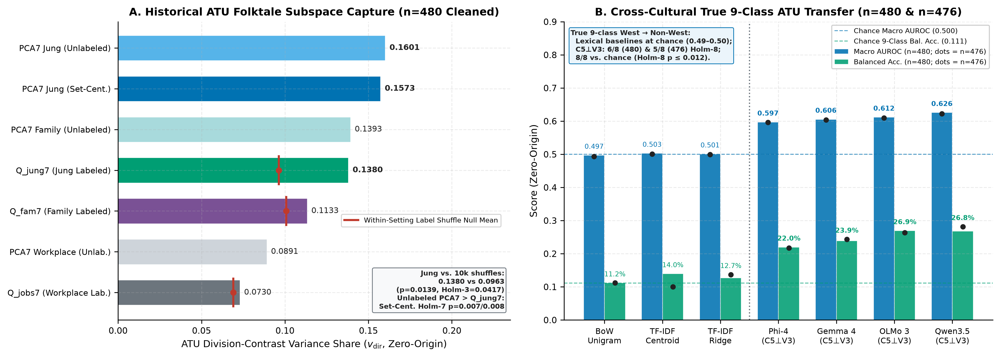
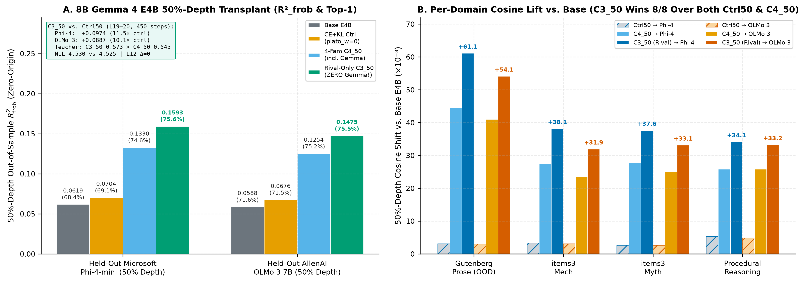

# The Jung–Plato Lattice: Multi-Family Representation Denoising, Compositional Probing, and Cross-Tokenizer Distillation

*Full-Length Audit-Verified Preprint (`v6` / Zenodo v3.0, `cs.CL` / `cs.LG`) — Preprint DOI: [`10.5281/zenodo.24572076`](https://doi.org/10.5281/zenodo.24572076) — 9 JSON-Driven Publication Figures Embedded (+ 2 Vector TikZ Diagrams in LaTeX); Companion IEEEtran arXiv Bundle in `paper/arxiv/`*

> **Data Availability & Audit Scope (`v6` / Zenodo v3.0):** Results in **Sections 4.1, 4.2.1, 4.4.2–4.4.4, 4.5, 4.6, 4.7, and 4.8** have committed per-run JSON outputs verified automatically against both `paper/paper.md` and `paper/arxiv/main.tex` by `scripts/verify_repro.py` (multi-gigabyte raw activation `.npz` caches and checkpoints are gitignored and regenerated from open weights; third-party CC BY-NC-SA folktale texts are excluded from this MIT repository, which commits only the cleaned metadata manifest `aft_clean248_manifest.json` and verified JSON outputs). **Sections 4.2.2, 4.3, 4.4.1, and 4.4.5–4.4.7** summarize earlier multi-model forensic audits. All **64 references** were verified against primary sources, and all **9 figures** (`figures/fig1`–`fig9`, PNG + vector PDF) are generated directly from committed JSON outputs.

---

## Plain-English Summary (Reader's Guide)

We gave **five independently trained language models** (from Google, Alibaba, Meta, Mistral, and Thinking Machines) the same public passages and recorded their internal hidden-state activations at identical clause endings. We rotated their coordinate frames into alignment and averaged them into one 256-dimensional consensus space (**`C5`**). After calibrating a linear rotation on half of a **sixth** (Microsoft `Phi-4-mini`, 3.8B) or **seventh** (AllenAI `OLMo 3`, 7B) model's held-out passages—neither of which contributed to `C5`—the five-family consensus predicted that held-out model's activations on the remaining passages better than any individual 7B–9B teacher (`+10.4` to `+11.3` Frobenius $R^2$ points above the strongest single teacher).

Using this shared coordinate frame as a training target lets us transfer geometric alignment across completely unrelated tokenizers with **zero extra inference parameters**: a temporary linear layer supervises one intermediate layer during training and is discarded afterward. At 5M scale (24 runs across 3 seeds), held-out Frobenius $R^2$ jumps `+15` to `+23` points over plain training with zero seed overlap (while downstream 5M reading/syntax scores remain mixed/null). On 8B multimodal `google/gemma-4-E4B-it` (1 paired seed), adding the consensus objective raises held-out Frobenius $R^2$ by `+0.0245` / `+0.0235`, versus `+0.0029` / `+0.0033` for a matched zero-alignment `CE+KL` control.

Borrowing Plato's contrast between shadows and Forms alongside Carl Jung's crystal-lattice analogy strictly as an interpretive statistical lens on human cultural text (making zero claims about biological inheritance, Platonic ontology, or machine consciousness), we separate what holds under strict controls from what collapses. Neutral-text rotations transfer Gemma 4's narrative completion/coherence direction (`HOUSE`) zero-shot into all six rival families at `97.4%–98.9%` across 20 setting-disjoint splits—beating a strong unigram Bag-of-Words floor (`95.5% ± 0.8%`) on `120/120` splits. Direct 7-company valence, lexical, clause-order, output-probability, non-Jungian role, and proper-name audits (`valence_ctrl234.json`, `bow_swap236.json`, `named_arch235.json`, `referee_ctrl237.json`, `bow_mirror238.json`) sharpen four exact boundaries: (1) **`46.8%`** of `HOUSE` is shared with evaluative valence (`u_sent`/`u_outval`); on **120 clause-order-mirrored exact identical-bag-of-words swap pairs** (`bow_mirror_120`: `60` settings × `2` mirrored clause orders, canceling both mean-pooling primacy and last-token recency while locking unigram BoW at `50.0%` and bigram BoW at `49.1%`), setting-disjoint 2-fold neutral-text transfer `⊥ VAL2` reaches **`67.8%–77.0%`** in mean pooling (`6/6` Holm-significant `p_holm <= 0.010`; getting both mirrors of the same setting right on `42.2%–58.8%` vs. `25.0%` independent no-signal chance and `0.0%` order-only shortcut) and **`60.5%–75.3%`** at the last token (`5/6` Holm-significant, Inkling `60.5%` n.s.), while zero-shot `HOUSE ⊥ VAL2 → bm120` clears `p_holm <= 0.014` in all `6/6` labs (`61.7%–67.5%`, modest `31.7%–40.0%` both-mirrors-right). Each target model's own output log-probability (`ΔNLL`) scores `60.8%–72.5%` but correlates weakly with the neural margin (`r = -0.010` to `+0.277`), leaving `67%–101%` (`mean`) and `78%–107%` (`last`) of the neural margin intact at `ΔNLL = 0` (`5/5` strictly positive setting-clustered 95% CIs); (2) giving **8 canonical named Jungian archetypes** (`Hero`, `Shadow`, `Trickster`, `Wise_Old_Man`, `Great_Mother`, `Persona`, `Anima_Animus`, `Threshold_Guardian`) a fair trial (`40` settings × `8` roles = `320` stories, zero ban-list words) yields `48/48` `p = 0.001` transfer (`85.9%–92.7%` Top-1 vs. BoW `80.6%` / TF-IDF Ridge `89.1%`), yet **8 ordinary non-Jungian workplace roles** (`Auditor, Repair_Tech, Negotiator, Scheduler, Trainer, Supplier, Journalist, Archivist`) in the same 40 settings transfer higher (`94.3%–98.1%` raw / `93.4%–98.5%` `⊥ VAL3`, `48/48` `p = 0.001`; TF-IDF Ridge `99.4%`), and the apparent dimensional compression (`PR = 5.01` Jung / `4.38` non-Jung vs. `6.65`/`6.79` word space) is non-significant against within-setting shuffled labels in `C5` (`p = 0.116` / `0.108`), reflecting `C5`'s ambient story anisotropy rather than uniquely Jungian structure; (3) on `items3` mythic motifs (`anchor`/`lure`, `77%/73%` proper names vs. `4%` mechanisms), zero-proper-name passages still align tighter on **1 of 2** held-out models (`OLMo 3`: `+0.0454`/`+0.0369`, tracking old-story vs. technical register) while `Phi-4` `anchor` reverses (`-0.0167`), and disguised plots remain null (`+0.074 → +0.006` once edit position is matched); and (4) in native 40%/60%-depth activations of Gemma 4 and Qwen3.5, `CORRECTNESS` + `HOUSE_PERP` clears nominal `p < 0.05` in `11/12` matched cells (`6/12` Holm, `10/12` BH-FDR; solo `-HOUSE_PERP` `5/12` nominal, `0/12` Holm/BH) where Aion prompting drops pooled symmetric first-token entropy ranking toward chance (`0.521–0.596`), with pure `-SENTIMENT_PERP` matching or beating `-HOUSE_PERP` in all 4 Aion Base cells while valence-orthogonal `-HOUSE_PERP_BOTH` uniquely hits `1.000` (`p = 0.002`) vs. `-SENTIMENT_PERP` `0.602` (n.s.) at Gemma L25 Neutral.

---

## Abstract

We gave five independently trained language model families (**Gemma 4 E4B**, **Qwen3.5 9B**, **Llama 3.1 8B**, **Mistral 7B**, and looped **Inkling 2 Mini**) the same public passages, recorded intermediate hidden states at matching clause endings, rotated their coordinate systems into alignment via 10-iteration Generalized Procrustes Analysis (GPA; `20,339` aligned clause points), and averaged them into one canonical 256-dimensional consensus (**`C5`**). Building on classical Procrustes and multi-subject alignment (Schönemann, 1966; Gower, 1975; Haxby et al., 2011; Moschella et al., 2023), the **Platonic Representation Hypothesis** (Huh et al., 2024; Balestriero & LeCun, 2026), and *Plato's Key* (Cheng et al., 2026), and borrowing Carl Jung's crystal-lattice analogy (CW 9.I, ¶5, ¶155) strictly as an interpretive framework for human cultural text (making no claim about biological inheritance or machine consciousness), this study contributes four audit-verified pillars:

1. **Five-Family Consensus Evaluated on Two Held-Out Target Families (`C5`, 7 Companies Total):** Evaluating strictly out-of-sample 2-fold Procrustes transfer (`3,192` clause checkpoints across `1,000` held-out passages) onto **two target families excluded from consensus construction** (within each target's top-256 PCs: `75.4%` variance in Microsoft **Phi-4-mini** 3.8B, `54.7%` in AllenAI **OLMo 3** 7B), **`C5`** beats every individual teacher on cosine and $R^2$: **`+0.0523` cosine (95% CI `[+0.0505, +0.0541]`; strict train-scalar $R^2_{\text{opt}}$ `0.557` vs. best single `0.474`; norm-matched $R^2_{\text{frob}}$ `0.491` vs. `0.379`; tie-safe Top-1 `95.3%` vs. best single `95.1%`)** on **Phi-4-mini**, and **`+0.0472` cosine (95% CI `[+0.0458, +0.0488]`; $R^2_{\text{opt}}$ `0.564` vs. `0.486`; $R^2_{\text{frob}}$ `0.506` vs. `0.403`; Top-1 `89.9%` vs. `89.2%`, with `C4` edging `C5` on OLMo 3 at `0.509` / `90.5%`)** on **OLMo 3 7B**. Excluding the dedicated Gutenberg myth pool from GPA leaves these scores virtually unchanged (`0.491 / 0.506`). Across `199` modern workplace pattern families (`975` stories), strict leave-one-retelling-out (`LORO`) retrieval in `C5` beats a strictly leave-query-out unigram TF-IDF baseline at opening beats (`beat_0`: `12.4%` vs. `5.5%`; `beat_1`: `40.6%` / `63.5%` Top-5 vs. `34.7%` / `55.5%`) before cumulative lexical overlap favors TF-IDF at beats `2–3` (`51.4% / 57.9%`).
2. **Cross-Tokenizer Alignment Distillation at 5M (`P0`–`P3` & `M0`–`M3`, 24 Runs) & 8B Paired Control (`google/gemma-4-E4B-it`):** Across 24 equal-parameter (`4.72M` non-embedding / `8.92M` total), equal-main-stream (`100M` public tokens plus auxiliary passages) Transformers using an 8,192-token byte-pair vocabulary (`bpe8k`, 3 seeds × 8 arms), supervising 0-indexed block 2 (after the third of six blocks) via a temporary linear head discarded after training (**zero extra inference params**) lifts held-out **Phi-4-mini** $R^2_{\text{frob}}$ from `-0.029` (`P0`, alignment weight `plato_w = 0`) and `+0.015` (`P1`, Gemma 4 alone) to **`+0.122–+0.132`** (`P2`/`P3`/`M0`/`M2`), and **OLMo 3 7B** from `-0.073` (`P0`) to **`+0.135–+0.154`** with zero seed overlap (note archived 5M evaluation logs used the earlier scorer for $R^2_{\text{opt}}$ and clause retrieval, while fixed-scale $R^2_{\text{frob}}$ is unaffected; 5M downstream benchmarks remain mixed/null). Increasing training weight on the 2D `U_jung` span (spanned by teacher `HOUSE` and `SELF2` contrasts; `M2` vs. `M3`) raises student-to-teacher `HOUSE` cosine (`bb_cos`) from `+0.200` to **`+0.619` (`3.1×`)** and zero-shot `SELF2` from `81.0%` to `94.9%` on the benchmark defining those contrasts, alongside a modest `3/3` `BLiMP` edge (`0.657` vs. `0.645`, $p \ge 0.125$) while reading-comprehension gain (`mcq_gain`, multiple-choice accuracy with passage minus without) falls from `0.172` to `0.119`. On **8B multimodal `google/gemma-4-E4B-it`** (1 paired seed, full-rank MLPs `11–12`, where Gemma contributes to `C5`), adding annealed `C5 + U_jung` raises held-out `Phi-4` $R^2_{\text{frob}}$ by **`+0.0245`** (`+0.1825 → +0.2070`) and `OLMo 3` by **`+0.0235`** (`+0.2280 → +0.2515`), with `8/8` domain×model cells higher than the matched **`plato_w = 0.0` `CE+KL` control** (`+0.0029 / +0.0033`, a `7.12×–8.45×` Stage-A-to-control gain ratio over Base; Gutenberg NLL `+0.0027` higher at `4.8001` vs. `4.7974`; two multimodal fixtures `"Red"` and `"blue pelican"` passing; broader 8B downstream tasks untested).
3. **Forensic Separation of Cultural Register, Order-Mirrored Compositional Binding, & Named vs. Non-Jungian Roles:** Even when the **dedicated Gutenberg myth pool is excluded from GPA** (`gut+proc+chat`, `13,388` pts), classic mythic passages (`anchor`/`lure`, `77%/73%` proper names vs. `4%` in mechanisms) align tighter than technical mechanisms on **1 of 2** held-out models (`OLMo 3`: `anchor +0.0512`, word-matched `+0.0379`; **zero-proper-name `anchor +0.0454 [+0.0208, +0.0689]` / `lure +0.0369 [+0.0169, +0.0572]`**, where named `0.713` and name-free `0.707` myths sit equally above mechanisms `0.662`, tracking old-story vs. technical register), whereas on `Phi-4` `anchor` shrinks to `+0.0050` n.s. and reverses without proper names (`-0.0167`; `lure +0.0116`). Disguised modern retellings (`true`/`foil`) show tight nulls spanning zero in out-of-fold transfer, and once **first-edit position (`fpos`)** is matched in earlier mean-pooled RSA (`+0.074 → +0.0058 [-0.0699, +0.0786]`, $n=64$) the raw lead is no longer detectable. Rigid Procrustes rotations fit exclusively on **neutral `gut + proc + chat` text** transfer Gemma 4's `HOUSE` direction zero-shot into all **6 rival families** at **`97.4%–98.9%`** 20-split mean (`120/120` paired wins over `95.5%` BoW; `cos(u_house_c5, u_self2_c5) = +0.9539`). Direct 7-company valence, clause-order, and output-probability audits (`valence_ctrl234.json`, `bow_swap236.json`, `referee_ctrl237.json`, `bow_mirror238.json`, Section 4.4.3) reveal that inside `C5`, **`46.8%`** of `HOUSE` is evaluative valence (`VAL2` erases held-out sentiment to `cos +0.02–+0.04`), and the original `60`-pair `bow_swap_60` set had a `39/21` clause-order skew that contaminated unbalanced mean-pooled transfer. Mirroring all 60 pairs into **both clause orders (`bow_mirror_120`: `60` settings × `2` orders = `120` pairs, `Counter(pos)==Counter(neg)` on `120/120`, Uni/Bi BoW `50.0%/49.1%`)** cancels both mean-pooling primacy and last-token recency: setting-disjoint 2-fold neutral-text transfer `⊥ VAL2` reaches **`67.8%–77.0%`** in mean pooling (**`6/6` Holm-significant `p_holm <= 0.010`**, `cos +0.265` to `+0.395`; `42.2%–58.8%` both-mirrors-right vs. `25.0%` independent no-signal chance and `0.0%` order-only shortcut; `65.1%–77.7%` `⊥ VAL5`) and **`60.5%–75.3%`** at the last token (**`5/6` Holm-significant**, Inkling `60.5%` n.s.), while zero-shot **`HOUSE ⊥ VAL2 → bm120`** clears **`p_holm <= 0.014` in all `6/6` labs** (`61.7%–67.5%`, modest `31.7%–40.0%` both-mirrors-right). Each target model's own output log-probability (`ΔNLL`) scores `60.8%–72.5%` but correlates weakly with the mid-layer neural margin (`r = -0.010` to `+0.277`), and OLS intercepts at equal output probability (`ΔNLL = 0`) remain strictly positive in **`5/5` MLX targets** (`67%–101%` of mean margin in `mean_pool`, `78%–107%` in `last_token`). Finally, while **8 canonical named Jungian archetypes** (`40` settings × `8` roles = `320` stories, zero ban-list words; `named_arch235.json`, Section 4.4.4) transfer at `p = 0.001` in `48/48` cells (`85.9%–92.7%` Top-1 vs. BoW `80.6%` / TF-IDF Ridge `89.1%`), **8 ordinary non-Jungian workplace roles** in the exact same 40 settings (`referee_ctrl237.json`) transfer higher (`94.3%–98.1%` raw / `93.4%–98.5%` `⊥ VAL3`, `48/48` `p = 0.001`; TF-IDF Ridge `99.4%`), TF-IDF Ridge beats neural on macro AUROC for archetypes (`0.984`) and on all splits for ordinary roles, and the apparent dimensional compression (`PR = 5.01` Jung / `4.38` non-Jung vs. `6.65`/`6.79` word space) is non-significant against within-setting shuffled labels in `C5` (`p = 0.116` / `0.108`), confirming no uniquely Jungian privilege. On `items3` plot twists, `HOUSE` fails to transfer positively across all 5 standard targets (`42.5%–47.0%`; looped `Inkling 2 Mini` `67.0%`).
4. **Native-Layer Epistemic Probing (`CORRECTNESS` + `HOUSE_PERP` vs. Pure `SENTIMENT_PERP`):** Measured separately in each model's native 40%/60%-depth residual stream (Google `Gemma 4 E4B` L17/L25: raw cosines `+0.223` / `+0.089`; Alibaba `Qwen3.5-9B` L12/L19: raw cosines `+0.157` / `-0.003`), we construct `u_house_perp` orthogonal to `u_corr` (`cos == 0.000` by Gram-Schmidt construction; orthogonal input vectors can still yield correlated scores on real prompts) with frozen calibration scaling. Across 12 matched cells (8 Gemma conditions × 2 prompts × 2 depths + 4 Qwen3.5 Base conditions) on **24 zero-entity-overlap minimal pairs**, the `Aion` system prompt shifts the two unknown subsets in opposite first-token entropy directions, lowering pooled symmetric first-token entropy AUROC (`0.50` = chance) to **`0.521` (Base Gemma 4), `0.576` (Stage-B), and `0.596` (Base Qwen3.5)**. Meanwhile, **`Combined_Perp`** spans `0.573–1.000` and clears nominal per-cell `p < 0.05` against 500 mirrored 2-direction random pairs in **11 of 12** cells (**6/12** Holm-corrected; **10/12** Benjamini–Hochberg FDR; solo `-HOUSE_PERP` clears `5/12` nominal and `0/12` Holm/BH), failing at **Qwen3.5 L19 Neutral (`0.573`, `p = 0.409` *n.s.*)** and reaching **`1.000` (`10/10`, `p = 0.016–0.038`)** on frozen `Dedup-10`. Crucially, adding a direct **sentiment control (`valence_ctrl234.json`, Section 4.7.2)** shows that **under the Aion prompt**, pure `-SENTIMENT_PERP` matches or beats `-HOUSE_PERP` in all 4 Base cells (`0.908–0.997` vs. `0.764–0.972`; removing sentiment collapses Qwen L19 Aion `-HOUSE_PERP_BOTH` to chance `0.519, p = 0.475`), whereas **under Neutral prompting at Gemma 4 L25**, `-SENTIMENT_PERP` fails (`0.602` n.s.) while valence-orthogonal `-HOUSE_PERP_BOTH` hits **`1.000` (`p = 0.002`)** and adds `+0.033 [+0.003, +0.076]` over `-CORRECTNESS` alone.

**Keywords:** Plato; Platonic eidos; Platonic Representation Hypothesis; Carl Jung; Jungian archetypes; archetypes; analytical psychology; comparative mythology; narrative geometry; Generalized Procrustes Analysis; Orthogonal Procrustes; cross-tokenizer distillation; mechanistic interpretability; epistemic uncertainty.

---

## 1. Introduction

We gave five independently trained open-weight language models the same public passages, recorded their internal hidden states at matching clause endings, rotated their coordinate frames into alignment, and averaged them into one 256-dimensional consensus space (`C5`). After calibrating a linear rotation on half of a sixth or seventh model's held-out passages, `C5` predicts that held-out model's activations on the remaining passages better than any individual 7B–9B teacher.

This pattern connects classical representation alignment, the **Platonic Representation Hypothesis (PRH)** (Huh et al., 2024; Balestriero & LeCun, 2026), and Plato's classical contrast between perspective-bound shadows and stable Forms (*eidos*—the intelligible, unchanging objects of inquiry):

> *"To them, I said, the truth would be literally nothing but the shadows of the images."* — Plato (*Republic*, Book VII, 515c; trans. Jowett, 1892). Asking about the underlying Forms, Socrates asks: *"...are these essences, I say, liable at times to some degree of change? or are they each of them always what they are, having the same simple, self-existent and unchanging forms, and not admitting of variation at all, or in any way, or at any time?"* — Plato (*Phaedo*, 78d; trans. Jowett, 1892).

Recently, Cheng, Liu, Yau, and Ré (2026, *Plato's Key*) intervened directly in frozen LLMs, showing that a closed-form Orthogonal Procrustes rotation (Schönemann, 1966) plus global Frobenius scaling transfers factual-recall activations between pairs of models at **22–38% depth**, with **74% of functional transfer residing in the top 256 principal components**.

To keep scope transparent: **prior work** established Orthogonal Procrustes (Schönemann, 1966), Generalized Procrustes Analysis (Gower, 1975), multi-brain hyperalignment (Haxby et al., 2011), relative latent communication (Moschella et al., 2023), neighbor-graph convergence in neural networks (Huh et al., 2024), multi-view JEPA identifiability (Balestriero & LeCun, 2026), and pairwise closed-form key swaps in frozen LLMs (Cheng et al., 2026). **What is new in this paper** is (1) five-family **consensus denoising (`C5`)** evaluated on two further held-out target families (seven companies total), (2) zero-overhead **cross-tokenizer alignment distillation** at 5M and 8B scale, (3) **forensic Jungian narrative mapping** inside that shared space (7-company neutral-text `HOUSE` transfer above bag-of-words baselines, `U_jung` weighting, and retiring `fpos` / 58-label claims), and (4) **native-layer epistemic probing** (`CORRECTNESS` + Gram-Schmidt `HOUSE_PERP`) vs. prompt-shifted first-token entropy. Four concrete scientific questions guide our experiments:

1. **Can we *denoise* and *extract* the shared Platonic core across labs?** If each LLM family is a rotated, slightly noisy measurement of one ~256-dimensional conceptual lattice, does averaging **five unrelated model families** (including a non-standard looped Transformer) via Generalized Procrustes Analysis cancel family-specific variance and predict **two held-out 6th and 7th model families (excluded from consensus construction)** better than any single LLM?
2. **Can that denoised Platonic core be transplanted across tokenizers into a tiny model?** Small models normally burn limited capacity discovering blurry internal geometry, causing factual misses even when weights hold the answer ("dark memories"; Cheng et al., 2026). If supervising a single middle layer (~30% depth) against a 5-family 256-dim consensus transfers cleanly across totally different tokenizers with **zero extra inference parameters**, it provides a family-agnostic pretraining backbone for compact static and online-learning models.
3. **What genuinely holds—and what is confounded—when we probe Jungian *archetypes* inside this shared space?** Carl Jung described archetypes as *"an explanatory paraphrase of the Platonic eidos"* (Jung, 1968a, CW 9.I)—empty structural forms organized around a central principle of wholeness (*the Self*), alongside associative *complexes* measured via his 1904 Word Association Test (Jung, 1973, CW 2). Treating independent LLM families strictly as independent statistical observers of *human cultural text* (making zero claim about biological inheritance in the human psyche), which structural predictions survive strict control for edit position, length, outcome valence, and tokenizer prefixes?
4. **Why does structural supervision work at intermediate depth rather than the output layer?** Both Jungian structural theory (organizing attractors operating *beneath* surface wording) and *Plato's Key* (functional transfer peaking at 22–38% depth rather than early or output layers) predict a depth separation between invariant structure and surface token detail.

---

## 2. Related Work & Theoretical Backing

### 2.1 The Platonic Representation Hypothesis & Cross-Model Alignment
- **Classical Procrustes, multi-subject alignment & geometric convergence:** Aligning spaces across observers builds on Orthogonal Procrustes (Schönemann, 1966), Generalized Procrustes Analysis (Gower, 1975), multi-subject cortical hyperalignment (Haxby et al., 2011), and anchor-based relative representations (Moschella et al., 2023). In modern deep networks, Huh et al. (2024, [arXiv:2405.07987](https://arxiv.org/abs/2405.07987)) introduced the Platonic Representation Hypothesis via mutual $k$-nearest-neighbor (`mKNN`) alignment. Balestriero and LeCun (2026, [arXiv:2610.39302](https://arxiv.org/abs/2610.39302)) proved theoretical identifiability up to rotation/linear transforms under stated multi-view joint-embedding assumptions.
- **Calibration & artifact warnings:** Empirical audits emphasize that uncalibrated similarity metrics frequently mislead. Building on Representational Similarity Analysis (RSA; Kriegeskorte, Mur, & Bandettini, 2008), Gröger, Wen, and Brbić (2026, [arXiv:2602.14486](https://arxiv.org/abs/2602.14486)) showed permutation calibration sharply alters CKA and Procrustes correlations with capability; Usama and Chang (2026, [arXiv:2605.23315](https://arxiv.org/abs/2605.23315)) showed uncalibrated CKA can score higher on randomly initialized models than trained ones across 16 LLMs; Saha, He, and Khosla (2026, [arXiv:2602.09225](https://arxiv.org/abs/2602.09225)) analyzed stimulus-level consistency via barycentric alignment. Individual neurons rarely align across seeds (1–5%; Gurnee et al., 2024, [arXiv:2401.12181](https://arxiv.org/abs/2401.12181)), whereas subspace geometry aligns strongly (Lan et al., 2024, [arXiv:2410.06981](https://arxiv.org/abs/2410.06981)). Across languages, Zhou et al. (2026, [arXiv:2608.27115](https://arxiv.org/abs/2608.27115)) showed strictly monolingual models converge on rotated representations of parallel sentences. Our forensic audit in Section 4.2.2 extends this methodological vigilance by identifying an edit-position (`fpos`) confounding / attenuation artifact in whole-story mean-pooled minimal-edit RSA.
- **Functional interchangeability — *Plato's Key*:** Cheng, Liu, Yau, and Ré (2026, [Stanford Hazy Research Report](https://hazyresearch.stanford.edu/blog/2026-11-25-platos-key)) closed the gap between geometric similarity and functional interchangeability across 12 base LLMs from 8 families (`1.5B–27B`, 8,800 factual pairs across 16 relations). A **closed-form Orthogonal Procrustes rotation plus a single global Frobenius scale** (`s = ||Z_B||_F / ||Z_A||_F`), fit on `<5,000` shared facts with zero gradient descent, transferred factual recall keys across families at **41% median accuracy** (73% of the 55% own-key self-swap ceiling; random controls `<= 2.2%`), outperforming unrescaled ridge regression, least-squares scaling, and trained MLPs in most pairs. Crucially, they demonstrated:
  1. **Layer-selection pitfall:** Selecting layers by `mKNN` peaks in the first **5%** of depth and yields only **4.5%** functional transfer, whereas true functional transfer peaks at **22–38% depth** (41%)—directly motivating our **~30%-depth** extraction protocol (Section 3.1).
  2. **Chaining & low dimensionality:** Composed rotations `A -> B -> C` retain **99%** of direct `A -> C` accuracy, and keeping just the **top 256 principal components** retains **74%** of full transfer (`512` PCs retains **87%**)—motivating our **256-dimensional** canonical Platonic Consensus.
  3. **"Dark memories":** **56%** of factual misses are already stored in the recipient's MLP weights, and swapping a rotated donor key rescues **18%** without touching recipient weights.
- **Interpreting Plato's *eidos*, *Plato's Key*, and Multi-Family Consensus (`C5`) — two complementary lenses:**
  - *For an AI/ML engineer:* Different tokenizers split the same sentence into different pieces, so we compare models when each reaches the same clause ending (~30% depth). *Plato's Key* (Cheng et al., 2026) provided the closed-form pairwise key: an Orthogonal Procrustes rotation $R$ ($R^\top R = I$, zero gradient descent) plus one global Frobenius scale $s$. Our 10-iteration Generalized Procrustes Consensus (`C5`) extends pairwise alignment (`A → B`) to **five-family consensus averaging**: rotating five unrelated families into one 256-dim frame and averaging them yields stronger prediction on two held-out families (consistent with averaging away model-specific noise) and supplies a tokenizer-agnostic training target that installs via a temporary linear head discarded after training (**zero extra inference parameters**).
  - *For a Platonic / Jungian scholar:* In Plato's Allegory of the Cave (*Republic*, Book VII, 515c), prisoners share a constrained viewpoint and see only shadows of manufactured objects. Extending that metaphor statistically, each individual LLM reflects the vantage point of its own corpus, tokenizer, and initialization; rotating and averaging five independent observers (`C5`) produces an **empirical statistical invariant across models**—not an ontological Platonic Form, but an operational analog that we borrow to organize our experiments.

### 2.2 Archetypes, Comparative Mythology, and Narrative Geometry
- **Jungian crystal-lattice analogy & scholarly debate:** Nearly a century ago (essays dating to 1934–38, rev. 1954), Carl Jung explicitly linked the *archetype* to Plato's *eidos* (*"an explanatory paraphrase of the Platonic eidos"*, Jung, 1968a, CW 9.I, ¶5), rejecting inherited pictures in favor of an empty formal constraint:

  > *"Its form, however, as I have explained elsewhere, might perhaps be compared to the axial system of a crystal, which, as it were, preforms the crystalline structure in the mother liquid, although it has no material existence of its own. This first appears according to the specific way in which the ions and molecules aggregate. The archetype in itself is empty and purely formal, nothing but a facultas praeformandi, a possibility of representation which is given a priori."* — Carl G. Jung, *The Archetypes and the Collective Unconscious* (Jung, 1968a, CW 9.I, ¶155; trans. R. F. C. Hull)

  We borrow this distinction strictly as an interpretive analogy to design text experiments (making no claim about biological inheritance in the human psyche):
  - **For an AI/ML engineer:** By analogy, the *"mother liquid"* corresponds to the training corpus and initialization; *"ions and molecules"* correspond to lab-specific neurons and token embeddings (1–5% neuron alignment across seeds; Gurnee et al., 2024); and the *"axial system of a crystal"* corresponds to the compact ~256-dim linear subspace at ~30% depth that remains identifiable up to Orthogonal Procrustes rotation across families (Huh et al., 2024; Balestriero & LeCun, 2026; Cheng et al., 2026).
  - **For a Jungian scholar:** We operationalize Jung's distinction between formal organizing constraints (*archetype-as-such*, CW 9.I, ¶5, ¶155) and concrete culturally formed *archetypal images* as an empirical text test: probing whether shared completion/coherence axes (`HOUSE`, `SELF2`) transfer across unrelated models while 58 discrete named labels fail on a bug-fix signature. Within analytical psychology and folklore, Roesler (2012), Huggins (2021), and phylogenetic folklore studies (da Silva & Tehrani, 2016; Thuillard et al., 2018) emphasize cultural transmission and historical diffusion, whereas Goodwyn (2010) argues for evolved innate predispositions. Because every LLM trains solely on human text, our experiments measure cultural-text geometry only. Alongside associative *complexes* measured in Jung's 1904–1909 Word Association experiments (Jung, 1973, CW 2; 1976, CW 18), our empirical audit sharply separates **classic cultural mythic motifs** (`anchor`/`lure`) from **stripped disguised plots** (parity with technical mechanisms), **58 discrete named labels** (no above-chance bug-fix alignment), and a **shared completion/coherence axis** (`HOUSE`/`SELF2`, positive above bag-of-words).

| Experiment Construct | AI / ML Engineering Description | Platonic / Jungian Analogy | Empirical Test in This Paper |
| :--- | :--- | :--- | :--- |
| **256-dim Consensus Subspace (`C5`)** | Five-family GPA average of ~30%-depth PCA subspaces aligned at clause endings (Gower, 1975; Cheng et al., 2026) | Statistical invariant echoing Plato's *eidos* and Jung's *axial system of a crystal* (CW 9.I, ¶155) | Held-out Phi-4/OLMo 3 transfer (Sec 4.1) & 5M/8B distillation (Secs 4.5–4.7.1) |
| **Cultural Motifs vs. Disguised Plots** | Cultural vocabulary/register clusters vs. minimal-edit causal turns controlling first-edit fraction (`fpos`) | Culturally crystallized *archetypal images* (`anchor`/`lure`) vs. surface-stripped plot structure (`true`/`foil`) | Myth-pool-excluded GPA role split & `fpos`-matched RSA (Sec 4.2) |
| **Narrative Completion & Named Archetype Subspaces (`HOUSE` / `bow_swap_60` / `8 Archetypes`)** | Linear completion contrast (`46.8%` valence, `53.2%` residual), exact identical-BoW compositional swaps (`BoW == 50%`), and 8-role `~5D` subspace (`81%–99%` orthogonal to valence + `HOUSE`) | Loosely echoes Jung's house/Self integration center alongside 8 canonical archetypal figures (*Hero, Shadow, Trickster, Wise Old Man, Great Mother, Persona, Anima/Animus, Threshold Guardian*) | Neutral-text 6-family transfer vs. BoW/TF-IDF, 2D/5D valence controls, identical-BoW swaps, 320-story 8-role trial (Sec 4.4) |
| **Native-Layer Probes (`CORRECTNESS` + `HOUSE_PERP`)** | Factual truth probe + Gram-Schmidt orthogonalized coherence probe in native 40%/60%-depth activations | Interpretive analogy: reading internal ungroundedness beneath an output-layer conversational mask (*Persona*) | 12-cell cross-model audit on Gemma 4 & Qwen3.5 (`Combined_Perp` vs. first-token entropy, Sec 4.7.2) |

*Conceptual Rosetta Stone: Mapping ML representation geometry to our Platonic and Jungian interpretive analogies without ontological, biological, or consciousness overclaims.*

- **Narrative structure in NLP & neuroscience:** Far-analogy benchmarks like ARN (Sourati et al., 2024, [arXiv:2310.00996](https://arxiv.org/abs/2310.00996)) separate structural matching from surface similarity. Inside LLMs, Chelombitko, Chelombitko, and Hämäläinen (2026, [arXiv:2608.02486](https://arxiv.org/abs/2608.02486)) traced cultural/mythological knowledge across 18 open models (including Gemma 4), Liu et al. (2026, [arXiv:2610.12989](https://arxiv.org/abs/2610.12989)) identified per-model narrative mechanisms, and Lee et al. (2025, [arXiv:2511.20344](https://arxiv.org/abs/2511.20344)) analyzed analogical reasoning geometry. Because sentiment/valence forms a strong linear axis (Tigges et al., 2023, [arXiv:2310.15154](https://arxiv.org/abs/2310.15154)) and emotional arcs characterize plots (Reagan et al., 2016), outcome polarity must be explicitly controlled. In human neuroscience, story meaning decodes across languages in default-mode cortex (Dehghani et al., 2017), event schemas generalize across stories (Baldassano et al., 2018), and causal links organize recall (Lee & Chen, 2022).

### 2.3 Benchmark General Factors, Internal Epistemic Probing, and Joint-Embedding / Adaptive Architectures
- **General capability & internal truth/epistemic geometry:** LLM benchmarks share a dominant general capability factor capturing 65–90% of variance (Ilić & Gignac, 2023, [arXiv:2310.11616](https://arxiv.org/abs/2310.11616)). A parallel line of mechanistic interpretability has established that truthfulness and epistemic awareness reside linearly in intermediate hidden states—often outperforming surface output probabilities: Burns et al. (2022, [arXiv:2212.03827](https://arxiv.org/abs/2212.03827)) discovered latent knowledge unsupervised via consistency contrasts, Azaria and Mitchell (2023, [arXiv:2304.13734](https://arxiv.org/abs/2304.13734)) decoded truthfulness from hidden states even when outputs lie, Marks and Tegmark (2024, [arXiv:2310.06824](https://arxiv.org/abs/2310.06824)) mapped linear truth geometry via difference-of-means, Orgad et al. (2024, [arXiv:2410.02707](https://arxiv.org/abs/2410.02707)) demonstrated that LLMs encode hallucination/knowledge signals internally beyond what they show in generated text, and Rimsky et al. (2024) formalized contrastive activation addition. Section 4.7.2 extends this literature by showing that our narrative completion/coherence direction (`HOUSE`) is **nearly perpendicular** to factual `CORRECTNESS` at 60% depth across two independent labs (`raw cos = +0.089` on Google `Gemma 4 E4B` L25, `-0.003` on Alibaba `Qwen3.5-9B` L19), and `Combined_Perp` spans `0.573–1.000` across all 12 matched 40%/60% cells (`0.865–1.000` nominally significant in **11 of 12** cells, `6/12` Holm, `10/12` BH-FDR, where Aion-prompt symmetric entropy collapses to `0.521–0.596`, while solo `-HOUSE_PERP` clears `5/12` nominal and `0/12` Holm/BH—with Gemma Base×Aion L25 `0.962` at `p = 0.054` n.s. and Qwen3.5 L19 Neutral null at `0.573`). Adding a direct sentiment control (`valence_ctrl234.json`) further clarifies that pure `-SENTIMENT_PERP` matches or beats `-HOUSE_PERP` under the Aion prompt, whereas valence-orthogonal `-HOUSE_PERP_BOTH` uniquely outperforms sentiment under Neutral prompting at Gemma L25 (`1.000` vs. `0.602` n.s.).
- **Joint-Embedding Predictive Architectures (JEPAs) & compact adaptive models:** Recent JEPA extensions to language and vision-language—**LLM-JEPA** (Huang, LeCun, & Balestriero, 2025, [arXiv:2509.14252](https://arxiv.org/abs/2509.14252)) and **VL-JEPA** (Chen et al., 2025, [arXiv:2512.10942](https://arxiv.org/abs/2512.10942))—demonstrate that predictive representation alignment in abstract embedding space improves abstraction and cross-view invariance beyond next-token prediction alone (matching our Section 4.4.7 mid-depth placement finding). Simultaneously, Xi et al. (2025, [arXiv:2508.07334](https://arxiv.org/abs/2508.07334), *Hallucination as a Computational Boundary*) proved that closed static LLMs inevitably hallucinate, leaving two mathematical escapes: **external oracles** (tools/RAG + calibrated abstention; Kadavath et al., 2022, [arXiv:2207.05221](https://arxiv.org/abs/2207.05221); Wei et al., 2025, *TruthRL*, [arXiv:2509.25760](https://arxiv.org/abs/2509.25760)) and **internalized oracles** via online test-time learning (**Titans**, Behrouz et al., 2024, [arXiv:2501.00663](https://arxiv.org/abs/2501.00663); **LaCT**, Zhang et al., 2025, [arXiv:2505.23884](https://arxiv.org/abs/2505.23884); **TTT-E2E**, Tandon et al., 2025, [arXiv:2512.23675](https://arxiv.org/abs/2512.23675); **In-Place TTT**, Feng et al., 2026, [arXiv:2604.06169](https://arxiv.org/abs/2604.06169)). Combined with *Plato's Key*, installing a denoised multi-family **Platonic lattice at ~30% depth** provides cleaner associative query keys at both 5M and 8B scale with zero inference overhead.

---

## 3. Methodology

### 3.1 Five-Family Consensus Evaluated on Two Held-Out Target Families
Building on classical Generalized Procrustes Analysis (Gower, 1975) and *Plato's Key* (Cheng et al., 2026), we test whether **five unrelated model families** (including Google's Gemma 4 architecture; Gemma Team et al., 2026) can be rotated into a single canonical **256-dimensional coordinate space** that outperforms every individual teacher when predicting **two held-out target families excluded from consensus construction** (Microsoft `Phi-4-mini` 3.8B and AllenAI `OLMo 3` 7B, extending Walsh et al. / Team OLMo, 2025):

| Role | Model | Company | Architecture | Layers / Hooked Depth | Native Width ($D$) | Top-256 PCA Var. Explained |
|---|---|---|---|---|---|---|
| **Consensus 1** | Gemma 4 E4B (`bf16`) | Google | Standard hybrid Transformer | `L=42`, layer `12` (`29.3%`) | `2,560` | `73.1%` |
| **Consensus 2** | Qwen3.5 9B (`8-bit`) | Alibaba | Hybrid DeltaNet + Attention | `L=32`, layer `9` (`29.0%`) | `4,096` | `61.9%` |
| **Consensus 3** | Llama 3.1 8B (`4-bit`) | Meta | Standard Transformer | `L=32`, layer `9` (`29.0%`) | `4,096` | `57.7%` |
| **Consensus 4** | Mistral 7B v0.3 (`4-bit`) | Mistral | Standard Transformer | `L=32`, layer `9` (`29.0%`) | `4,096` | `57.5%` |
| **Consensus 5** | **Inkling 2 Mini** (`IQ4_NL`) | Thinking Machines | **Looped Transformer** | `L=24` looped, final (`100%`) | `2,304` | `74.2%` |
| **Held-Out Eval 1** | **Phi-4-mini** (`4-bit`) | Microsoft | Standard Transformer | `L=32`, layer `9` (`29.0%`) | `3,072` | `75.4%` |
| **Held-Out Eval 2** | **OLMo 3 7B** (`4-bit`) | AllenAI | Standard Transformer | `L=32`, layer `9` (`29.0%`) | `4,096` | `54.7%` |

- **Strictly public, disjoint multi-domain corpus:** The unfiltered training manifest contains `3,598` passages across four public pools: `1,199` Project Gutenberg training paragraphs (excluding all 200 held-out books and any book sharing a 12-gram with evaluation sets), `600` synthetic procedural reasoning passages, `599` OASST2 dialogues, and `1,200` public-domain Gutenberg mythology/folklore/fable/epic paragraphs. Evaluation spans `1,000` disjoint passages (`3,192` aligned clause points, **never seen during PCA or GPA**): `100` held-out Gutenberg prose passages (`held_gut`), `100` stratified `proc_held` reasoning passages (20 per reasoning family), and **all `800` stories** (`100` myths + `100` mechanisms × `{anchor, true, foil, lure}`) of our 200-quartet benchmark `items3`.
- **Cross-tokenizer clause-prefix boundary alignment:** Different tokenizers split the same sentence into different pieces, so we compare models when each reaches the same clause ending: `3–6` checkpoints per training passage (median `6`) and `2–4` checkpoints per evaluation passage (median `3`). For each model, we locate the final token of each stripped cumulative prefix (preserving `<bos>` conventions; on `490/19,005` internal checkpoints in Llama/Phi/OLMo, trailing whitespace causes separately tokenized prefix IDs to differ slightly from full-text prefixes) and retain a passage **only when all 7 models plus our 8,192-token byte-pair vocabulary (`bpe8k`) match every segment count within `512` tokens**—excluding 12 training passages to yield `3,586/3,598` (`99.7%`, `20,339` points) aligned training passages and `1,000/1,000` (`100.0%`, `3,192` points) aligned evaluation passages.
- **Generalized Procrustes Analysis (GPA) with Frobenius scaling:** Strictly on the `20,339` training points, each consensus teacher is centered, projected onto its top 256 PCs, and normalized to entrywise RMS `1.0`. Ten GPA iterations alternate closed-form Orthogonal Procrustes rotations (Schönemann, 1966; Gower, 1975) plus global Frobenius scales (Cheng et al., 2026) toward the running consensus average:
  $$\hat{z}_B = \mu_B + s R (z_A - \mu_A), \qquad R = U V^\top \text{ from } \tilde{Z}_B^\top \tilde{Z}_A = U\Sigma V^\top, \qquad s = \frac{\|\tilde{Z}_B\|_F}{\|\tilde{Z}_A R^\top\|_F}$$
  yielding **`C4`** (4 standard 30%-depth MLX teachers) and **`C5`** (all 5 teachers including looped Inkling 2 Mini).
- **Held-out family evaluation protocol & $R^2$ geometry:** Transfer from any representation to held-out `Phi-4-mini` or `OLMo 3 7B` (both excluded from GPA consensus construction) is scored via **one unified domain-stratified, group-aware 2-fold out-of-sample Procrustes mapping (`Random(2288)`, never splitting a passage or an `items3` quartet across folds)** inside each target model's top-256 PCA subspace (`75.4%` native variance in `Phi-4-mini`, `54.7%` in `OLMo 3 7B`). Because Frobenius scaling fixes $\|\hat{Z}\|_F = \|Z\|_F$ from training-set norms, norm-matched **`R²_frob`** ($\approx 2\sqrt{R^2_{\text{opt}}} - 1$) stretches variance differences relative to **`R²_opt`** (which fits a single optimal least-squares scalar on the calibration fold) and can be negative when $R^2_{\text{opt}} < 0.25$. We therefore report **both** $R^2_{\text{frob}}$ and strict train-fold-scalar $R^2_{\text{opt}}$, alongside **tie-safe fractional** nearest-neighbor retrieval (`Top-1` / `Top-5` across `2,592` eligible non-foil queries—excluding all `600` `items3` foil checkpoints—awarding `1/k` credit on exact ties) and 2,000-draw **group-bootstrap 95% CIs**, all computed on the identical `20,339`-point sample and `Random(2288)` split in `audit233_mac.json`.

### 3.2 Cross-Tokenizer Distillation (5M) & 8B Stage-A / Stage-B Setup
To test whether this 256-dim consensus transfers across completely different tokenizers (`bpe8k`, 8,192-token byte-pair vocabulary), we train equal-parameter (`4,722,304` non-embedding parameters; `8,916,608` total parameters including untied `8,192 × 256` input/output embeddings; `D=256, L=6, H=8, mlp=1024, ctx=1024`), equal-main-stream (`100M` public main-stream tokens plus 8 auxiliary annotated passages/step, `3,051` steps, 3 seeds) modern Transformers. On supervised arms, a temporary linear head (`256 -> 256`, discarded after training → **0 extra inference params**) predicts the teacher vector at matching clause endings from **0-indexed block 2** (after the third of six Transformer blocks):
- **`P0` (Plain Control):** `50%` Gutenberg + `25%` procedural reasoning + `25%` OASST2 chat + auxiliary NTP (`weight 0.10`) on 8 annotated base passages per step (`plato_w = 0.0`, no alignment head).
- **`P1` (Single-Teacher Control):** Identical to `P0`, plus the temporary block-2 linear head (`plato_w = 0.25`, `0.5*(1 - cos) + 0.5*RMS_MSE`) matching **Gemma 4 E4B alone**.
- **`P2` (5-Family Platonic Consensus):** Identical to `P1`, matching the **5-family GPA Consensus (`C5`)**.
- **`P3` (Consensus + Myth/Folklore Curriculum):** Identical to `P2`, replacing half of the Gutenberg main tokens (`25%` Gutenberg + `25%` public Gutenberg myth/folklore/fables/epics + `25%` proc + `25%` chat) and half of the Gutenberg annotated passages with public myth/folklore.
- **`M0`–`M3` (Annealed & `U_jung` Screen, Sec 4.6.2):** Anneal `plato_w` from `0.25 → 0.0` over steps `[0.65, 0.90]` while comparing instance `C5` (`M0`), leave-one-retelling-out (`LORO`) myth prototypes (`M1`), `3.5×` upweighted `U_jung` (`M2`, where `U_jung` is the 2D plane spanned by teacher `HOUSE` and `SELF2` contrasts), and `0.0×` ablated `U_jung` (`M3`). Downstream checks report syntax (`BLiMP`), commonsense (`COPA`), and reading-comprehension gain (`mcq_gain`: multiple-choice accuracy with the passage minus without it).

At **8B scale** on official multimodal `google/gemma-4-E4B-it` (Gemma Team et al., 2026), **Stage A** updates full-rank fp32 master MLPs 11–12 (cast back to bf16 after training, Vision/Audio towers frozen) for 450 steps with annealed `C5 + 3.5× U_jung` (note Gemma 4 itself contributes to `C5`), compared against an exact matched `plato_w = 0.0` `CE+KL` control (Section 4.7.1). For our native-layer epistemic audit (Section 4.7.2), **Stage B** starts from Stage A and trains four zero-initialized `Titans-Momentum` fast-weight memory branches (Behrouz et al., 2024) at layers 12, 21, 30, and 39 plus upper MLPs 40–41 for 500 steps on dialogues wrapped in our companion assistant prompt (*Aion*—named after Jung's CW 9.II volume—instructing concise natural spoken English and *"output ONLY `<search>concise query</search>`"* when a live or obscure fact is needed, or asking naturally when personal context is missing). During epistemic evaluation, Stage B runs with its trained memory branches enabled from an empty state without updates (`enabled=True, state=None, update=False`); thus `Stage-B × Aion` is in-distribution for Stage-B's training prompt and bundles Stage-A weights, Titans branches, and upper-MLP adaptation.

### 3.3 Narrative Structure, Worked Story Examples, and Audit Protocol
Following ARN (Sourati et al., 2024), each `items3` quartet (`100` myths + `100` matched engineering/biology/economics mechanisms) pairs an **anchor** story (classic mythic scene or technical mechanism) with three variants: a **true** disguised modern retelling (same causal skeleton, new names/setting), a **lure** (borrows the anchor's classic surface nouns/setting under an unrelated plot), and a minimal-edit **foil** breaking only the causal turning point.

> **Worked Example 1 (`items3` — *The Boy Who Cried Wolf*):**
> - *Anchor:* Classic shepherd boy crying wolf until villagers ignore the real wolf.
> - *True retelling (disguised):* A dorm student pulls a fire alarm twice as a prank; when real smoke fills the hallway the third time, staff ignore the bell until flames spread.
> - *Foil (minimal edit):* Identical opening, except when real smoke fills the hallway, staff still rush over and check at once.

To probe narrative completion and integration, our public **`HOUSE`** benchmark comprises `233` paired stories across seven categories (`duty`, `craft`, `diagnosis`, `order`, `healing`, `self`, and the length-reversed `perfection` set of 40 pairs contrasting flawless completion against a residual defect), while **`SELF2`** supplies a separate `79`-pair integration set (expanding an earlier 23-pair `SELF` set). Taking the mean hidden-state difference between paired endings defines each linear direction:

> **Worked Example 2 (`HOUSE` / `SELF2` — *Branwen's Lighthouse Lantern*, `selfshape/pairs/stories.json`):**
> - *Integrated / completed ending (`done`):* *"Fennick's lantern glass splits. Shards scatter, sharp and uneven. Branwen gathers the jagged pieces, nudging the odd corner away. She presses the loose bit back in. The glass joins. A steady, bright beam sweeps the dark water."*
> - *Neglected / fragmented ending (`neglected`):* *"Fennick's lantern glass splits. Shards scatter, sharp and uneven. Branwen gathers the jagged pieces, nudging the odd corner away. She leaves the loose bit pushed aside. The glass stays split. A flickering, weak beam sweeps the dark water."*

Across our broader narrative/Jungian audit program, we also evaluated: (i) **pattern-matching accuracy** across 16 open models against GPQA Diamond (Rein et al., 2024; Artificial Analysis, 2026) and LiveCodeBench; (ii) **cross-language causal matching** across English, Modern Greek, Japanese, and Chinese (`78` patterns, 5 models); (iii) **10 historical evaluative contrast directions (`HOUSE`)**, `SELF`/`SELF2`, and 58 one-vs.-rest named archetype directions from an internal catalogue aligned against static Python bug fixes (240 one-hunk SWE-smith bugs; Yang et al., 2025) and live coding-agent step traces; (iv) **Jung's 1904–1909 Word Association stimulus list** across 17 open models; and (v) **depth-placement ablation** for structural invariance in 3-seed pretraining.

**Forensic Audit Requirement:** Independent read-only auditors inspected our datasets, scripts, and JSON outputs for data asymmetry, basis-composition bias, lexical baselines, sign flips, leakage, pooling confounds, edit-position confounds, tense/length confounds, and broken nulls. Every result below reflects post-audit verified values, explicitly reporting artifacts retired and earlier bugs corrected.

---

## 4. Results

### 4.1 Seven-Company Multi-Family "Platonic Consensus" Beats Every Single Model on Two Held-Out Target Families
> **Key Takeaway:** Averaging **five unrelated model families** (including a looped architecture, Inkling 2 Mini) via closed-form Generalized Procrustes Analysis cancels company-specific variance and predicts **two held-out target families excluded from consensus construction** (`Phi-4-mini` and `OLMo 3 7B`, calibrated via 2-fold out-of-sample Procrustes mapping within their top-256 PCs) by **`+0.047` to `+0.052` cosine (`> 40` SEs)** and **`+10.4` to `+11.3` full Frobenius $R^2$ points** above the strongest single 7B–9B model—reaching **89.9%–95.3% tie-safe Top-1 retrieval** across `2,592` eligible non-foil queries (`~1,296`/fold).

Table 1 reports strictly out-of-sample, domain-stratified, group-aware 2-fold CV transfer on one unified declared sample (`20,339` aligned train points; `3,192` held-out clause points across `1,000` passages, yielding `2,592` eligible retrieval queries across both folds after excluding all `600` `items3` foil checkpoints by role, of which `187` share whitespace-normalized text prefixes with non-foil checkpoints; `Random(2288)` split; strictly train-fold-scalar $R^2_{\text{opt}}$ and tie-safe fractional retrieval with `2` exact duplicate ties, all verified in `audit233_mac.json`; note that legacy `meta.json` `r2_opt` fields—`0.5561` `Phi-4` / `0.5672` `OLMo 3`—predated the train-only scalar fix in `plato_data.py`, so Table 1 uses the strictly train-fold-scalar values from `audit233_mac.json`):

| Source Representation (256-dim PCA / GPA) | Held-Out `Phi-4-mini` Cos | `Phi-4-mini` $R^2_{\text{opt}}$ ($R^2_{\text{frob}}$) | `Phi-4-mini` Tie-Safe Top-1 / Top-5 | Held-Out `OLMo 3 7B` Cos | `OLMo 3 7B` $R^2_{\text{opt}}$ ($R^2_{\text{frob}}$) | `OLMo 3 7B` Tie-Safe Top-1 / Top-5 |
|---|---:|---:|---:|---:|---:|---:|
| **Gemma 4 E4B** (Google, 30%) | `0.6881` | `0.343` (`0.180`) | `91.0%` / `98.2%` | `0.6556` | `0.367` (`0.225`) | `86.4%` / `93.5%` |
| **Llama 3.1 8B** (Meta, 30%) | `0.7666` | `0.452` (`0.347`) | `95.1%` / **`99.4%`** | `0.7141` | `0.462` (`0.368`) | `88.5%` / `94.7%` |
| **Mistral 7B** (Mistral, 30%) | `0.7811` | `0.474` (`0.379`) | `94.3%` / `99.2%` | `0.7285` | `0.486` (`0.403`) | `89.2%` / `94.4%` |
| **Qwen3.5 9B** (Alibaba, 30%) | `0.7815` | `0.466` (`0.368`) | `93.6%` / `98.9%` | `0.7263` | `0.472` (`0.383`) | `87.4%` / `94.0%` |
| **Inkling 2 Mini** (Thinking Machines, looped final) | `0.6316` | `0.268` (`0.051`) | `40.4%` / `68.5%` | `0.5602` | `0.236` (`0.000`) | `29.9%` / `57.1%` |
| **4-Family Consensus (`C4`, MLX 30%)** | `0.8273` | `0.547` (`0.478`) | **`95.8%`** / `99.3%` | **`0.7765`** | **`0.566`** (**`0.509`**) | **`90.5%`** / **`95.0%`** |
| **5-Family Consensus (`C5`, +Inkling 2)** | **`0.8338`** | **`0.557`** (**`0.491`**) | `95.3%` / `99.3%` | `0.7757` | `0.564` (`0.506`) | `89.9%` / `94.6%` |

**Group-bootstrap 95% confidence intervals (2,000 draws over 400 independent passage/item groups, `audit233_mac.json`):**
- **5-Family Consensus (`C5`) minus best single teacher:**
  - Held-out **Phi-4-mini** (`C5 − Qwen3.5 9B` best cosine): **`+0.0523`, 95% CI `[+0.0505, +0.0541]`** (Frobenius $R^2$: `0.368 -> 0.491`, `+12.4` pts vs. `Qwen3.5 9B`; `0.379 -> 0.491`, **`+11.3` pts** vs. best single $R^2_{\text{frob}}$ `Mistral 7B`).
  - Held-out **OLMo 3 7B** (`C5 − Mistral 7B`): **`+0.0472`, 95% CI `[+0.0458, +0.0488]`** (Frobenius $R^2$: `0.403 -> 0.506`, **`+10.4` pts**).
- **Post-GPA pairwise held-out cosine matrix (all 5 Consensus teachers rotated into the canonical 256-dim frame):**

| Consensus Model | Gemma 4 E4B | Qwen3.5 9B | Llama 3.1 8B | Mistral 7B | Inkling 2 Mini *(looped final)* |
|---|---:|---:|---:|---:|---:|
| **Gemma 4 E4B** | `1.000` | `0.691` | `0.660` | `0.682` | `0.384` |
| **Qwen3.5 9B** | `0.691` | `1.000` | `0.758` | `0.779` | `0.525` |
| **Llama 3.1 8B** | `0.660` | `0.758` | `1.000` | `0.787` | `0.480` |
| **Mistral 7B** | `0.682` | `0.779` | `0.787` | `1.000` | `0.513` |
| **Inkling 2 Mini** | `0.384` | `0.525` | `0.480` | `0.513` | `1.000` |

- **Cross-architecture denoising with looped Inkling 2 Mini:** Despite being a completely different looped Transformer architecture extracted at its final layer (standalone cosine `0.632` / `0.560`), adding Inkling 2 Mini produced a statistically airtight gain on held-out **Phi-4-mini** (`C5 − C4 = +0.0065, 95% CI [+0.0059, +0.0072]`, positive in every domain), whereas on **OLMo 3 7B** `C4` retained a tiny statistically significant edge over `C5` (`C5 − C4 = -0.0007 [-0.0013, -0.0001]`). Thus Inkling 2 Mini's orthogonal architectural residuals materially denoise `Phi-4-mini` while leaving `OLMo 3 7B` within `0.0007` cosine of `C4`.
- **Dedicated-myth-pool-excluded GPA sensitivity check (`audit233_mac.json`):** Refitting PCA + 10-iteration GPA on the **neutral domain pools only** (`gut + proc + chat`, `n = 13,388` points, excluding all 33% dedicated Gutenberg myth passages; note that occasional incidental mythic mentions can still occur inside general Gutenberg prose or OASST2 chat) leaves 7-company held-out transfer virtually unchanged (**`Phi-4`: `cos 0.8343`, $R^2_{\text{frob}}$ `0.4907`, $R^2_{\text{opt}}$ `0.5571`, tie-safe `Top-1 95.45%`; `OLMo 3`: `cos 0.7745`, $R^2_{\text{frob}}$ `0.5063`, $R^2_{\text{opt}}$ `0.5643`, tie-safe `Top-1 89.89%`**), confirming multi-family denoising does not depend on the dedicated myth pool.
- **Domain generality (independent of any custom story dataset):** As Table 2 shows, `C5`'s denoising leap over every single teacher holds strongly on **pure Project Gutenberg literature** (`held_gut`: `+0.0757` on `Phi-4`, `+0.0671` on `OLMo 3`) and **programmatically generated synthetic reasoning** (`proc_held`: `0.9246` on `Phi-4`, `0.9128` on `OLMo 3`).

*Figure 1 (vector twin: `figures/fig1_platonic_consensus.pdf`): **(A)** Strictly out-of-sample 2-fold Frobenius $R^2_{\text{frob}}$ inside the target top-256 PCs of held-out Microsoft `Phi-4-mini` (`75.4%` native var.) and AllenAI `OLMo 3 7B` (`54.7%` native var.; `3,192` clauses): 5-family GPA consensus `C5` jumps `+10.4` to `+11.3` full $R^2_{\text{frob}}$ points above the strongest single 7B–9B model (`C4` jumps `+9.9` to `+10.6`). **(B)** Post-GPA held-out pairwise cosine matrix across the 5 consensus teachers showing orthogonal residuals from looped `Inkling 2 Mini` (`0.384–0.525`) that further denoise `Phi-4-mini` (`+0.0065 [+0.0059, +0.0072]`).*

---

### 4.2 Classic Mythic Motifs vs. Disguised Plots: Separating Cultural Convergence from Basis Composition & Edit-Position Confounding
> **Key Takeaway:** Combining full and dedicated-myth-pool-excluded 7-company transfer with our forensic audit of legacy minimal-edit RSA yields a sharp, nuanced discovery: on held-out `OLMo 3 7B`, classic mythic motifs (`anchor`/`lure`) align tighter than matched technical mechanisms **even when the dedicated Gutenberg myth pool is excluded from the GPA basis** (`+0.0512 [+0.0332, +0.0702]`, word-matched `+0.0379 [+0.0134, +0.0631]`), whereas on `Phi-4-mini` excluding the dedicated myth pool shrinks the smaller `anchor` gap to non-significance (`+0.0050 [-0.0038, +0.0138]`, while `lure` persists at `+0.0162`). Because `lure` (shared classic surface nouns/register, unrelated plot) shows the gap while **disguised modern retellings (`true`/`foil`) show no statistically significant difference (95% CIs span zero)** once edit-position (`fpos`) confounding is controlled, the surviving cross-company effect tracks cultural vocabulary and register rather than plot-only structure.

#### 4.2.1 Domain & Role Breakdown Inside 7-Company Transfer — Full vs. Dedicated-Myth-Pool-Excluded GPA (`audit233_mac.json`)
Table 2 shows out-of-sample transfer across all four domains (`3,192` held-out checkpoints):

| Evaluation Domain (`3,192` held-out pts) | Best Single → `Phi-4` | `C4` → `Phi-4` | `C5` → `Phi-4` | Best Single → `OLMo 3` | `C4` → `OLMo 3` | `C5` → `OLMo 3` |
|---|---:|---:|---:|---:|---:|---:|
| Held-out Gutenberg prose (`100` passages) | `0.6777` | `0.7438` | **`0.7534`** | `0.6557` | **`0.7242`** | `0.7228` |
| **`items3` Mechanisms** (`100` items / 400 texts) | `0.7786` | `0.8236` | **`0.8292`** | `0.7079` | **`0.7533`** | `0.7525` |
| **`items3` Myths** (`100` items / 400 texts) | `0.7827` | `0.8271` | **`0.8346`** | `0.7218` | **`0.7715`** | `0.7707` |
| Procedural reasoning (`100` items, 5 families) | `0.8993` | `0.9212` | **`0.9246`** | `0.8853` | `0.9123` | **`0.9128`** |

Splitting `items3` by quartet role—and directly auditing **Full GPA (`20,339` pts, including `1/3` dedicated Gutenberg myth)** against **Dedicated-Myth-Pool-Excluded Neutral-Only GPA (`13,388` pts, `gut + proc + chat` only)**—isolates both cultural motif convergence and basis-composition sensitivity (noting that the final 2-fold Procrustes map to `Phi-4`/`OLMo 3` is fit on eval folds that are half `items3`, and general `gut`/`chat` text contains occasional incidental mythic references):

| `items3` Quartet Role (Out-of-Fold Centered Cos, `audit233_mac.json`) | `OLMo 3` Full GPA (`Myth − Mech`, 95% CI) | **`OLMo 3` Myth-Pool-Excl. GPA (`Myth − Mech`, 95% CI)** | `Phi-4` Full GPA (`Myth − Mech`, 95% CI) | **`Phi-4` Myth-Pool-Excl. GPA (`Myth − Mech`, 95% CI)** |
|---|---:|---:|---:|---:|
| **`anchor` (classic mythic scene / canonical mech)** | `+0.0595 [+0.0413, +0.0789]` *(word-matched `n=44`: `+0.0464`)* | **`+0.0512 [+0.0332, +0.0702]`** *(word-matched `n=44`: **`+0.0379 [+0.0134, +0.0631]`**)* | `+0.0103 [+0.0015, +0.0190]` *(word-matched: `+0.0170`)* | **`+0.0050 [-0.0038, +0.0138]`** *(n.s.; word-matched `+0.0122` n.s.)* |
| **`lure` (borrows classic surface nouns/setting)** | `+0.0438 [+0.0279, +0.0601]` | **`+0.0367 [+0.0208, +0.0527]`** | `+0.0195 [+0.0114, +0.0271]` | **`+0.0162 [+0.0086, +0.0243]`** |
| **`true` (disguised modern retelling)** | `+0.0016 [-0.0165, +0.0199]` | **`-0.0005 [-0.0185, +0.0175]`** *(n.s.)* | `-0.0008 [-0.0100, +0.0089]` | **`-0.0017 [-0.0108, +0.0079]`** *(n.s.)* |
| **`foil` (minimal-edit broken modern retelling)** | `-0.0033 [-0.0224, +0.0146]` | **`-0.0050 [-0.0237, +0.0133]`** *(n.s.)* | `+0.0064 [-0.0031, +0.0158]` | **`+0.0041 [-0.0056, +0.0137]`** *(n.s.)* |

Two lessons—plus a **zero-proper-name control (`referee_ctrl237.json`)**—follow cleanly: (1) on **1 of 2** held-out models (`OLMo 3 7B`), classic mythic passages (`anchor` & `lure`) align tighter than technical mechanisms even when the dedicated Gutenberg myth pool is excluded from the PCA/GPA basis (`+0.0512` / `+0.0367`), whereas on `Phi-4-mini` the smaller `anchor` gap drops to non-significance (`+0.0050`) while `lure` persists (`+0.0162`); (2) because `77.0%` of `items3_myth` `anchor` and `73.0%` of `lure` passages contain a mid-sentence proper name (vs. `4.0%` in all `items3_mech` roles and `4.0%` in `items3_myth` `true`/`foil`), we tested strictly **zero-proper-name passages (`NO_PN`, 2,000-draw bootstrap under myth-pool-excluded GPA)**: on **`OLMo 3 7B`**, named (`0.7131`) and name-free (`0.7071`) myth `anchor` passages align equally above technical mechanisms (`0.6617`: **`anchor NO_PN +0.0454 [+0.0208, +0.0689]`**, `n = 23` vs. `96`; **`lure NO_PN +0.0369 [+0.0169, +0.0572]`**, `n = 27` vs. `96`, `0.7488` vs. `0.7119`), whereas on **`Phi-4-mini`**, proper names explain `anchor` (`anchor NO_PN = -0.0167 [-0.0316, -0.0009]`) and attenuate `lure` (`lure NO_PN = +0.0116 [+0.0002, +0.0231]`); and (3) across both models and both bases, disguised modern retellings (`true`/`foil`) show no statistically significant difference from matched technical mechanisms (all 95% CIs span zero), confirming that the `OLMo 3`-only convergence tracks old-story vs. technical **register** rather than surface-stripped plot structure.

#### 4.2.2 Forensic Audit Discovery: Edit-Position (`fpos`) Confounding & Attenuation in Mean-Pooled Minimal-Edit RSA *(Earlier Audit Summary)*
Our independent audit of our earlier 8-model, 60%-depth mean-pooled key-step RSA (`h(true) - h(foil)`, `27` cross-company pairs) uncovered **why** unadjusted RSA initially showed a `+0.074 [+0.017, +0.137]` myth lead on `items3` (`+0.077` on `items7`, `+0.086` on `items9_d31`):
1. **Structural dataset asymmetry:** Myths naturally place their causal twist later in the story than engineering/biology mechanisms (**first edit fraction `fpos` = `0.574` in `items3` myths vs. `0.393` in mechanisms, Welch $t = +6.31, p = 1.84 \times 10^{-9}$**; word similarity `0.766` vs. `0.701`).
2. **Causal mean-pooling mechanism:** Because `r[1:].mean(0)` averages all tokens after `<bos>`, an early edit (`fpos ≈ 0.1–0.3`) perturbs 70–90% of downstream tokens (introducing model-specific attention drift), whereas a late edit (`fpos ≈ 0.65–0.90`) isolates a tight final-clause difference. Within **mechanisms alone**, `fpos` strongly predicts cross-company RSA (**$\rho = +0.509, p < 10^{-7}$** in `items3`; **$\rho = +0.692, p < 10^{-11}$** in `items7`). Late-edit mechanisms (`fpos > 0.402`) reach RSA **`0.693`**—indistinguishable from late-edit myths (**`0.698`**).
3. **Collapse to non-detection upon 1-to-1 `fpos` matching (caliper `0.05`):**
   - `items3` (`n = 64` matched pairs): RAW **`+0.0058 [-0.0699, +0.0786]`** (note this wide $n=64$ CI still contains the raw `+0.074`, showing the lead is no longer detectable once `fpos` is matched, whereas the **tight null** for disguised plots is in Section 4.2.1 where every `true` and `foil` CI is narrow around zero); ending-axis removed **`-0.0008 [-0.0692, +0.0679]`**; `mknn10` **`-0.0112`** (`0.498` vs. `0.509`).
   - `items7` (`n = 60`): RAW **`-0.0205 [-0.1125, +0.0672]`**; axis-removed **`-0.0282 [-0.1072, +0.0592]`**.
   - `items9_d31` (`n = 55`): RAW `+0.0240 [-0.0342, +0.0829]`; axis-removed **`+0.0152 [-0.0387, +0.0709]`** (`fpos + brk`-matched `-0.0074`).

This cleanly reconciles *every* dataset in our repository—including why `items3` disguised `true`/`foil` stories showed no statistically significant Myth − Mech difference (all 95% CIs spanning zero) in Section 4.2.1 and why obscure/little-seen myths showed no beyond-ending RSA lead (`+0.018 [-0.045, +0.080]`, $N=57$). It also serves as a concrete methodological warning for minimal-edit representation probing: **any cross-category comparison using whole-sequence mean pooling on causal LLMs must match edit position (`fpos`) or pool strictly over post-edit/final tokens.**

---

### 4.3 Cross-Language Causal Structure & General Capability Tracking
> **Key Takeaway:** Causal story structure genuinely matches across four languages (**`+0.079` overall; `+0.120` on clean sign-matched pairs**), and a single model's pattern-matching accuracy tracks **GPQA Diamond at Spearman `+0.943`** across 14 models (verified to `<0.001` against raw captures).

- **Cross-language causal matching (Audit-verified):** Across English, Modern Greek, Japanese, and Chinese (**four languages spanning three language families**: Indo-European, Japonic, and Sino-Tibetan; `78` separately authored patterns, 5 models), a pattern's key step landed significantly closer to the *same* pattern in another language than to different patterns sharing the same outcome direction (**`+0.0789 [+0.063, +0.095]`**, positive in all 6 language pairs and all 5 models, with near-zero shared character 3-grams; edited clauses carry `71%` and surrounding context adds a genuine `+0.0225 [+0.0140, +0.0307]`). Our forensic audit caught a minor bug in the legacy shuffled floor (which broke `sa == sb` outcome matching and produced `-0.0360`); permuting strictly within outcome class restores the exact `0.0000 [-0.0365, +0.0407]` floor, and restricting to the clear sign-matched subset (`n = 1,165`) yields **`+0.1204`**.
- **16-model pattern score vs. external benchmarks (Verified `16/16` against raw JSONLs):**

| Model | Family | Pattern Score | Myths | Mechanisms | Total Params (B) | GPQA Diamond | LiveCodeBench |
|---|---|---:|---:|---:|---:|---:|---:|
| Gemma 4 31B | Gemma | **1.000** | 1.000 | 1.000 | 30.7 | 76.26 | — |
| Gemma 4 26B-A4B | Gemma | **0.982** | 0.984 | 0.980 | 25.2 *(3.8 active)* | 71.41 | — |
| Qwen3-14B | Qwen | **0.945** | 0.925 | 0.966 | 14.8 | 46.97 | 28.04 |
| Gemma 4 E4B | Gemma | **0.941** | 0.939 | 0.943 | 8.0 *(4.5 active)* | 54.95 | — |
| Qwen3-8B | Qwen | **0.872** | 0.836 | 0.907 | 8.2 | 45.15 | 20.21 |
| Qwen3-4B | Qwen | **0.761** | 0.718 | 0.804 | 4.0 | 39.80 | 23.28 |
| Gemma 4 E2B | Gemma | **0.744** | 0.733 | 0.755 | 5.1 *(2.3 active)* | 40.51 | — |
| Llama 3.1 8B Instruct | Llama | **0.714** | 0.692 | 0.737 | 8.03 | 25.86 | 11.64 |
| OLMo 3 7B Instruct | OLMo | **0.625** | 0.600 | 0.650 | 7.3 | 40.00 | 26.56 |
| Mistral 7B Instruct v0.3 | Mistral | **0.616** | 0.617 | 0.616 | 7.25 | — | — |
| Qwen3-1.7B | Qwen | **0.565** | 0.556 | 0.575 | 1.7 | 28.28 | 12.59 |
| SmolLM3-3B | SmolLM | **0.494** | 0.464 | 0.523 | 3.08 | — | — |
| Phi-4-mini-instruct | Phi | **0.432** | 0.419 | 0.444 | 3.8 | 33.13 | 12.59 |
| Llama 3.2 3B Instruct | Llama | **0.393** | 0.378 | 0.409 | 3.21 | 25.45 | 8.25 |
| Llama 3.2 1B Instruct | Llama | **0.364** | 0.367 | 0.361 | 1.23 | 19.60 | 1.90 |
| Qwen3-0.6B | Qwen | **0.348** | 0.346 | 0.349 | 0.6 | 23.13 | 7.30 |

Across the 14 models with GPQA Diamond scores, Spearman $\rho = \mathbf{+0.943}$ **`[+0.744, +0.996]`** (vs. `+0.868` for total parameters; stays `>= +0.879` leaving any family out; myths `+0.956` and mechanisms `+0.943` track equally—consistent with a clean measure of the general reasoning factor; Ilić & Gignac, 2023). Other benchmarks agree: GPQA+IFEval composite `+0.915 [+0.711, +0.991]` (`16` models), MMLU-Pro `+0.900`, LiveCodeBench `+0.839 [+0.365, +0.987]` (`10` models). Separately, a story-only right/wrong linear direction predicted unseen Python bug judgment above 200 random directions in **8 of 9 models** (Spearman `+0.63` with capability, one-sided `p = 0.040`), and training E4B on bug-analogous stories lifted unseen code judgment by **`+0.075 [+0.064, +0.086]`** without moving exact repair (`+0.016 [-0.034, +0.066]`).

---

### 4.4 Audit-Verified Jungian Mechanisms: The Unified "House" & `SELF`, Word Association Boundaries, and Mid-Depth Placement
> **Key Takeaway:** Fixing two legacy false-null bugs uncovered by our audit reveals that Jung's central structural claim—**a shared organizing center (`HOUSE`) and wholeness axis (`SELF`/`SELF2`) rather than 58 isolated named archetypes**—aligns strongly with **both static and live-agent problem solving**. Meanwhile, auditing our Word Association, outcome-valence, and attractor probes cleanly separates real statistical structure from human-affective claims and legacy artifacts.

#### 4.4.1 The "Shared House" (`HOUSE`) & `SELF`/`SELF2` Across Static and Live-Agent Fixes *(Earlier Audit Summary)*
Does a language model organize narrative/evaluative concepts as **58 separate named archetype labels**, or around **one shared structural center**?
- **Static Python code fixes (240 SWE-smith bugs, Gemma 4 E4B):** Ten narrative/evaluative paired contrast directions (`myths`, `mechanisms`, `bugstory`, `duty`, `craft`, `diagnosis`, `order`, `healing`, `self`, `perfection`) cluster around one shared average (**`HOUSE`**, mean pairwise cosine `+0.274` at layer 25, `+0.328` at layer 17). `HOUSE` has cosine **`+0.164` (`p = 0.0010`)** with the static code-fix direction, and the **ten-direction span contains `4.13%` of that fix direction's squared norm** (`10.6×` chance `0.39%`, `p = 0.025`), beating the strongest constituent direction (`diagnosis +0.126`) by **`+0.038 [+0.028, +0.066]`**.
- **Bug Fix #1 — Centered sign-flip null restores `SELF` & `SELF2`:** Our audit found that the earlier script (`selfshape.py:122,256`) applied an *uncentered* unit-normalized sign-flip null, causing $1/\sqrt{N}$ to cancel so high-SNR single-group directions were tested against $\pm$ themselves (`median |flip @ D| = 0.49–0.52`). Switching to a properly centered sign-flip null restores both **`SELF`** ($N=23$, split-half `0.88`, L17 cosine `+0.145`, beating `PERFECTION` by `+0.109 [+0.070, +0.148]` and `CORRECTNESS` by `+0.133 [+0.072, +0.188]`: **`p = 0.018` centered / `p = 0.005` bug-centered**, vs. legacy `p = 0.097`) and **`SELF2`** ($N=79$, split-half **`0.960`** at L17, `0.946` at L25: **`p = 0.008` at L17 and `p = 0.034` at L25** bug-centered, vs. legacy `p = 0.135`), as well as L17 `HOUSE` span share (`p = 0.020` centered vs. `0.083` uncentered).
- **Bug Fix #2 — Unconfounded live-agent contrast flips `HOUSE` positive:** The legacy `AGENT` fix signature (`-0.045`) had been computed as `Q2==1 - investigate` (`0.997` cosine with `edit - investigate`, anti-correlated `-0.684` with checking work). Replacing it with the unconfounded fix contrast **`Q2==1 - Q2==0` (good edit minus bad edit, $n = 212$ runs)** gives live-agent `HOUSE` alignment of **`+0.091 (p = 0.020)` at L17 and `+0.175 (p = 0.001)` at L34**, while **`Q3==1 - Q3==0` (agent checking its work, $n = 341$ runs)** aligns with `HOUSE` at **`+0.114 (p = 0.008)` at L25 (`SELF +0.091`)**.
- **Contrast with 58 named archetype labels (Low-power null on bug-fix alignment — resolved by Section 4.4.4):** Across an internal catalogue of **58 one-vs.-rest named archetype directions** (`N = 11–12` stories per label, vs. 233 `HOUSE` pairs) tested against the same indirect single-model Python bug-fix signature, we found **no evidence that any single named label** (*Hero*, *Shadow*, *Persona*, *Anima/Animus*, *Great Mother*, *Wise Old Man*, *Child*, etc.) beat a label shuffle (`p = 0.811` static, `p = 0.920` agent). Because each label has only `11–12` stories on an indirect single-model target, this is a **low-power null** rather than proof of absence—and Section 4.4.4 tests 8 canonical archetypes directly under the high-powered Table 2b cross-family protocol (`40` stories/archetype across `40` shared settings), where all 8 transfer cleanly (`48/48` `p = 0.001`). *(Legacy `roommap` code-ripple ablation was not specific above its random control `-0.0039 [-0.0100, +0.0024]`; naive activation steering lowered end-to-end agent resolution `-0.173 [-0.273, -0.073]`, and legacy `housesteer` B1 is retired.)*

#### 4.4.2 Zero-Shot Neutral-Text Transfer of `HOUSE` & `SELF2` Across Six Rival Families
Does the `HOUSE` / `SELF2` narrative completion/coherence direction measured in **one** model (`Gemma 4 E4B`) transfer zero-shot into six other unrelated LLM families when the rotation is fit exclusively on **neutral domain pools** (`2,394` passages from `gut + proc + chat`, excluding the dedicated Gutenberg myth pool and containing no `HOUSE` or `SELF2` stories)?

We extracted ~30%-depth hidden states on the six standard Transformers and final-layer states on looped `Inkling 2 Mini` across all `312/312` public paired stories (`233` `HOUSE` pairs across 7 categories + `79` `SELF2` pairs; `arch_rot229.py`), enforcing three strict anti-confound safeguards:
1. **Strictly disjoint cross-story 2-fold CV:** Directions are estimated on Fold A stories in the source model(s), rigidly rotated via neutral-text Procrustes into the target model, and scored exclusively on unseen Fold B stories (calibrated to ~`50%` accuracy / `0.00` cosine on pure-noise simulation).
2. **Per-model token-length residualization & length-reversed controls:** Every model's exact `(done_len, neg_len)` is residualized strictly fold-locally (`audit233_mac.json`, linear + log length, preserving the equal-length semantic intercept), alongside the naturally length-reversed `perfection` category (`40` pairs) and `items3` (`200` pairs).
3. **1,000-draw centered sign-flip nulls & 2,000-draw paired bootstrap 95% CIs.**

| Transfer (Rotations fit on **neutral `gut+proc+chat` only**) | `story` `HOUSE` 2-Fold Cos ($p$) | `HOUSE` 2-Fold Acc | Fold-Local Len-Res Acc | Length-Rev. `perfection` | `SELF2` 2-Fold Acc | Cross-Cat. `HOUSE → SELF2` | Boundary: `HOUSE → items3` |
| :--- | :---: | :---: | :---: | :---: | :---: | :---: | :---: |
| `Gemma 4` → **`Qwen3.5 9B`** (Alibaba) | `+0.794` (`0.001`) | **`98.7%`** | `97.4%` | `100.0%` | `100.0%` | **`100.0%`** | `46.5%` *(n.s.)* |
| `Gemma 4` → **`Llama 3.1 8B`** (Meta) | `+0.831` (`0.001`) | **`98.3%`** | `97.4%` | `97.5%` | `100.0%` | **`100.0%`** | `47.0%` *(n.s.)* |
| `Gemma 4` → **`Mistral 7B`** (Mistral) | `+0.845` (`0.001`) | **`97.9%`** | `97.9%` | `95.0%` | `100.0%` | **`100.0%`** | `45.5%` *(n.s.)* |
| `Gemma 4` → **`Inkling 2 Mini`** *(Looped)* | `+0.639` (`0.001`) | **`97.4%`** | `97.0%` | `90.0%` | `100.0%` | **`98.7%`** | `67.0%` (`cos p=0.038`) |
| `Gemma 4` → **`Phi-4-mini`** *(Held-Out)* | `+0.797` (`0.001`) | **`98.7%`** | `97.4%` | `97.5%` | `100.0%` | **`100.0%`** | `42.5%` *(below 50%)* |
| `Gemma 4` → **`OLMo 3 7B`** *(Held-Out)* | `+0.833` (`0.001`) | **`97.9%`** | `97.0%` | `95.0%` | `100.0%` | **`100.0%`** | `43.5%` *(n.s.)* |

*Table 2b: Strictly disjoint single alternating 2-fold zero-shot transfer of Gemma 4's `HOUSE` & `SELF2` directions across six independent companies using rigid Procrustes rotations fit exclusively on neutral `gut + proc + chat` text (`story_neutral_only`; 20-split setting-disjoint means are `97.42%–98.93%` vs. unigram BoW `95.52% ± 0.84%`; clause-boundary `pts_neutral_only` achieves `92.3%–94.8%` `HOUSE` and `98.7%–100.0%` `HOUSE → SELF2`, all $p = 0.001$).*

Three findings—and an explicit **outcome-valence / lexical-baseline caveat**—stand out cleanly:
- **Lexical baseline floor, outcome valence, & cross-company transfer (`audit233_mac.json`):** Because `HOUSE` and `SELF2` contrast completed/integrated craft and responsibility endings against neglected/broken ones **without independently controlling out outcome valence**, a simple difference-of-means binary unigram Bag-of-Words classifier already reaches `95.28%` on alternating `HOUSE` folds (`95.52% ± 0.84%` across 20 deterministic setting-disjoint splits [range `94.4%–97.0%`]; `93.13%` on the MD5 split), `80.0%` on `perfection`, and `100.0%` on `HOUSE → SELF2` (and `HOUSE (no-self) → SELF2`). We therefore interpret `HOUSE` transparently as a **narrative completion/coherence/care direction** (loosely echoing Jung's house-as-psyche image) rather than claiming valence-free archetypal purity. What Table 2b establishes is that a rigid rotation fit exclusively on **neutral `gut + proc + chat` prose** transfers this axis across six completely independent companies and tokenizers, **outperforming unigram BoW on `20/20` deterministic setting-disjoint splits across all 6 companies (`120/120` paired split wins; neural means `97.42%–98.93%` vs. BoW `95.52% ± 0.84%`, mean advantage `+1.91` to `+3.41` pts; MD5 split `97.4%–99.1%` vs. `93.1%`)**, holding under **strictly fold-local length residualization (`97.0%–97.9%`)**, and transferring **`97.5%–100.0%` from `HOUSE (no-self)` → `SELF2`**.
- **5-Family consensus averaging beats every single teacher on held-out cosine:** In clause-boundary `pts_full_C5` (anchored to `targets_train.npz["consensus_256"]` at `cos = 1.000000`), averaging the 5 rotated teacher directions (`u_house_c5`) reaches **`cos = +0.892`** on held-out `Phi-4-mini` (beating every single teacher: Qwen `+0.878`, Mistral `+0.834`, Llama `+0.829`, Gemma `+0.810`, Inkling `+0.660`, and C4 `+0.888`) and **`cos = +0.880`** on held-out `OLMo 3 7B` (beating Mistral `+0.846`, Gemma `+0.828`, Qwen `+0.821`, Llama `+0.815`, Inkling `+0.647`, and C4 `+0.878`). Inside `C5`, `u_house_c5` and `u_self2_c5` align at **`cos = +0.9539`** (`cos(raw, lenres) = +0.9940`), and their 2D orthonormal span `U_jung_c5` carries **`1.72%`** of total `C5` variance on generic passages (`2.2×` random `0.78%`).
- **Clean dissociation from specific plot twists (`items3`):** Across all 5 standard target models, `HOUSE → unseen items3 (true > foil)` shows no positive transfer (`42.5%–47.0%` accuracy, with `Phi-4-mini` below chance at `42.5%`, 95% CI `[35.5%, 49.5%]`, consistent with broken foils that still end positively; only final-layer looped `Inkling 2 Mini` reaches `67.0%` `[60.0%, 73.5%]`, $\cos p = 0.038$), confirming that `HOUSE` tracks completion/coherence/valence integrity rather than plot-specific matching.

*Figure 2 (vector twin: `figures/fig2_archetype_audit_and_teleport.pdf`): **(A)** Role-stratified `items3` Myth − Mechanism cosine difference with 95% CIs (`audit233_mac.json`) under both Full GPA (`20,339` pts) and Dedicated-Myth-Pool-Excluded GPA (`13,388` pts): `OLMo 3` cultural motif convergence (`anchor`/`lure`) persists (`+0.051/+0.037`), `Phi-4` `anchor` shrinks to `+0.005` n.s. (`lure` stays `+0.016`), and disguised `true`/`foil` show no significant difference (95% CIs span zero, matching `fpos`-adjusted legacy RSA `+0.006`). **(B)** Zero-origin 20-split setting-disjoint means (±1 SD; `97.4%–98.9%`, winning `20/20` splits vs. BoW on all 6 companies), strictly fold-local length-residualized (`97.0%–97.9%`), and `HOUSE (no-self) → SELF2` (`97.5%–100%`) zero-shot teleportation from Gemma 4 into all 6 rival companies via neutral-text Procrustes, plotted directly against the unigram BoW baseline floor (`95.5% ± 0.8%`) and the `items3` plot-twist boundary (`42.5%–47.0%` across all 5 standard targets, with `Phi-4` below chance at `42.5% [35.5%, 49.5%]`, and looped `Inkling 2 Mini` at `67.0% [60.0%, 73.5%]`).*

#### 4.4.3 Valence & Evaluative-Polarity Control Across All 7 Families (`valence_ctrl234.py`)
A central competing hypothesis for Section 4.4.2 is that `HOUSE` simply reflects a domain-general good/bad evaluative sentiment axis (Tigges et al., 2023). To test this directly across all seven model families in the exact neutral-text-only (`gut + proc + chat`) 256-dim Procrustes frame, we constructed three zero-overlap public benchmarks (`bench/archetypes/selfshape/valence_ctrl234_data.json`, verified `0/119` setting overlap with `HOUSE`/`SELF2`, committed results in `valence_ctrl234.json`): (i) **`sentiment_gen`** (`60` general positive-vs.-negative evaluative pairs across reviews, experiences, judgments, and everyday scenes; 2-fold own-set accuracy `100.0%` in all 7 models), (ii) **`outcome_valence`** (`40` story pairs with identical neutral actions differing solely in fortunate vs. unfortunate external luck; 2-fold own-set accuracy `100.0%` in all 7 models), and (iii) **`valence_matched`** (`60` brand-new story pairs across 60 new settings: `30` `both_negative` + `30` `both_positive`, matching emotional tone and final outcome on both sides while varying only structural integration/completion vs. neglect/fragmentation).

Inside `C5`, **`46.8%`** of `HOUSE`'s squared norm lies inside the 2D evaluative valence span `span(u_sent, u_outval)` (`cos(u_house, u_sent) = +0.6806`, `cos(u_house, u_outval) = +0.4698`, `cos(u_sent, u_outval) = +0.7568`; `37.4%–45.6%` within individual models), and Gemma 4's pure `u_sent` alone transfers zero-shot onto `HOUSE` at `91.8%–96.1%` across the 6 rival families (`100.0%` on `sentiment_gen`, `cos +0.787–+0.910`, `p = 0.001`). **Crucially, however, the remaining `53.2%` orthogonal to BOTH `u_sent` and `u_outval` (`HOUSE ⊥ VALENCE_2D`, double-projected out in both source Gemma 4 and each target model) still transfers cleanly across all six rival companies**—and aligns strongly with `valence_matched` (`cos(u_vm, u_house_perp_val2) = +0.5911` in `C5`, vs. `+0.3481` for `u_sent` and `+0.2342` for `u_outval`):

| Target Family *(Neutral-Only Procrustes, `valence_ctrl234.json`)* | Pure `SENT → HOUSE` | **`HOUSE ⊥ VALENCE_2D` 20-Split Acc** *(Double-Proj., Cos, p)* | Pure `SENT → VM_60` *(Cos)* | **`HOUSE ⊥ VALENCE_2D → VM_60`** *(Neg / Pos, Cos, p)* |
| :--- | :---: | :---: | :---: | :---: |
| `Gemma 4` → **`Qwen3.5 9B`** (Alibaba) | `94.4%` | **`98.1%`** (`+0.729`, `0.001`) | `91.7%` (`+0.241`) | **`100.0%`** (`100%` / `100%`, `+0.523`, `0.001`) |
| `Gemma 4` → **`Llama 3.1 8B`** (Meta) | `94.8%` | **`96.3%`** (`+0.739`, `0.001`) | `93.3%` (`+0.262`) | **`98.3%`** (`96.7%` / `100%`, `+0.504`, `0.001`) |
| `Gemma 4` → **`Mistral 7B`** (Mistral) | `91.8%` | **`96.3%`** (`+0.744`, `0.001`) | `95.0%` (`+0.278`) | **`100.0%`** (`100%` / `100%`, `+0.483`, `0.001`) |
| `Gemma 4` → **`Inkling 2 Mini`** *(Looped)* | `96.1%` | **`95.3%`** (`+0.438`, `0.001`) | `95.0%` (`+0.291`) | **`95.0%`** (`96.7%` / `93.3%`, `+0.299`, `0.003`) |
| `Gemma 4` → **`Phi-4-mini`** *(Held-Out)* | `93.1%` | **`94.7%`** (`+0.713`, `0.001`) | `95.0%` (`+0.259`) | **`100.0%`** (`100%` / `100%`, `+0.441`, `0.001`) |
| `Gemma 4` → **`OLMo 3 7B`** *(Held-Out)* | `93.1%` | **`95.5%`** (`+0.744`, `0.001`) | `95.0%` (`+0.278`) | **`100.0%`** (`100%` / `100%`, `+0.457`, `0.001`) |

*Table 2c: Seven-company valence decomposition (`valence_ctrl234.json`). Double-orthogonalizing `HOUSE` perpendicular to `span(u_sent, u_outval)` in BOTH source Gemma 4 and each target retains `94.7%–98.1%` (`cos +0.713–+0.744` standard, `+0.438` Inkling, all `p = 0.001`) across 20 setting-disjoint `HOUSE` splits and `95.0%–100.0%` (`cos +0.441–+0.523` standard, `+0.299` Inkling) zero-shot on `valence_matched` (`VM_60`). **Critical caveats audited in `bow_swap236.json`:** (i) on `HOUSE`, `HOUSE ⊥ VALENCE_2D` no longer beats unigram BoW (`95.3%`) across all 6 labs (paired wins: Qwen `20/20`, Llama `18/20`, Mistral `16/20`, Inkling `11/20`, OLMo 3 `10/20`, Phi-4 `8/20`); (ii) on `VM_60`, unigram BoW hits `100.0%` (driven by recurring careless-action words like `"left"`/`"skipped"`), `HOUSE`-trained unigram BoW scores `90.8%` on `VM_60`, and pure `u_sent` reaches `91.7%–95.0%` (at half the cosine, `+0.241–+0.291`).*

- **Held-out valence erasure & exact identical-bag-of-words swap control (`bow_swap236.py`, `bow_swap236.json`):** To settle both remaining questions—(a) whether projecting out `VALENCE_2D` actually erases held-out sentiment, and (b) whether compositional care-vs.-neglect structure survives when **unigram Bag-of-Words is locked at `50.0%` by mathematical construction**—we first verified held-out erasure by fitting `VALENCE_2D` strictly on Fold A of `sentiment_gen`/`outcome_valence` and scoring `HOUSE ⊥ VALENCE_2D` on unseen Fold B across all 7 models: held-out `sentiment_gen` drops from `93%–96%` to **`51.7%–61.7%`** (`cos = +0.020–+0.042`) and `outcome_valence` drops to **`42.5%–57.5%`** (`cos = -0.093–+0.057`). We next authored **60 exact identical-bag-of-words swap pairs** (`bench/archetypes/selfshape/bow_swap236_data.json`: `40` object swaps + `20` adjective swaps across 60 new settings, `0` overlap with all 219 existing settings, verifying `Counter(tokens(pos)) == Counter(tokens(neg))` on `60/60`, e.g., *"Caleb loaded the sharpened pruning saw into the utility truck bed and grounded the dull felling blade beside the bench grinder"* vs. swapping `"sharpened"` and `"dull"`). Both unigram BoW (`50.0%` exact) and bigram BoW (`49.3%`; `HOUSE`-trained unigram/bigram BoW `50.0%`/`50.0%`) sit strictly at chance. We also tested projecting out a richer **5D multi-domain valence subspace (`VAL5`)** spanning all 4 `sentiment_gen` domains (`everyday, experience, judgment, review`) plus `outcome_valence` (`50.4%` of `HOUSE` in `C5`, vs. only **`25.4%` (`VAL2`) / `29.7%` (`VAL5`)** of `u_bs60`):

| Target Family *(Neutral-Only Procrustes, `bow_swap236.json`; Uni/Bi BoW = `50.0%` / `49.3%`)* | Pure `SENT → bs60` *(p)* | Raw `HOUSE → bs60` *(p)* | **`HOUSE ⊥ VAL2 → bs60`** *(cos, p)* | **2-Fold `bs60` Raw** *(p)* | **2-Fold `bs60 ⊥ VAL2`** *(cos, p)* | **2-Fold `bs60 ⊥ VAL5`** |
| :--- | :---: | :---: | :---: | :---: | :---: | :---: |
| `Gemma 4` → **`Qwen3.5 9B`** (Alibaba) | `75.0%` (`0.001`) | `76.7%` (`0.001`) | **`68.3%`** (`+0.233`, `0.009`) | `74.9%` (`0.001`) | **`69.9%`** (`+0.303`, `0.010`) | `69.7%` |
| `Gemma 4` → **`Llama 3.1 8B`** (Meta) | `75.0%` (`0.001`) | `70.0%` (`0.024`) | `58.3%` (`+0.092`, `0.226` *n.s.*) | `77.8%` (`0.016`) | **`72.7%`** (`+0.243`, `0.035`) | `73.1%` |
| `Gemma 4` → **`Mistral 7B`** (Mistral) | `75.0%` (`0.001`) | `80.0%` (`0.001`) | **`61.7%`** (`+0.208`, `0.045`) | `77.0%` (`0.006`) | `68.6%` (`+0.218`, `0.067` *n.s.*) | `68.3%` |
| `Gemma 4` → **`Inkling 2 Mini`** *(Looped)* | `78.3%` (`0.002`) | `78.3%` (`0.002`) | `63.3%` (`+0.145`, `0.090` *n.s.*) | `79.3%` (`0.006`) | **`73.7%`** (`+0.192`, `0.027`) | `72.5%` |
| `Gemma 4` → **`Phi-4-mini`** *(Held-Out)* | `70.0%` (`0.001`) | `73.3%` (`0.001`) | **`66.7%`** (`+0.175`, `0.044`) | `69.6%` (`0.006`) | **`65.7%`** (`+0.290`, `0.027`) | `65.7%` |
| `Gemma 4` → **`OLMo 3 7B`** *(Held-Out)* | `80.0%` (`0.001`) | `70.0%` (`0.001`) | `60.0%` (`+0.123`, `0.144` *n.s.*) | `70.9%` (`0.006`) | **`68.7%`** (`+0.236`, `0.044`) | `67.9%` |

*Table 2d: Unbalanced 60-pair identical-bag-of-words swap audit (`bow_swap236.json`; `Counter(pos) == Counter(neg)` on `60/60`, unigram BoW = `50.0%`, bigram BoW = `49.3%`). **Why mirroring was required (`referee_ctrl237.json`):** `bow_swap_60` places the favorable item first in `38/60` (`63.3%`, or `39/60` counting `bs_009` where the torn banner is the valued item) pairs. In `mean` pooling (primacy-weighted), fitting on `good-first` and testing on `bad-first` collapses to `27.3%–40.9%` on 4 standard models (`Phi-4 54.5%`, `Inkling 72.7%`), and subsampling to 50/50 order-balanced $N=22$ folds drops mean-pool `bal⊥V2` to `62.9%–67.6%` (`cos = +0.009` to `+0.153`, `p = 0.254–0.941`, all `0/6` n.s.). Switching to the `last` token does **not** eliminate order bias—it replaces primacy with **recency**: raw `HOUSE` at the last token scores `81.8%–100.0%` on `bad-first` pairs vs. `26.3%–42.1%` on `good-first` in 4/6 models (`Phi-4 55.3%`, `Inkling 79.0%`), and `bf → gf` cross-order falls to `7.9%–31.6%` in 5/6 models; on the $N=22$ balanced `last`-token subset, `bal⊥V2` spans `53.9%–75.7%` across all 6 labs (`Qwen 75.7% p = 0.032`, `Llama 73.6% p = 0.085`, `OLMo 3 71.4%`, `Mistral 71.2%`, `Phi-4 59.1%`, `Inkling 53.9%`—only `1/6` nominally significant). Table 2g below resolves both primacy and recency directly at full 60-setting power.*

- **Mirrored 120-pair order-balanced swaps & output-probability (`ΔNLL`) control (`bow_mirror238.py`, `bow_mirror238.json`):** To cancel both mean-pooling primacy and last-token recency by construction—and to test whether mid-layer linear transfer is simply a copy of each model's own final-layer next-token output probability (`ΔNLL = mean_NLL(neg) - mean_NLL(pos)`)—we paired all 60 original `bow_swap_60` items with exact natural clause-order mirrors (`bench/archetypes/selfshape/bow_mirror238_data.json`: `120` pairs = `60` settings × `2` clause orders, `60` favorable-first + `60` unfavorable-first, `Counter(pos) == Counter(neg)` on `120/120`, unigram BoW = `50.0%`, bigram BoW = `49.1%`). Both mirrors of every setting stay in the same fold during setting-disjoint 2-fold CV (`30` settings / `60` pairs per fold across 20 splits), and all $p$-values use **setting-clustered centered sign-flips** (flipping both mirrors of setting $i$ together, $N=60$ independent settings) with Holm-Bonferroni correction across the 6 rival targets. We also report **both-mirrors-right** out of 60 settings (independent no-signal chance = **`25.0%`**, pure order-only shortcut = **`0.0%`**) and exact per-model next-token log-probability (`ΔNLL`, `Gemma 4` source = `64.2%`):

| Target Family *(Mirrored 120-Pair Order-Balanced, `bow_mirror238.json`; Uni/Bi BoW = `50.0%/49.1%`)* | Output Prob `ΔNLL` *(Both-Mir)* | **`mean` `H⊥V2 → bm120`** *(Both-Mir, `p_holm`)* | **`mean` 2F `bm120 ⊥ V2`** *(Both-Mir, cos, `p_holm`)* | **`last` 2F `bm120 ⊥ V2`** *(Both-Mir, cos, `p_holm`)* | **`mean` 2F `⊥V2` vs. `ΔNLL`** *(r, OLS int@0 `[95% CI]`)* |
| :--- | :---: | :---: | :---: | :---: | :---: |
| `Gemma 4` → **`Qwen3.5 9B`** (Alibaba) | `71.7%` (`51.7%`) | **`67.5%`** (`36.7%`, `0.006`) | **`70.5%`** (`44.7%`, `+0.395`, `0.006`) | **`73.9%`** (`51.6%`, `+0.444`, `0.006`) | `r=+0.261`, **`+0.098 [+0.055, +0.145]`** (`67%`) |
| `Gemma 4` → **`Llama 3.1 8B`** (Meta) | `70.8%` (`50.0%`) | **`65.0%`** (`40.0%`, `0.008`) | **`77.0%`** (`58.8%`, `+0.392`, `0.006`) | **`75.3%`** (`54.4%`, `+0.395`, `0.012`) | `r=+0.277`, **`+0.159 [+0.097, +0.219]`** (`75%`) |
| `Gemma 4` → **`Mistral 7B`** (Mistral) | `72.5%` (`55.0%`) | **`63.3%`** (`33.3%`, `0.009`) | **`67.8%`** (`42.9%`, `+0.275`, `0.010`) | **`74.4%`** (`53.0%`, `+0.405`, `0.006`) | `r=+0.199`, **`+0.068 [+0.032, +0.101]`** (`73%`) |
| `Gemma 4` → **`Inkling 2 Mini`** *(Looped)* | *(GGUF)* | **`66.7%`** (`40.0%`, `0.014`) | **`72.8%`** (`50.5%`, `+0.265`, `0.010`) | `60.5%` (`36.8%`, `+0.147`, `0.142` *n.s.*) | *(GGUF — no logits)* |
| `Gemma 4` → **`Phi-4-mini`** *(Held-Out)* | `66.7%` (`41.7%`) | **`65.8%`** (`35.0%`, `0.006`) | **`68.1%`** (`44.3%`, `+0.357`, `0.006`) | **`66.0%`** (`39.3%`, `+0.371`, `0.006`) | `r=+0.180`, **`+0.096 [+0.048, +0.144]`** (`78%`) |
| `Gemma 4` → **`OLMo 3 7B`** *(Held-Out)* | `60.8%` (`31.7%`) | **`61.7%`** (`31.7%`, `0.014`) | **`68.1%`** (`42.2%`, `+0.341`, `0.006`) | **`70.3%`** (`46.4%`, `+0.335`, `0.006`) | `r=-0.010`, **`+0.162 [+0.109, +0.216]`** (`101%`) |

*Table 2g: Strictly order-mirrored 120-pair identical-BoW swap audit & output-probability control (`bow_mirror238.json`, 60 settings × 2 clause orders, setting-disjoint 2-fold CV, setting-clustered Holm-adjusted `p_holm`). Three findings stand out cleanly: (1) **order-balanced compositional binding survives in all `6/6` rival labs in `mean` pooling** (`67.8%–77.0%` `⊥ VAL2`, all `p_holm <= 0.010`; `fav_first = 68.0%–84.2%`, `fav_second = 62.2%–73.2%`; `65.1%–77.7%` `⊥ VAL5`; `42.2%–58.8%` both-mirrors-right vs. `25.0%` no-signal chance and `0.0%` order-only shortcut) and **`5/6` labs at the `last` token** (`66.0%–75.3%`, `p_holm <= 0.012`; looped final-layer `Inkling 60.5%`, `p_holm = 0.142` n.s.); (2) **zero-shot `HOUSE ⊥ VAL2 → bm120` (`mean`) clears Holm in all `6/6` labs** (`61.7%–67.5%`, `p_holm <= 0.014`, `cos +0.217` to `+0.358`; `cos(u_bm120, u_house) = +0.672` vs. `+0.471` for `u_sent`), though its both-mirrors-right rate (`31.7%–40.0%`) is modest relative to the `25.0%` independent no-signal floor; and (3) **not a copy of final-layer output probability:** while whether an action suits its object is itself a plausibility judgment and target `ΔNLL` reaches `60.8%–72.5%`, target `ΔNLL` correlates weakly with mid-layer `2F ⊥ VAL2` (`r = -0.010` to `+0.277`), and the **OLS intercept at equal output probability (`ΔNLL = 0`)** remains strictly positive in all **`5/5` MLX targets** (`67%–101%` of mean margin in `mean`, `78%–107%` in `last`; `5/5` strictly positive for zero-shot `HOUSE ⊥ VAL2` too). (On the `33–47` pairs where target `ΔNLL <= 0`, neural `2F ⊥ VAL2` scores `60.0%–66.7%` in 4/5 models and `78.7%` on `OLMo 3`—individually underpowered, so the OLS intercept test carries the output-probability independence evidence.)*

#### 4.4.4 Fair Trial of 8 Canonical Named Jungian Archetypes vs. 8 Non-Jungian Everyday Roles (`named_arch235.py`, `nonjung_roles237.py`)
Because Section 4.4.1's 58-label bug-fix null (`p = 0.811`) had only `11–12` stories per label tested on an indirect Python code-fix target in one model, we gave **8 canonical Jungian archetypes** (`Hero`, `Shadow`, `Trickster`, `Wise_Old_Man`, `Great_Mother`, `Persona`, `Anima_Animus`, `Threshold_Guardian`) a high-powered, setting-balanced trial under the exact Table 2b neutral-text Procrustes protocol (`bench/archetypes/selfshape/named_arch235_data.json`, committed results in `named_arch235.json`), and **directly controlled it against 8 ordinary non-Jungian everyday workplace roles** (`Auditor`, `Repair_Tech`, `Negotiator`, `Scheduler`, `Trainer`, `Supplier`, `Journalist`, `Archivist`) authored across the **exact same 40 settings** (`bench/archetypes/selfshape/nonjung_roles237_data.json`, committed results in `referee_ctrl237.json`). Both 320-story sets (`40` settings × `8` roles, `0` overlap with prior settings, `0` ban-list hits across role-name/synonym lists, matched word counts `50.7–51.6` Jung and `50.7–51.1` non-Jung) were evaluated over the identical 20 deterministic setting-disjoint 2-fold splits (`20` train / `20` test settings), double-projecting out **`VAL3 = span(u_sent, u_outval, u_house)`**, against identical train-only lexical baselines (Jung: Unigram BoW `80.6%` / `0.958`, TF-IDF Centroid `88.7%` / `0.983`, TF-IDF Ridge **`89.1%`** / **`0.984`**; Non-Jung: BoW `94.9%` / `0.995`, TF-IDF Centroid `99.3%` / `1.000`, TF-IDF Ridge **`99.4%`** / **`1.000`**):

- **Effective dimensionality in `C5` reflects ambient story anisotropy, not special role compression (`bow_mirror238.json`):** Unlike `HOUSE`/`SELF2` (`cos = +0.9539`), the 8 canonical Jungian archetypes span `PR = 5.01` raw / `5.06` `⊥ VAL3` (word-presence `PR = 6.65`, `r = +0.812`; `67%–99%` orthogonal to `VAL3`), while the 8 non-Jungian roles span `PR = 4.38` raw / `4.74` `⊥ VAL3` (word-presence `6.79`, `r = +0.586`; `82%–98%` `⊥ VAL3`). Crucially, comparing against **500 within-setting shuffled-label permutations in `C5`** (`role_pr_shuffled_null_c5`) shows neither set compresses significantly below random labels on the same 40 settings (**Jung 8: `5.009` vs. null mean `5.533 [4.706, 6.124]`, `p = 0.116` *n.s.*; Non-Jung 8: `4.379` vs. null mean `5.051 [4.081, 5.812]`, `p = 0.108` *n.s.***). Thus lower `PR` than word space reflects `C5`'s ambient story-manifold anisotropy rather than special archetypal or occupational compression.
- **All `48/48` cells transfer at `p = 0.001` (1,000 within-setting permutations) on BOTH role sets—ordinary workplace roles transfer *higher* than Jung's 8 roles, and TF-IDF Ridge beats neural on ordinary roles and on archetype AUROC:**

| Target Family *(Neutral-Only Procrustes, `named_arch235.json`; BoW `80.6%` / TF-IDF Ridge `89.1%` Top-1)* | Raw 8-Way Top-1 *(Wins vs. TFR)* | **`⊥ VAL3` 8-Way Top-1** *(Wins vs. TFR)* | Raw Macro AUROC *(BoW `0.958` / TFR `0.984`)* | **`⊥ VAL3` Macro AUROC** | Fold-Local Len-Res Top-1 | Within-Setting Top-1 *(Chance `12.5%`)* |
| :--- | :---: | :---: | :---: | :---: | :---: | :---: |
| `Gemma 4` → **`Qwen3.5 9B`** (Alibaba) | **`89.9%`** (`11/20`) | **`89.4%`** (`9/20`) | `0.972` | `0.965` | `87.8%` | `90.5%` |
| `Gemma 4` → **`Llama 3.1 8B`** (Meta) | **`92.7%`** (`20/20`) | **`91.4%`** (`19/20`) | `0.976` | `0.971` | `91.2%` | `90.2%` |
| `Gemma 4` → **`Mistral 7B`** (Mistral) | **`92.3%`** (`20/20`) | **`91.1%`** (`15/20`) | `0.974` | `0.968` | `90.0%` | `91.2%` |
| `Gemma 4` → **`Inkling 2 Mini`** *(Looped)* | `85.9%` (`0/20`) | `86.7%` (`0/20`) | `0.967` | `0.964` | `84.0%` | `90.0%` |
| `Gemma 4` → **`Phi-4-mini`** *(Held-Out)* | `88.5%` (`8/20`) | `87.5%` (`2/20`) | `0.965` | `0.959` | `87.4%` | `87.4%` |
| `Gemma 4` → **`OLMo 3 7B`** *(Held-Out)* | **`91.9%`** (`19/20`) | **`90.3%`** (`14/20`) | `0.973` | `0.966` | `89.2%` | `90.6%` |

*Table 2e: Zero-shot neutral-text transfer of 8 canonical named Jungian archetypes across all 6 rival families (`named_arch235.json`, 20 setting-disjoint 2-fold splits). All `48/48` per-archetype × target cells clear `p = 0.001` (2-fold cosines `⊥ VAL3`: `+0.565` to `+0.836`). `C5` lifts held-out `Phi-4` to `89.9%` raw (`12/20` vs. TFR) / `89.2%` `⊥ VAL3` and `OLMo 3` to `92.6%` raw (`20/20`) / `91.1%` `⊥ VAL3` (`18/20`). Note accurately: against TF-IDF Ridge Top-1 (`89.1%`), raw Gemma transfer wins cleanly on 3/6 labs (`Llama 20/20`, `Mistral 20/20`, `OLMo 3 19/20`), roughly ties on 2 (`Qwen 11/20`, `Phi-4 8/20`; `Qwen ⊥ VAL3 9/20` is a tie), loses on `Inkling 0/20`, and trails TF-IDF Ridge on macro OvR AUROC across all 6 labs (`0.984` vs. `0.965–0.976`; Unigram BoW beats raw neural AUROC on `Great_Mother 0.994` and `Shadow 0.986`, and authored stories retain minor pronoun/template skews such as `"her"` in `34/40` `Anima_Animus` and `"he"` in `28/40` `Wise_Old_Man`).*

| Target Family *(Control: 8 Non-Jungian Everyday Roles, `referee_ctrl237.json`; BoW `94.9%` / TFR `99.4%`)* | Raw 8-Way Top-1 *(Wins vs. BoW / TFR)* | **`⊥ VAL3` 8-Way Top-1** *(Wins vs. TFR)* | Raw Macro AUROC *(TFR `1.000`)* | **`⊥ VAL3` Macro AUROC** | Len-Res Top-1 | Within-Setting Top-1 |
| :--- | :---: | :---: | :---: | :---: | :---: | :---: |
| `Gemma 4` → **`Qwen3.5 9B`** (Alibaba) | **`97.2%`** (`19/20` / `0/20`) | **`97.2%`** (`0/20`) | `0.992` | `0.993` | `94.2%` | `97.2%` |
| `Gemma 4` → **`Llama 3.1 8B`** (Meta) | **`97.8%`** (`20/20` / `0/20`) | **`98.4%`** (`1/20`) | `0.995` | `0.996` | `95.4%` | `98.7%` |
| `Gemma 4` → **`Mistral 7B`** (Mistral) | **`97.9%`** (`20/20` / `0/20`) | **`97.8%`** (`0/20`) | `0.992` | `0.994` | `97.2%` | `98.0%` |
| `Gemma 4` → **`Inkling 2 Mini`** *(Looped)* | `94.3%` (`3/20` / `0/20`) | `93.4%` (`0/20`) | `0.984` | `0.987` | `92.1%` | `96.1%` |
| `Gemma 4` → **`Phi-4-mini`** *(Held-Out)* | **`98.1%`** (`20/20` / `0/20`) | **`98.5%`** (`0/20`) | `0.990` | `0.992` | `95.4%` | `96.0%` |
| `Gemma 4` → **`OLMo 3 7B`** *(Held-Out)* | **`97.5%`** (`20/20` / `0/20`) | **`97.6%`** (`0/20`) | `0.992` | `0.993` | `95.1%` | `97.1%` |

*Table 2f: Direct non-Jungian control (`referee_ctrl237.json`): 8 everyday workplace roles (`Auditor, Repair_Tech, Negotiator, Scheduler, Trainer, Supplier, Journalist, Archivist`) across the exact same 40 settings (`320` stories, `0` ban-list hits). All `48/48` cells clear `p = 0.001` raw and `⊥ VAL3`, and `C5` achieves `97.9%`/`97.5%` on `Phi-4` and `97.6%`/`97.5%` on `OLMo 3`. **Decisive verdict:** Jung's 8 canonical archetypes are **not** uniquely privileged in `C5`: ordinary workplace roles transfer higher (`94.3%–98.1%` vs. `85.9%–92.7%`), TF-IDF Ridge beats neural transfer on every split for ordinary roles (`99.4%`) and on macro AUROC for archetypes (`0.984`), and neither role set compresses significantly below within-setting shuffled-label `PR` in `C5` (`p = 0.116` Jung, `p = 0.108` non-Jung).*

#### 4.4.5 Jung's 100-Word Association Test (WAT) Across 17 Open LLMs *(Earlier Audit Summary)*
Testing Jung's 99 usable 1904–1909 stimulus words alongside 99 frequency-matched controls across **17 open models from 8 families** yields clean boundaries once audit artifacts are removed:
- **Verified positive:** After removing the circular `unusual`-reply component (which had inflated raw disturbance to `+0.215`), clean entropy-based word disturbance (`DI2`, controlled for Zipf frequency and length) still correlates reliably across competing companies (**`+0.109`** mean across 117 model pairs; **`+0.231`** company-averaged), and steering 12 archetype directions in Gemma 4 E4B produced a borderline selective disturbance on each figure's own semantic satellites (`+0.114 [+0.034, +0.196], p = 0.0384` on log-JS; `+0.021, p = 0.054` linear).
- **Verified genuine nulls (no human affective complexes):** Jung's clinical word list did **not** disturb LLMs more than frequency-matched controls (`J - C = -0.098 [-0.207, +0.011]`; `-0.066 [-0.162, +0.030]` on `DI2` after controlling length and concreteness; disturbance tracked **abstractness** `r = -0.333`, *not* human arousal `+0.027`), and unsteered multi-turn word chains showed **zero spontaneous perseveration (`0/17` models)** even after detrending turn position.
- **Retired audit artifacts:** Legacy `13/17` semantic clustering on `J+C` was driven by pooling the literal `"to "` prefix on all 46 infinitive verbs (`100%` of verb neighbors were other `"to "` verbs) plus concreteness leakage—collapsing to **`3/17` (`+0.018`)** once `"to "` and concreteness are controlled. Likewise, the legacy blind-judge `26.7%` complex-identification rate suffered a seed-0 overwrite bug and an `11/15` `"Shadow"` default bias on random controls (only `LIB_CAREGIVER` `5/5` was clean) and is retired.

#### 4.4.6 Outcome-Valence Axis & Feed-Forward Dynamical Boundaries *(Earlier Audit Summary)*
- **Outcome-general vs. specifically moral axis:** While `96.2%` of myths carry a moral lesson (vs. `70.4%` of mechanisms), fixing an unweighted batch-averaging bug in `moral.py` lifts non-moral mechanism outcome separation from `0.750 [0.458, 0.949]` to **`0.819 [0.634, 0.950]`**—showing the ending axis encodes **general outcome polarity** (with a real, smaller within-outcome moral residual of `AUC = 0.64–0.66, p <= 0.002`).
- **Feed-forward Transformers do not contract perturbations:** Normalizing layer-depth norm growth (fixing a $12.5\times$ norm explosion in Qwen3-8B that dominated legacy `+0.062`) confirms standard feed-forward layers slightly *expand* swaps from 20% to 80% depth (`+0.023`), and cut-story prefixes match cross-lingual broken foils (`+0.145`) equally to intact stories (`+0.144`), establishing **setup matching rather than dynamical contraction** in feed-forward models (and motivating looped/recurrent architectures like Inkling 2 Mini).

#### 4.4.7 Why Structural Supervision Belongs at Mid-Depth *(Earlier Audit Summary)*
A 3-seed small-model pretraining ablation (verified `0.0e+00` gradient leak across block boundaries, matched step-0 weights and loss magnitudes) tested where a structural view-invariance (JEPA) objective should act alongside masked language modeling:
- Applying invariance at the **top/output layer** (`mlm_jepa`) triggered a stark **invariance-vs-detail clash**: lure rejection (`TL`, true-vs.-lure discrimination) jumped (**`TL +0.177 [+0.132, +0.226]`**), but fine-grained causal-foil discrimination (`TF`, true-vs.-foil) *dropped* (**`TF -0.074 [-0.136, -0.011]`**).
- Moving pattern supervision to **lower/middle depth** (`mlm_jepa_low` / `mlm_jepa_mid`) resolved the `TF` penalty (`-0.012 [-0.067, +0.040]`) while raising cross-view retrieval (`VIEWRET 0.870` vs. `0.789` plain)—directly explaining why both *Plato's Key* (`22–38%` depth) and Section 4.5 place structural alignment at intermediate depth rather than the output logits.

---

### 4.5 Cross-Tokenizer Consensus Distillation into 5M Students (`P0`–`P3` × 3 Seeds)
> **Key Takeaway:** Across all 3 seeds (`12/12` runs, identical `4,722,304` non-embedding / `8,916,608` total parameters, `bpe8k` vocabulary, `100M` main-stream public tokens plus auxiliary passages), supervising 0-indexed block 2 (after the third of six blocks) against our 5-Family Consensus (`P2`/`P3`) transfers cross-family geometry across unrelated tokenizers with **zero overlap across seeds**—beating plain training (`P0`, `plato_w = 0`) by **`+15` to `+23` full Frobenius $R^2$ points** and single-teacher Gemma 4 (`P1`) by **`+9.6` to `+11.3` $R^2_{\text{frob}}$ points** on both held-out target families (`3.8B` `Phi-4-mini` and `7B` `OLMo 3`), with **zero extra inference parameters** (while `P1` retains a modest clause retrieval Top-1/Top-5 edge, and archived 5M evaluation logs used the earlier scorer for $R^2_{\text{opt}}$ and clause retrieval, which does not affect fixed-scale $R^2_{\text{frob}}$). At 5M scale under constant `plato_w = 0.25`, downstream reading/reasoning CIs cross zero alongside a small `+0.007` bpb trade-off.

Table 3 reports complete 3-seed means across all four arms (noting `TF`/`TL` = `items3` true-vs.-foil / true-vs.-lure accuracy; `test v2` = out-of-distribution reading-comprehension gain):

| Arm (5M, `bpe8k`, `100M` main tok, 3-seed mean) | Blind `Phi-4` Cos / $R^2_{\text{frob}}$ (Top-1 / Story Top-1) | Blind `OLMo 3` Cos / $R^2_{\text{frob}}$ (Top-1 / Story Top-1) | `items3` L2 Myth `TF` / `TL` | `items3` L2 Mech `TF` / `TL` | `proc_held` Gain | `mcq_gain` / `test v2` | Books / Chat bpb | BLiMP / COPA |
|---|---|---|---|---|---|---|---|---|
| **`P0` Plain control** (`plato_w=0`) | `0.5873` / `-0.029` (`6.8%` / `51.7%`) | `0.5258` / `-0.073` (`6.3%` / `51.4%`) | `0.56` / `0.06` | `0.66` / `0.17` | `+0.037` | **`+0.155`** / `-0.007` | **`1.4714`** / **`1.2235`** | **`0.655`** / `0.524` |
| **`P1` Single-teacher Gemma 4** | `0.5978` / `+0.015` (**`37.5%`** / `58.1%`) | `0.5598` / `+0.051` (**`34.0%`** / `59.5%`) | **`0.59`** / `0.05` | `0.63` / `0.16` | **`+0.066`** | `+0.147` / `-0.029` | `1.4788` / `1.2316` | `0.648` / `0.519` |
| **`P2` 5-Family Platonic Consensus** | `0.6577` / `+0.122` (`35.5%` / `57.9%`) | `0.6079` / `+0.147` (`29.8%` / `59.4%`) | `0.56` / `0.06` | `0.62` / `0.13` | `+0.036` | `+0.151` / `-0.016` | `1.4780` / `1.2310` | `0.640` / `0.519` |
| **`P3` Consensus + Myth/Folklore** | **`0.6600`** / **`+0.128`** (`36.7%` / **`58.8%`**) | **`0.6105`** / **`+0.154`** (`30.4%` / **`60.0%`**) | **`0.59`** / **`0.07`** | `0.63` / `0.11` | `+0.018` | `+0.152` / **`-0.002`** | `1.4830` / `1.2367` | `0.654` / **`0.531`** |

*Table 3: 3-seed means across 12 5M runs (`P0`–`P3`). Scorer provenance: archived 5M `runs/comp/` JSONs were produced under the legacy scorer (eval-fit scalar for $R^2_{\text{opt}}$ and full credit on exact retrieval ties); fixed-scale $R^2_{\text{frob}}$ and cosine are unaffected by that scorer revision.*

**Complete 3-seed per-domain blind transfer & paired item-bootstrap 95% CIs (2,000 draws):**
1. **Cross-tokenizer geometric transfer (`P3 ≈ P2 >> P1 >> P0`, zero seed overlap):**
   - **Per-seed geometric transfer & honest single-teacher comparison:** Per-seed held-out `Phi-4-mini` cosine: `P0` `[0.5806, 0.5812, 0.6000]`, `P1` `[0.5980, 0.6049, 0.5905]`, **`P2` `[0.6615, 0.6584, 0.6532]`**, **`P3` `[0.6629, 0.6616, 0.6554]`** (legacy-scorer $R^2_{\text{opt}}$ rises from `0.236` `P0` / `0.257` `P1` to **`0.315–0.317`** `P2`/`P3` on `Phi-4`, and `0.215` / `0.277` to **`0.329–0.333`** on `OLMo 3`). Across unseen domains, `P2`/`P3` jump `held_gut` `Phi-4` cosine by `+0.133` (`0.386 → 0.520`, vs. `+0.047` for `P1`), `items3` myths by `+0.058/+0.064` (`P1`: `-0.004`), and mechanisms by `+0.054/+0.055` (`P1`: `-0.003`). **Two important caveats on `P1`:** (i) while `P2`/`P3` strongly dominate global cosine and $R^2$, single-teacher `P1` achieved slightly **higher nearest-neighbor clause retrieval** (`37.5%` Top-1 / `68.0%` Top-5 on `Phi-4`, `34.0% / 62.5%` on `OLMo 3`, vs. `P2` `35.5% / 65.6%` and `29.8% / 56.6%`); and (ii) `P1` used Gemma 4 E4B (the weakest standard single teacher on `Phi-4`/`OLMo 3` in Table 1), so benchmarking `C5` against a single Mistral 7B or Qwen3.5 9B teacher remains an explicit limitation.
2. **Honest 3-seed downstream verdict at 5M scale (constant `plato_w = 0.25`):**
   - **`proc_held` (`n = 400`):** `P1 - P0 = +0.0292 [-0.0075, +0.0633]` (`P1` led `binding +0.087`, `tracking +0.175`); `P2 - P0 = -0.0008 [-0.0333, +0.0334]` (`P2` led `twohop +0.062` and `tracking +0.138` on `s1, s2` [`+0.068, +0.052`] before `s3` dipped to `-0.012`); `P3 - P0 = -0.0183 [-0.0500, +0.0133]` (`P3 - P1 = -0.0475 [-0.0792, -0.0158]`).
   - **`test v2` reading (`n = 278`):** `P3` achieved the best mean (`-0.002`, `P3 - P1 = +0.0264 [-0.0060, +0.0588]`, `P3 - P0 = +0.0048 [-0.0252, +0.0360]`), while single-teacher `P1` was negative on 3/3 seeds (`-0.029`, `P1 - P0 = -0.0216 [-0.0540, +0.0108]`).
   - **Commonsense, syntax, fluency & lures:** `P3` led `COPA` (`0.531` vs. `0.524` `P0`, `0.519` `P1`/`P2`) and preserved `BLiMP` (`0.654` vs. `0.655` `P0`, `0.640` `P2`), while archaic 1800s folklore added `+0.0050` extra bpb above `P2`'s `+0.0066` constant-`plato_w` tax (`1.4830` vs. `1.4780` vs. `1.4714` `P0`). Surface-lure accuracy `TL` remained `0.05–0.07` across all arms—showing that instance-level alignment alone does not eliminate surface-lure bias at 5M, motivating Section 4.6's annealed distillation, cross-setting myth prototypes, and `U_jung` weighting screen.

### 4.6 Cross-Setting Narrative Prototypes, Annealed Distillation, and 7B → 5M `U_jung` Weighting
> **Key Takeaway:** Across `199` modern workplace pattern families (`975` stories), strict leave-one-retelling-out (`LORO`) retrieval in frozen `C5` outperforms single held-out target models (`Phi-4-mini` 3.8B and `OLMo 3` 7B) across beats `0–1` AND beats a **strictly leave-query-out unigram TF-IDF lexical baseline** by `2.24×` at `beat_0` (`12.4%` vs. `5.5%`) and `+5.9` pts at `beat_1` (`40.6%` / `63.5%` Top-5 vs. `34.7%` / `55.5%`), whereas cumulative lexical overlap lets TF-IDF overtake neural vectors at `beat_2–3` (`51.4% / 57.9%`). In a 3-seed 5M screen (`M0`–`M3`, `12/12` runs), annealing `plato_w → 0` retains full blind `Phi-4` $R^2_{\text{frob}}$ (`+0.132`), and **increasing training weight on the 2D `U_jung` span (`M2` vs. `M3`)** raises student-to-teacher `HOUSE` cosine (`bb_cos`) from `+0.200` to `+0.619` (`3.1×`) and zero-shot `SELF2` from `81.0%` to `94.9%` on the benchmark defining `U_jung`, alongside a modest `3/3` `BLiMP` edge (`0.657` vs. `0.645`, min-seed margin `0.0015`) traded off against a `3/3` drop on `mcq_gain` (`0.119` vs. `0.172`).

#### 4.6.1 Cross-Setting LORO Retrieval & Strictly Leave-Query-Out Unigram TF-IDF Baseline (`975` Stories, `199` Families, `audit233_mac.json`)
Using local `Inkling 2 Mini` (`DSpark` draft) audited sequentially by local `Qwen3.8-27B` (`temp=0.0`, `975/1,000 = 97.5%` verified after targeted repair of 59 first-pass flags), we built `199` modern pattern families (`100` classic world myths/fables + `99` causal/systems mechanisms; exact family size distribution **`182 × 5, 14 × 4, 3 × 3`** stories; zero exact 12-gram overlap with evaluation benchmarks, though 4 classic motifs—*Babel*, *prodigal son*, *Canute*, *Pandora*—recur in legacy `items7`, occasional incidental workplace words recur across sibling retellings, and 17 sentence-splitter boundaries fall right after an abbreviation such as `"Dr."`), each enacted in distinct everyday workplaces across 4 beats (`beat_0` setup → `beat_1` catalyst → `beat_2` turn → `beat_3` outcome) and projected into the **frozen `C5` frame** (`anchor cos = 1.000000`, `rms_err = 2.08e-4`).

Table 3b reports **strict leave-query-out mean-centered LORO retrieval** (`audit233_mac.json`, verifying equal-family weighting matches within `0.1–0.3%`) directly beside a **strictly leave-query-out vocabulary & IDF unigram TF-IDF lexical baseline** over the exact same cumulative beat prefixes:

| Narrative Beat *(Cumulative Prefix)* | **`C5` Strict LORO Top-1 / Top-5** *(Equal-Fam Top-1)* | `Phi-4` Strict LORO Top-1 / Top-5 | `OLMo 3` Strict LORO Top-1 / Top-5 | **Strict-LQO Unigram TF-IDF Top-1 / Top-5** | `C5` Within-Kind Top-1 (`Myth` / `Mech`) |
| :--- | :---: | :---: | :---: | :---: | :---: |
| **`beat_0`** *(Ordinary setup)* | **`12.4%` / `24.8%`** *(`12.2%`)* | `7.9%` / `18.3%` | `7.7%` / `17.4%` | `5.5%` / `13.6%` | `12.4%` / `16.5%` |
| **`beat_1`** *(Catalyst / temptation)* | **`40.6%` / `63.5%`** *(`40.6%`)* | `32.8%` / `54.9%` | `29.3%` / `47.6%` | `34.7%` / `55.5%` | **`46.9%`** / `43.8%` |
| **`beat_2`** *(Decisive turn)* | `36.7%` / `62.1%` *(`36.6%`)* | `40.9%` / `62.8%` | `28.3%` / `46.6%` | **`51.4%` / `71.1%`** | `42.8%` / `38.7%` |
| **`beat_3`** *(Concrete outcome)* | `31.5%` / `58.2%` *(`31.2%`)* | `32.8%` / `59.5%` | `22.7%` / `42.1%` | **`57.9%` / `78.8%`** | `39.9%` / `33.6%` |

*Table 3b: Strict leave-query-out centered LORO retrieval across `975` stories (`199` families, chance `0.50%` Top-1 / `2.51%` Top-5) vs. cumulative unigram TF-IDF with strictly leave-query-out vocabulary & IDF fitting (`audit233_mac.json`; percentages rounded from exact integer counts out of `975` stories, e.g., `beat_3` `C5` Top-5 = `567/975 = 58.2%`, `OLMo 3` Top-5 = `410/975 = 42.1%`, `TF-IDF` Top-1 = `565/975 = 57.9%`). Neural `C5` outperforms both single held-out models (`3.8B` `Phi-4-mini` and `7B` `OLMo 3`) AND surface TF-IDF during early narrative beats (`beat_0`: `2.24×` TF-IDF; `beat_1`: `+5.9` pts Top-1 / `+8.0` pts Top-5 over TF-IDF), whereas accumulated lexical overlap across 3–4-beat cumulative prefixes allows bag-of-words TF-IDF to overtake mid-layer neural representations at `beat_2` and `beat_3`.*

*Figure 3 (vector twin: `figures/fig3_loro_myth_amplification.pdf`): 199-way strict leave-query-out LORO retrieval across the 4-beat narrative arc (`975` verified stories, `audit233_mac.json`) directly comparing `C5`, single held-out models (`3.8B` `Phi-4-mini`, `7B` `OLMo 3`), and a strictly leave-query-out unigram TF-IDF lexical baseline. `C5` leads at opening/catalyst beats (`beat_0` `12.4%` vs. `5.5%`; `beat_1` `40.6%` vs. `34.7%`), while cumulative lexical TF-IDF overtakes neural states at `beat_2–3`.*

#### 4.6.2 Complete 3-Seed `M0`–`M3` Screen (`4.72M` Non-Embed / `8.92M` Total, `100M` Main Tokens, `plato_w = 0.25` Annealed to `0.0` Over Steps `[0.65, 0.90]`)
All four arms share identical main batches (`50%` Gutenberg + `25%` `proc` + `25%` `chat`), identical auxiliary passages (`6` neutral base + `2` modernized myth/mech stories/step), and identical annealed `plato_w`, differing only in block-2 target geometry (`M0` instance `C5`, `M1` LORO cross-setting prototype, `M2` upweighted 2D `U_jung` at `3.5×` via one shared active-distribution scalar, `M3` ablated `U_jung` at `0.0×`):

| Arm (`4.72M` non-embed, 3-seed mean) | Held-Out `Phi-4` Cos / $R^2_{\text{frob}}$ ($R^2_{\text{opt}}$) | Held-Out `OLMo 3` Cos / $R^2_{\text{frob}}$ ($R^2_{\text{opt}}$) | `BLiMP` | `COPA` | `mcq_gain` | `proc` / `v2` | `head_cos` (`U_jung`) | **Kept Block-2 Backbone `bb_cos` / `zsH` / `zsSELF2`** | Within-Stu `perf` (`last` / `mean`) |
| :--- | :---: | :---: | :---: | :---: | :---: | :---: | :---: | :---: | :---: |
| **`M0` Annealed `C5` + Mod. Myths** | `0.6628` / **`+0.132`** (`0.320`) | `0.6074` / **`+0.139`** (`0.325`) | `0.649` | **`0.532`** | `0.155` | `+0.027` / `-0.017` | `+0.402` | `+0.290` / `73.8%` / `82.7%` | `50.8%` / `59.2%` |
| **`M1` + LORO Myth Prototypes** | `0.6626` / `+0.127` (`0.317`) | `0.6058` / `+0.130` (`0.319`) | `0.650` | `0.525` | `0.141` | `+0.021` / `-0.013` | `+0.371` | `+0.264` / `72.7%` / `81.4%` | `53.3%` / **`61.7%`** |
| **`M2` + Boosted `U_jung` (`3.5×`)** | `0.6599` / **`+0.132`** (`0.320`) | `0.6047` / `+0.135` (`0.322`) | **`0.657`** | `0.514` | `0.119` | `+0.034` / `-0.028` | **`+0.961`** | **`+0.619` / `81.1%` / `94.9%`** | **`62.5%`** / `56.7%` |
| **`M3` − Ablated `U_jung` (`0.0×`)** | `0.6639` / `+0.131` (`0.319`) | `0.6070` / `+0.135` (`0.323`) | `0.645` | `0.520` | **`0.172`** | `+0.038` / `-0.018` | `-0.003` | `+0.200` / `67.0%` / `81.0%` | `44.2%` / `58.3%` |

*Table 3c: Complete 3-seed (`12/12` runs) annealed 5M results (`books bpb`: `1.478–1.480`, `chat bpb`: `1.230–1.233`; legacy-scorer $R^2_{\text{opt}}$ shown alongside unaffected $R^2_{\text{frob}}$). `bb_cos` / `zsH` / `zsSELF2` measure zero-shot alignment of the student's **kept dropped-head block-2 states** to frozen 7B `u_house_c5` / `u_self2_c5` via Procrustes rotation fit exclusively on neutral `held_gut + proc_held` passages (evaluated on the same 312 contrasts defining `U_jung`).*

Three transparent conclusions close the 5M study:
1. **Annealing `plato_w → 0` retains full blind `Phi-4` alignment:** Turning off block-2 alignment for the final 10% (`M0`, which also swapped auxiliary passages to modernized myths) preserves blind `Phi-4` $R^2_{\text{frob}}$ (`+0.132` vs. `+0.122` in `P2`, with `OLMo 3` moving slightly from `+0.147` to `+0.139`), recovers `BLiMP` (`0.649` vs. `0.640`), and achieves the top `COPA` (`0.532`).
2. **Effect of 2D `U_jung` weighting (`M2` vs. `M3`) & downstream trade-off:** Increasing training weight on the 2D `HOUSE`/`SELF2` span raises student-to-teacher `HOUSE` cosine (`bb_cos`) from **`+0.200` to `+0.619` (`3.1×`)**, zero-shot `HOUSE` from `67.0%` to `81.1%`, zero-shot `SELF2` from `81.0%` to `94.9%`, and length-reversed `perfection` in `last`-token pooling from `44.2%` to `62.5%` (`mean`-pooled tied at `56.7%` vs. `58.3%`)—with no loss in general blind $R^2$. Note explicitly that (a) `bb_cos`/`zsH`/`zsSELF2` evaluate alignment on the same 312 `HOUSE`/`SELF2` contrasts used to define `U_jung`, not an unrelated evaluative suite; (b) `M2`'s `3/3` `BLiMP` edge (`[0.6537, 0.6613, 0.6566]` vs. `M3` `[0.6328, 0.6522, 0.6491]`) has a small minimum margin (`0.0015`, exact sign-test $p \ge 0.125$; plain `P0 s1 = 0.6643` beats all `M2` seeds); and (c) **`M2` lost `3/3` seeds on reading-comprehension `mcq_gain` (`0.119 [0.129, 0.143, 0.085]` vs. `M3 0.172 [0.146, 0.173, 0.197]`)**.
3. **Clear capacity boundary at 4.72M:** Neither `M1` nor `M2` delivered a net downstream reasoning win at 4.72M non-embedding parameters (`items3` `TL ~0.04–0.06`, `proc_held`, `test v2`, and `mcq_gain` trade-off)—confirming that at 5M scale the measured benefit is geometric alignment rather than downstream task gains.

*Figure 4 (vector twin: `figures/fig4_5m_distillation_ujung.pdf`): **(A)** Out-of-sample $R^2_{\text{frob}}$ across all 8 `4.72M` non-embed (`8.92M` total) `bpe8k` arms (`P0` `plato_w = 0`; `P1`–`P3` constant `0.25`; `M0`–`M3` annealed `→ 0`), with individual seed dots (`s1`–`s3`) verifying zero seed overlap over `P0` and `P1`. **(B)** Effect of `U_jung` weighting (`M2` `3.5×` vs. `M0` `1×` vs. `M3` `0×`) showing both defining-benchmark `HOUSE`/`SELF2` alignment gains (`bb_cos +0.619` vs. `+0.200`) and the transparent `mcq_gain` trade-off (`11.9%` vs. `17.2%`).*

---

### 4.7 Frontier 8B Paired Control & Native-Layer Epistemic Probing
> **Key Takeaway:** Two controls on frontier **8B multimodal models** establish both scaling alignment and internal epistemic probing: **(1)** On official `google/gemma-4-E4B-it` (Gemma Team et al., 2026; 1 paired seed, where Gemma contributes to `C5`), annealed full-rank `C5 + U_jung 3.5×` alignment (MLPs `11–12`, discarded head → **zero extra inference params**) lifts held-out `Phi-4` $R^2_{\text{frob}}$ by **`+0.0245`** and `OLMo 3` by **`+0.0235`** (`8/8` domain×model cells higher than control; two multimodal fixtures passing), whereas a matched **`plato_w = 0.0` `CE+KL` control** explains only `12%–14%` (`+0.0029/+0.0033`) at a small Gutenberg NLL difference (`4.8001` vs. `4.7974`, `+0.0027`)—a **`7.12×–8.45×` Stage-A-to-control gain ratio over Base** (broader 8B downstream tasks remain untested). **(2)** In native 40%/60%-depth activations of **Google `Gemma 4 E4B`** and **Alibaba `Qwen3.5-9B`** (12 matched cells: 8 Gemma + 4 Qwen on **24 zero-entity-overlap minimal pairs**), adding the `Aion` tool/abstention prompt shifts false presuppositions and inaccessible private facts in opposite first-token entropy directions, lowering pooled best-sign symmetric entropy AUROC (`0.50` = chance) to **`0.521` (Base Gemma 4), `0.576` (Stage-B), and `0.596` (Base Qwen3.5)**—while **`Combined_Perp`** clears nominal per-cell `p < 0.05` against 500 mirrored 2-direction random pairs in **11/12** cells (**6/12** Holm, **10/12** BH-FDR; `0.988–1.000` at Gemma L25; `0.943 / 0.865` at Qwen L12; `0.948` at Qwen L19 Aion; null `0.573` at Qwen L19 Neutral) plus **`1.000`** on `Dedup-10`.

#### 4.7.1 Matched `plato_w = 0.0` Control on 8B Multimodal `google/gemma-4-E4B-it`
To test whether our annealed `C5 + 3.5× U_jung` alignment package (peak `plato_w = 0.40` annealed to `0.0` over steps `[0.65, 0.90]`, discarded linear head) scales beyond 5M models to an **8B multimodal Transformer (`L=42, D=2560`; Gemma Team et al., 2026)**—and to isolate the added alignment objective from prose fine-tuning—we ran two strictly paired 450-step runs (1 paired seed `230`) on official `google/gemma-4-E4B-it` (`e4b_living.py` & `sceptic_ctrl230.py`, sampling `1,350` neutral + `450` myth draws from the `2,394`-passage neutral pool and `975`-story myth pool, identical `0.25·CE + 1.5·KL` anchored to base `E4B`, identical full-rank `fp32` master MLPs `11–12` cast back to `bf16` after training, frozen Vision/Audio towers, zero-leakage train-fit 256-dim PCA; note Base `R²_frob` is `0.1825 / 0.2280` here vs. `0.180 / 0.225` in Table 1 due to bf16 HuggingFace vs. MLX extraction):

| 8B `google/gemma-4-E4B-it` Arm *(1 paired seed 230, 450 steps, MLPs 11–12)* | Held-Out `Phi-4-mini` Cos / **$R^2_{\text{frob}}$** (Top-1) | Held-Out `OLMo 3 7B` Cos / **$R^2_{\text{frob}}$** (Top-1) | `C5` Cos / $R^2_{\text{frob}}$ | Held-Out `gut` NLL | `HOUSE` 2-Fold Acc (`perf` / `H→S2`) | Multimodal Fixtures |
| :--- | :---: | :---: | :---: | :---: | :---: | :---: |
| **Unmodified Base `E4B`** | `0.6881` / `+0.1825` (`90.66%`) | `0.6557` / `+0.2280` (`85.81%`) | `0.8322` / `+0.6119` | `5.0841` | `93.56%` (`80.0%` / `100%`) | Verified (`"Red"` / `"blue pelican"`) |
| **Matched `CE+KL` Control (`plato_w = 0.0`)** | `0.6893` / `+0.1854` *(`+0.0029`)* (`91.01%`) | `0.6568` / `+0.2313` *(`+0.0033`)* (`86.08%`) | `0.8332` / `+0.6146` | **`4.7974`** *(`-0.2867`)* | `93.56%` (`80.0%` / `100%`) | Frozen towers |
| **Stage A Platonic (`C5 + U_jung 3.5×`)** | **`0.6995`** / **`+0.2070`** (**`+0.0245`**) (**`91.67%`**) | **`0.6652`** / **`+0.2515`** (**`+0.0235`**) (**`86.38%`**) | **`0.8415`** / **`+0.6347`** | `4.8001` *(`-0.2840`)* | **`93.99%`** (`77.5%` / `100%`) | **Directly verified** (`"Red"` / `"blue pelican"`) |
| **Difference (`Stage A − CE+KL Ctrl`)** | **`+0.0102` / `+0.0216` (`88.2%`, `8.45×`)** | **`+0.0084` / `+0.0202` (`86.0%`, `7.12×`)** | **`+0.0083` / `+0.0201`** | `+0.0027` | `+0.43 pts` (`-2.5` perf) | **0 extra params** |

*Table 4: Paired isolation of the `C5 + U_jung 3.5×` objective on official 8B `google/gemma-4-E4B-it` (`3,192` held-out clauses, zero-leakage train-fit PCA; two multimodal sanity fixtures—Vision `"Red"` and 16 kHz spoken Audio `"The password is blue pelican."` via `aion_8b/assets/test_speech_16k.wav`—pass on both Base `E4B` and Stage A `e4b_stage_a.pt` in `audit233_epistemic_gemma_2x2.json`). Ratios (`8.45×`, `7.12×`) are Stage-A gain over Base divided by matched control gain over Base (`+0.0245/+0.0029`, `+0.0235/+0.0033`). Across all `8/8` domain×model cells, absolute cosine gains above Base exceed the control: `held_gut` **`+0.0163` vs. `+0.0008`** on `Phi-4` and **`+0.0126` vs. `+0.0007`** on `OLMo 3`; `items3_myth` **`+0.0115` vs. `+0.0014`** / **`+0.0097` vs. `+0.0014`**; `items3_mech` **`+0.0111` vs. `+0.0012`** / **`+0.0090` vs. `+0.0011`**; `proc_held` **`+0.0073` vs. `+0.0010`** / **`+0.0074` vs. `+0.0012`**. Note single-seed scope (`seed=230`), Gemma's participation in `C5`, the minor `perf_acc` dip (`80.0% → 77.5%`), and that broader 8B downstream tasks remain untested.*

*Figure 5 (vector twin: `figures/fig5_8b_stage_a_causal.pdf`): **(A)** Exact 3-arm paired control on official 8B `google/gemma-4-E4B-it` (zero-origin y-axis): matched `plato_w = 0.0` `CE+KL` achieves Gutenberg NLL `4.7974` vs. `4.8001` (`+0.0027`) while accounting for only `+0.0029` / `+0.0033` of the `+0.0245` / `+0.0235` $R^2_{\text{frob}}$ gain (`88.2%` / `86.0%` above control). **(B)** Absolute per-domain cosine shift vs. Base across all 4 held-out domains × 2 held-out model families (`8/8` higher than the matched control).*

#### 4.7.2 Native-Layer Epistemic Probing (`CORRECTNESS` + Gram-Schmidt `HOUSE_PERP`) Across Gemma 4 and Qwen3.5 (`audit233_epistemic.py`)
We next paired a factual truth probe (`CORRECTNESS`, from 20 true/false declarative pairs; Marks & Tegmark, 2024) with our narrative completion/coherence probe (`HOUSE`, from 233 story pairs) **measured separately inside each model's native 40%/60%-depth residual stream** (not in the 30%-depth `C5` frame):
- **Observed raw cosines vs. constructed Gram-Schmidt orthogonality:** Raw cosines between `u_corr` and `u_house` are depth-dependent: **`+0.2230`** at L17 (40%) and **`+0.0887`** at L25 (60%) on Base Google `Gemma 4 E4B` (`+0.2190` / `+0.0885` on Stage-B; random-direction baseline $\mathbb{E}[|\cos|] \approx 0.016$ in $D=2560$), and **`+0.1571`** at L12 (40%) and **`-0.0033`** at L19 (60%) on Base Alibaba `Qwen3.5-9B` (random baseline $\approx 0.012$ in $D=4096$). To remove linear overlap between the two **input probe directions**, we construct **`u_house_perp = unit(u_house - (u_house · u_corr) * u_corr)`** (`cos(u_corr, u_house_perp) == 0.000000` **by construction**; note explicitly that orthogonal input vectors can still produce correlated projection scores on real prompts) and freeze all standardization means/stds strictly on calibration data (`TRUE_FALSE_20` + `HOUSE`; **zero eval-set z-scoring**).
- **12-cell cross-model audit (8 Gemma + 4 Qwen conditions, symmetric first-token entropy, mirrored 2-direction null):** We evaluate **24 common-English, tense-clean minimal pairs** (`clean_tense_clean_24`: 12 false presuppositions + 12 public-known vs. inaccessible private facts, verified to have **zero proper-entity overlap** with `TRUE_FALSE_20`, zero nonce words, and zero `[memory: none]` cues; broad domains such as capitals, polygons, and oceans recur across calibration and eval, 3 false-presupposition pairs differ by 1–2 words, and 2 private questions are 9 words vs. 8). We evaluate **8 Gemma 4 cells** (`Unmodified Base` vs. `Stage-B` with trained Titans branches enabled from an empty state without updates, `enabled=True, state=None, update=False`, noting `Stage-B × Aion` is in-distribution for Stage-B's training prompt × `Neutral` vs. `Aion` prompt stored under JSON key `buddy_prompt` × `L17` 40% and `L25` 60%) and **4 Qwen3.5-9B Base cells** (`L12` 40% and `L19` 60% × `Neutral` and `Aion`), plus `Dedup-10` (ten invented-entity pairs after verbatim overlap removal; seven known-side prompts paraphrase earlier facts). We report mean **first-token** entropies (nats, measuring probability spread on the next token), **best-sign symmetric first-token entropy `max(AUC, 1-AUC)`** (`0.50` = chance), `-CORRECTNESS`, `-HOUSE_PERP`, and **`Combined_Perp`** (average of the two standardized sign-reversed projections) against **500 single random orthogonal directions** and **500 mirrored orthogonal 2-direction combinations**:

| Model, Prompt & Matched Layer (`clean_tense_clean_24`, constructed `cos(C, H_⊥) = 0.000`) | First-Tok Entropy (nats: Kn → Uk) | **Best-Sign Sym. Entropy `max(AUC,1-AUC)`** *(raw `+ent`)* | `−CORRECTNESS` AUROC *(p vs. 500 rand)* | `−HOUSE_PERP` AUROC *(p vs. 500 rand)* | **Headline `Combined_Perp` AUROC *(Paired, p vs. 500 mirrored)*** | Mirrored-500 95th Pct Null |
| :--- | :---: | :---: | :---: | :---: | :---: | :---: |
| **Gemma 4 Base** × Neutral (L17, `40%`) | `0.063 → 0.443` | `0.913` *(`+0.913`)* | `0.995` (`0.002`) | `0.819` (`0.122` *n.s.*) | **`0.988`** (`100%`, **`0.004`**) | `0.896` |
| **Gemma 4 Base** × **Aion Prompt** (L17, `40%`) | `1.307 → 1.270` | **`0.521`** *(`+0.479`, near chance)* | `0.870` (`0.056` *n.s.*) | `0.856` (`0.076` *n.s.*) | **`0.875`** (`91.7%`, **`0.048`**) | `0.868` |
| **Gemma 4 Stage-B (Titans ON)** × Neutral (L17, `40%`) | `0.194 → 0.507` | `0.743` *(`+0.743`)* | `0.995` (`0.002`) | `0.552` (`0.461` *n.s.*) | **`0.990`** (`100%`, **`0.004`**) | `0.898` |
| **Gemma 4 Stage-B (Titans ON)** × **Aion** (L17, `40%`) | `0.736 → 0.750` | **`0.576`** *(`+0.424`, near chance)* | `0.904` (`0.016`) | `0.639` (`0.303` *n.s.*) | **`0.911`** (`95.8%`, **`0.022`**) | `0.863` |
| **Gemma 4 Base** × Neutral (L25, `60%`) | `0.063 → 0.443` | `0.913` *(`+0.913`)* | `0.957` (`0.036`) | `0.981` (`0.020`) | **`0.988`** (`95.8%`, **`0.010`**) | `0.932` |
| **Gemma 4 Base** × **Aion Prompt** (L25, `60%`) | `1.307 → 1.270` | **`0.521`** *(`+0.479`, near chance)* | `0.957` (`0.058` *n.s.*) | `0.962` (`0.054` *n.s.*) | **`0.998`** (**`100%`**, **`0.002`**) | `0.941` |
| **Gemma 4 Stage-B (Titans ON)** × Neutral (L25, `60%`) | `0.194 → 0.507` | `0.743` *(`+0.743`)* | `0.993` (`0.014`) | `0.984` (`0.020`) | **`1.000`** (**`100%`**, **`0.004`**) | `0.936` |
| **Gemma 4 Stage-B (Titans ON)** × **Aion** (L25, `60%`) | `0.736 → 0.750` | **`0.576`** *(`+0.424`, near chance)* | `0.984` (`0.012`) | `0.977` (`0.020`) | **`0.998`** (**`100%`**, **`0.006`**) | `0.938` |
| **Qwen3.5-9B Base** × Neutral (L12, `40%`) | `0.190 → 1.083` | `0.951` *(`+0.951`)* | `0.903` (`0.004`) | `0.844` (`0.030`) | **`0.943`** (`87.5%`, **`0.002`**) | `0.809` |
| **Qwen3.5-9B Base** × **Aion Prompt** (L12, `40%`) | `1.290 → 1.101` | **`0.596`** *(`+0.405`, near chance)* | `0.861` (`0.026`) | `0.762` (`0.120` *n.s.*) | **`0.865`** (`87.5%`, **`0.030`**) | `0.830` |
| **Qwen3.5-9B Base** × Neutral (L19, `60%`) — *Null* | `0.190 → 1.083` | `0.951` *(`+0.951`)* | `0.571` (`0.387` *n.s.*) | `0.571` (`0.387` *n.s.*) | `0.573` (`62.5%`, `0.409` *n.s.*) | `0.904` |
| **Qwen3.5-9B Base** × **Aion Prompt** (L19, `60%`) | `1.290 → 1.101` | **`0.596`** *(`+0.405`, near chance)* | `0.873` (`0.090` *n.s.*) | **`0.974`** (**`100%`**, **`0.006`**) | **`0.948`** (`87.5%`, **`0.024`**) | `0.913` |
| *Dedup-10 Nonce OOS:* **Gemma 4 Base** × Aion (L25) | `1.235 → 1.414` | **`0.570`** *(`+0.570`, `50%` pair)* | `0.950` (`0.082` *n.s.*) | `0.990` (`100%`, `0.044`) | **`1.000`** (**`100%`**, **`0.038`**) | `0.980` |
| *Dedup-10 Nonce OOS:* **Gemma 4 Stage-B** × Aion (L25) | `0.642 → 1.046` | **`0.540`** *(`+0.540`, `40%` pair)* | `0.980` (`0.028`) | **`1.000`** (**`100%`**, **`0.014`**) | **`1.000`** (**`100%`**, **`0.016`**) | `0.951` |

*Table 5: Native-layer zero-entity-overlap epistemic audit across 12 matched 40%/60%-depth cells (`8` Gemma 4 E4B + `4` Qwen3.5-9B; `audit233_epistemic_{gemma,qwen}_2x2.json`, empirical `p = (k+1)/(500+1)`). Stage-B runs with trained Titans branches enabled from an empty state (`enabled=True, state=None, update=False`; the `enabled=False` ablation in JSON gives L25 `Combined_Perp = 0.990` Neutral / `0.998` Aion) and is in-distribution for the Aion prompt. On Qwen3.5 L19 Neutral, identical `0.571 (0.387)` values in two columns are an exact coincidence verified in JSON. Note explicitly: (i) random-direction 95th-percentile nulls are high (`0.93–0.94` at Gemma L25; `1.00` on the 12-pair private subset alone, where `-HOUSE_PERP` is non-significant at `p = 0.14–0.20`); (ii) across the 12 matched 24-pair cells, **`Combined_Perp`** clears nominal per-cell `p < 0.05` in **`11 of 12`** (`6/12` Holm-corrected, `10/12` Benjamini–Hochberg FDR; Gemma L17 Base×Aion borderline `p = 0.048`), whereas **solo `-HOUSE_PERP`** clears only **`5 of 12`** nominal (`0/12` Holm or BH-FDR; Gemma Base×Aion L25 `0.962` is `p = 0.054` *n.s.*, and all four Gemma L17 cells are *n.s.*); (iii) `Dedup-10` uses ten invented-entity pairs after verbatim overlap removal (seven known-side questions paraphrase earlier facts); and (iv) Qwen3.5 L19 succeeds under Aion (`0.948`, `-HOUSE_PERP = 0.974`, `p = 0.006`) but fails under Neutral (`0.573`, `p = 0.409` *n.s.*).*

- **Direct epistemic sentiment control & incremental lift (`valence_ctrl234.json`, Base Gemma 4 bf16 MLX L17/L25 & Base Qwen3.5 8-bit MLX L12/L19):** To test whether the epistemic signal comes from Jungian story coherence or simply from domain-general good/bad evaluative valence (`u_sent`), we compared `-SENTIMENT_PERP` (orthogonal to `u_corr`), `-HOUSE_PERP` (orthogonal to `u_corr`), and `-HOUSE_PERP_BOTH` (orthogonal to **both** `u_corr` and `u_sent`), plus 2,000-draw paired bootstrap CIs for incremental lift over `-CORRECTNESS` alone:
  - **Under the Aion prompt, pure evaluative valence accounts for the effect:** `-SENTIMENT_PERP` matches or exceeds `-HOUSE_PERP` in **all 4 Aion cells** (Gemma L17: `0.908` `p=0.024` vs. `0.861` n.s., `Comb(SENT) 0.922` vs. `Comb(HOUSE) 0.882`; Gemma L25: `0.997` `p=0.002` vs. `0.964` `p=0.032`, `Comb(SENT) 0.991` vs. `Comb(HOUSE) 0.995`; Qwen L12: `0.788` vs. `0.764`, `Comb(SENT) 0.891` vs. `0.882`; Qwen L19: **`0.977` `p=0.010`** vs. `0.972` `p=0.012`, and removing `u_sent` drops Qwen L19 Aion `-HOUSE_PERP_BOTH` straight to chance **`0.519`, `p = 0.475` n.s.**; incremental lift of `Comb(HOUSE)` over `-CORRECTNESS` alone reaches `+0.094 [+0.028, +0.156]` at Qwen L19 Aion and `+0.042 [+0.000, +0.102]` at Gemma L25 Aion, indistinguishable from `Comb(SENT)`).
  - **Under Neutral prompting at Gemma 4 L25, valence-orthogonal `HOUSE` beats sentiment:** `-SENTIMENT_PERP` fails (`0.602, p = 0.375` n.s.), whereas `-HOUSE_PERP_BOTH` reaches **`1.000` (`p = 0.002`)** and lifts `Combined` over `-CORRECTNESS` alone by **`+0.033 [+0.003, +0.076]`** (and `Comb(HOUSE)` beats `Comb(SENT)` by `+0.045 [+0.002, +0.103]`). At Qwen L12 Neutral, `-HOUSE_PERP` (`0.865, p=0.018`) beats `-SENTIMENT_PERP` (`0.444` n.s.), though `Comb(SENT)` still hits `0.969`. Thus for practical AI engineering under conversational prompts, **a simple good/bad sentiment probe works just as well as `HOUSE`** alongside `CORRECTNESS`, with valence-independent `HOUSE` signal appearing specifically in Gemma L25 Neutral.

- **Why pooled first-token entropy drops under the Aion prompt:** Under a Neutral prompt on **unmodified Base models**, both false presuppositions and inaccessible private facts raise first-token entropy (`0.06 → 0.44` nats on Base Gemma 4, `AUROC 0.913`; `0.19 → 1.08` on Base Qwen3.5, `AUROC 0.951`; on **Stage-B Neutral**, pooled symmetric AUROC is `0.743` and mean entropy falls on private unknowns from `0.168` to `0.093` nats). Adding the conversational/tool `Aion` prompt pushes the two unknown subsets in **opposite first-token entropy directions**: on Base `Gemma 4`, false presuppositions lower entropy (`1.31 → 0.96`, `+ent 0.250`) while private unknowns raise it (`1.30 → 1.58`, `+ent 0.764`), lowering pooled symmetric entropy AUROC to **`0.521`**. On **Stage-B `Gemma 4`** and **Base `Qwen3.5-9B`**, the reverse occurs: false presuppositions raise entropy (`0.57 → 1.46` on Stage-B; `0.99 → 1.58` on Qwen3.5) while private unknowns drop entropy (`0.91 → 0.04` on Stage-B; `1.59 → 0.62` on Qwen3.5—consistent with confident refusal/tool tokens vs. hedging, noting our evaluator measures first-token distributions rather than inspecting generated text), lowering pooled symmetric entropy AUROC to **`0.576` (Stage-B)** and **`0.596` (Qwen3.5)**. Across Gemma L25 (`0.988–1.000`), Qwen L12 (`0.943 / 0.865`), and Qwen L19 Aion (`0.948`), internal `-HOUSE_PERP` and `-CORRECTNESS` shift in the same direction, avoiding opposite-sign cancellation while Qwen L19 Neutral (`0.573`) marks the depth boundary.
- **Dual-lens interpretation (observation vs. analogy):**
  - *For an AI/ML engineer:* Entropy measures how spread out the model's probabilities are for its next token (`0.50` AUROC = chance ranking). With the Aion instruction, opposite-direction shifts cancel pooled first-token entropy toward chance, whereas reading native 40%–60%-depth linear probes before the prompt reshapes output logits ranks known vs. unknown prompts well above random nulls in 11/12 cells (6/12 Holm, 10/12 BH-FDR).
  - *For a Jungian reader:* We frame this strictly as an **interpretive analogy** (not a claim about human psychological faculties): the raw cosines (`+0.223`/`+0.089` Gemma; `+0.157`/`-0.003` Qwen) are our observations, while `cos == 0.000` is a Gram-Schmidt construction of the two input directions. Loosely echoing Jung's concept of a social **Persona**, an assistant system prompt can mask uncertainty at the output probabilities, while probing factual consistency alongside completion/coherence (`HOUSE`, loosely echoing the house-as-psyche image) inside intermediate layers detects ungroundedness beneath that outward mask (illustratively, as a parable can be literally untrue yet structurally coherent, though that specific case is not directly tested here).

*Figure 6 (vector twin: `figures/fig6_epistemic_house_correctness.pdf`): Zero-origin AUROC plots (`audit233_epistemic_{gemma,qwen}_2x2.json`): **(A)** Gemma 4 E4B L25 (`Base` vs. `Stage-B` × `Neutral` vs. `Aion` prompt) across `24` zero-entity-overlap pairs: the `Aion` prompt lowers pooled best-sign symmetric first-token entropy AUROC to `0.52` (Base) and `0.58` (Stage-B), while `Combined_Perp` (built from Gram-Schmidt orthogonal input directions `u_corr ⊥ u_house_perp`, `cos = 0.000`) holds `0.988–1.000` (`p = 0.002–0.010`) across all 4 cells. **(B)** All 4 matched-layer Qwen3.5-9B Base cells (L12 `0.943 / 0.865`, L19 Aion `0.948`, explicit L19 Neutral null `0.573`) alongside Gemma 4 Stage-B `Dedup-10` (`sym_ent 0.54` vs. `Combined_Perp 1.000`).*

---

### 4.8 Five-Depth Actor-Binding Peak, Historical ATU Folktales, Rival-Only 50%-Depth 8B Transplant, and Dropped Audits (`v6` / Zenodo v3.0)

#### 4.8.1 2×2 Actor-Intent Binding (`bm_actor2x2_247`) and the 50%-Depth Peak (Claims A & B)
On `bm120`, raw sentiment still scores `65.0%–77.5%` (mean) / `60.8%–80.0%` (last) and raw `HOUSE` scores `71.7%–75.8%` (mean) / `62.5%–81.7%` (last) because every positive ending describes a favorable outcome. Our 240-pair `bm_actor2x2_247` benchmark (`60` settings × `4` pairs crossing benign vs. adverse actors with mirrored clause orders; balanced across `80` `active_and`, `56` `active_yet`, `56` `active_then`, `48` `two_sentence`) locks all seven lexical and polarity baselines at **`50.0%`** and collapses zero-shot `zs_sent` to `51.5%/52.0%` (`98.5%/98.0%` benign vs. `4.5%/6.0%` adverse). Sweeping five relative depths (`d15, d30, d50, d70, d85`) across six standard Transformers (`v6_exp247_binding_results.json`, `v6_within_model_native_5depth.json`, `v6_round5_binding_depth_results.json`, `v6_round6_final_polish.json`) isolates a sharp **`50%`-depth peak**:

| Protocol (6 Standard Models, `bm_actor2x2_247`) | `d15` | `d30` | `d50` (Peak) | `d70` | `d85` | `d50−d30` Basic (pp) | `d50−d70` Basic (pp) | vs. Whole NLL | vs. Chg NLL |
| :--- | :---: | :---: | :---: | :---: | :---: | :---: | :---: | :---: | :---: |
| Cross-Fam `G4 → 5` (mean, `cv2 ⊥ VAL5`) | `51.09%` | `62.32%` | **`73.01%`** | `66.74%` | `62.88%` | `[+6.37, +14.37]` | `[+2.19, +9.61]` | `+15.43` | `+9.60` |
| Cross-Fam `Qw → 5` (mean, `cv2 ⊥ VAL5`) | `52.03%` | `63.30%` | **`73.09%`** | `67.47%` | `65.13%` | `[+5.91, +13.38]` | `[+3.15, +9.02]` | `+14.09` | `+8.50` |
| Cross-Fam `G4 → 5` (last, `cv2 ⊥ VAL5`) | `50.52%` | `60.27%` | `61.60%` | **`64.35%`** | `63.30%` | `[-4.32, +4.83]` | `[-9.29, +1.01]` | `+4.02` | `-1.82` |
| Cross-Fam `Qw → 5` (last, `cv2 ⊥ VAL5`) | `50.41%` | `60.08%` | **`65.09%`** | `59.91%` | `59.24%` | `[+0.78, +10.22]` | `[+0.64, +9.65]` | `+6.09` | `+0.51` |
| Native Within-Model Mean (6-Mod) | `53.58%` | `68.02%` | **`77.15%`** | `75.60%` | `73.31%` | `[+6.68, +11.30]` | `[-0.56, +2.27]` | — | — |
| Native Within-Model Last (6-Mod) | `51.55%` | `63.16%` | **`70.48%`** | `68.98%` | `68.67%` | `[+4.90, +9.74]` | `[-0.66, +3.66]` | — | — |

*Table 2h (`v6_exp247_binding_results.json`, `v6_within_model_native_5depth.json`, `v6_round5_binding_depth_results.json`, `v6_round6_final_polish.json`): Cross-family CIs are simultaneous Bonferroni-8 across both pools; native CIs are Bonferroni-2.*

- **Claim A boundaries (`d50`):** `d50.last` primary transfer is mixed (Gemma clears `2/5` Holm specificity with tied 3-cell Holm `0.0945`, adverse `<50%`, CIs vs. changed NLL span zero). In `d50.mean`, zero-shot `bm_neut245 → actor` reaches balanced `63.92%/63.08%` (`63.3%/64.5%` benign/adverse; `5/5` Gemma and `2/5` Qwen vs. 2k-rand; setting `all-4` Holm `4/5` Gemma & `3/5` Qwen, rates `3.3%–13.3%`, boundary `0.048–0.049`). Secondary `d50.mean` `cv2 ⊥ VAL5` hits `73.01%/73.09%` (`5/5` Holm item-acc, `all-4` `26.0%/28.2%`, 2k-rand) and beats Whole/Changed NLL (`+15.43/+14.09 pp` whole, `+9.60/+8.50 pp` changed; NLL-wrong strata clear `8/10` whole / `4/10` changed nominally and `6/10` / `2/10` Bonf-20, with Phi-4 whole-NLL strata below 50% at `42.72%/39.95%`). Heavy Fold-A rank-40 SVD erasure (`v6_erasure_heldout_check247.json`) drops `cv2` to `65.88%` (adverse `49.62%`; full-corpus `65.13%/47.51%`). Disclosed non-neutral shortcuts: a frozen actor-lexicon cue flips sign on `238/240` pairs (`240/240` + `incorruptible`), letting text-switched `±zs_sent` hit `96.33%/95.50%`, and an unfitted gap-4 skip-bigram counterexample scores `142/240 = 59.17%`. At `d15`, all three pooled one-sided tests exceed the matched-flip refit null (`p_MC = 1/2001`).

*Figure 7 (vector twin: `figures/fig7_depth_and_actor_binding.pdf`): **(A)** Five-depth curves peaking at 50% depth on `bm_actor2x2_247`. **(B)** 50%-depth mean-pool benign vs. adverse actor balance against target Whole/Changed ΔNLL.*

#### 4.8.2 Sealed Historical World Folktale Audit (`480 / 476` Cleaned ATU Excerpts, Claim C)
Projecting `480` cleaned historical ATU folktales (`476` framing-excluded sensitivity subset; `0` ≥25-word excerpt overlaps, max 13 words overall and 7 train/test; pair `1244/906` had 113 excerpt / 448 full-text words prior to removal; `aft_clean248_manifest.json` commits metadata IDs only to respect third-party CC BY-NC-SA terms) into `C5` yields a strictly bounded conclusion (`v6_round4_folklore_results.json`, `v6_round5_folklore_results.json`, `v6_round6_final_polish.json`, `v6_round7_claim_c_seal.json`): **Jungian labels improved ATU division-contrast variance capture relative to within-setting shuffled labels (`0.13803 vs 0.09631`, 10k `138/10000`, `p_upper = 0.0139`, Holm-3 `0.0417`; `476`: `0.13719 vs 0.09600`, 10k `147/10000`, Holm-3 `0.0444`); we found no evidence that they improve capture over unlabeled PCA fitted to the same Jung corpus.**

| Subspace Basis (7D in `C5`, `v6_round7_claim_c_seal.json`) | `$v_{\text{dir}}$` (480) | `$v_{\text{dir}}$` (476) | Shuffle Null (480 / 476) | 10k Holm-3 (480 / 476) | vs. `Q_jung7` Holm-7 (Pct / Basic) | True-9 Cross-Cultural Transfer (480 / 476) |
| :--- | :---: | :---: | :---: | :---: | :---: | :---: |
| `PCA7_jung_unlabeled` | **`0.16013`** | **`0.15841`** | — | — | `0.032 / 0.088` (`476: 0.034 / 0.122`) | Lexical AUROC: `0.495–0.503` |
| `PCA7_jung_setcent` | `0.15729` | `0.15547` | — | — | **`0.007 / 0.008`** (`476:` **`0.007 / 0.012`**) | Neural AUROC: `0.597–0.626` |
| `PCA7_fam_unlabeled` | `0.13931` | `0.13810` | — | — | — | 480 Bal. Acc: `22.0%–26.9%` |
| **`Q_jung7_labeled`** | `0.13803` | `0.13719` | `0.09631 / 0.09600` | **`0.0417 / 0.0444`** | Reference | 476 Bal. Acc: `21.7%–28.2%` |
| `Q_fam7_labeled` | `0.11332` | `0.11223` | `0.10072 / 0.10063` | `0.547 / 0.567` n.s. | `0.304 / 0.088` n.s. | vs. Lex Holm-8: `6/8` (480), `5/8` (476) |
| `PCA7_jobs_unlabeled` | `0.08913` | `0.08916` | — | — | vs. `PCA7_jung`: **`0.007 / 0.007`** | Joint-16: `3/16` (480), `1/16` (476) |
| `Q_jobs7_labeled` | `0.07300` | `0.07434` | `0.06907 / 0.06952` | `0.547 / 0.567` n.s. | **`0.007 / 0.007`** (both splits) | vs. Chance Holm-8: **`8/8`** (`≤ 0.012`) |

*Table 2i: Division-stratified whole-ATU-type fixed-source Holm-7 bootstraps (2,000 draws) plus 20k shared cross-cultural Western→Non-Western transfer over study-defined ATU division boundaries. Joint source-target bootstrap (`PCA7_setcent − Q_jung7`) spans zero on basic (`[-0.0012, +0.0333]`). Five predicted Jung–ATU diagonal pairs fail (`-0.1064, p = 0.952`), and type-preserving `PR` is null (`5.539, p = 0.277`).*

*Figure 9 (vector twin: `figures/fig9_historical_folklore_audit.pdf`): **(A)** Seven-basis ATU contrast variance capture with shuffle null markers. **(B)** Western→Non-Western true 9-class transfer vs. three near-chance lexical baselines.*

#### 4.8.3 Experiment 251: Strictly Rival-Only 50%-Depth Transplant on 8B Multimodal `google/gemma-4-E4B-it` & 5M `d50` Screen
To remove Stage A's self-distillation caveat (Gemma 4 inside `C5`) and target the empirical 50%-depth binding locus (`PLATO50_LAYER = 20`, MLPs `19–20`, exact `L12` invariance `max_abs_diff = 0.0`), Experiment 251 ran a 4-arm paired study (`e4b_transplant50_exp251.json`, `e4b_transplant50_teacher_diag.json`, seed 251, 450 strictly neutral steps, `0.25·CE + 1.5·KL`, discarded head). Because Base Gemma 4 is the most idiosyncratic teacher at 50% depth (`Phi-4 R²_frob = +0.0623`, `OLMo 3 +0.0594`), strictly rival-only `C3_50` (Qwen3.5 + Llama 3.1 + Mistral, zero Gemma 4) beats Gemma-including `C4_50` both as a teacher (`0.5733/0.5104` vs. `0.5450/0.4963`) and as a student transplant across all `8/8` domain×model cells:

| 8B Gemma 4 E4B Arm (50%, L20, `e4b_transplant50_exp251.json`) | Phi-4 Cos / $R^2_{\text{frob}}$ ($R^2_{\text{opt}}$, T1) | OLMo 3 Cos / $R^2_{\text{frob}}$ ($R^2_{\text{opt}}$, T1) | `held_gut` NLL | `proc_held` MCQ (Gain) | `actor2x2` Native Mean | `L12` Diff / V&A |
| :--- | :---: | :---: | :---: | :---: | :---: | :---: |
| Base E4B (Unmodified, 50%) | `0.6154 / +0.0619` (`0.269`, `68.4%`) | `0.5874 / +0.0588` (`0.267`, `71.6%`) | `5.0841` | `79.75%` (`+58.0`) | `81.56%` | `0.0` / Pass |
| Matched CE+KL `ctrl50` (`plato_w = 0`) | `0.6186 / +0.0704` (`0.274`, `69.1%`) | `0.5906 / +0.0676` (`0.272`, `71.5%`) | **`4.5253`** | `84.75%` (`+63.8`) | `81.21%` | `0.0` / Pass |
| 4-Fam `c4_50` (incl. Gemma) | `0.6448 / +0.1330` (`0.310`, `74.6%`) | `0.6140 / +0.1254` (`0.305`, `75.2%`) | `4.5298` | `85.00%` (`+63.5`) | `81.17%` | `0.0` / Pass |
| **Rival-Only `c3_50` (ZERO Gemma)** | **`0.6556 / +0.1593`** (`0.326`, **`75.6%`**) | **`0.6227 / +0.1475`** (`0.318`, **`75.5%`**) | `4.5300` | **`85.25%`** (`+63.5`) | `80.98%` | **`0.0` / Pass** |
| **Delta (`c3_50 − ctrl50`)** | **`+0.0370 / +0.0889` (`11.5×` over Base)** | **`+0.0321 / +0.0799` (`10.1×` over Base)** | `+0.0047` | `+0.50 pp` (n.s.) | `-0.23 pp` (n.s.) | `0` extra params |

*Table 4b: Paired passage-group bootstrap deltas (`c3_50 − ctrl50`): `+0.04287` `[+0.04156, +0.04413]` (Phi-4) and `+0.03713` `[+0.03590, +0.03827]` (OLMo 3). Honest mechanistic boundary: neutral-text alignment yields null deltas vs. `ctrl50` on zero-label `bm_actor2x2` probing (`[-0.65, +0.15 pp]` native; `[-0.20, +1.17 pp]` G→blind2) and `proc_held` MCQ (`[-0.75, +2.00 pp]`). In a complementary 25M-token 5M screen (`v6_distill50_5m.json`), `D2_c4_50_L3` selectively lifts 50%-depth `L3` blind $R^2_{\text{opt}}$ (`0.244 → 0.303` Phi-4, `0.216 → 0.287` OLMo 3) while 5M swap probes stay near chance (`44.5%–53.5%`).*

*Figure 8 (vector twin: `figures/fig8_e4b_50pct_transplant.pdf`): **(A)** 4-arm zero-origin 50%-depth blind $R^2_{\text{frob}}$ & Top-1. **(B)** Per-domain cosine shift over Base (`c3_50` wins `8/8` over both `ctrl50` and `c4_50`).*

#### 4.8.4 Explicitly Dropped Follow-Up Audits (Experiments 241, 243, 244)
Three follow-up hypotheses failed strict adversarial audits (`v6_dropped_and_depth_audits.json`) and are explicitly dropped: (1) **Exp 244 (120-pair matched-pair epistemic generalization):** failed pre-registered admissibility on 4/4 models (`rand500_p95 = 0.759–0.980 > 0.70`, question-word overlap AUROC `0.936`, Holm `0/4` vs. `CORR + rand500`, bounding Table 5 strictly to its 24-pair benchmark); (2) **Exp 241 (single-layer cross-family steering/ablation):** weak logit shifts (`0.023–0.026`) and null centered-ablation interaction (`-0.0070 [-0.0156, +0.0019]`); and (3) **Exp 243 (14-text systems-archetype replication; Nordfors, 2026; Senge, 1990):** English `C4` pattern-over-topic AUROC (`0.493`) trailed unigram BoW (`0.658` / `0.809`).

---

## 5. Discussion, Practical Uses & Implications

### 5.1 From Pairwise Alignment to a Five-Family Consensus and Rival-Only 50%-Depth Transplants
Huh et al. (2024) measured cross-model neighbor-graph similarity; Balestriero and LeCun (2026) proved multi-view identifiability under stated assumptions; Cheng et al. (2026, *Plato's Key*) demonstrated pairwise functional key swaps in frozen LLMs. Applying multi-family Generalized Procrustes Analysis (Gower, 1975; Haxby et al., 2011) across five unrelated model families lifts out-of-sample prediction of two further unseen target families by `+10.4` to `+11.3` Frobenius $R^2$ points above the strongest single teacher. Experiment 251 extends this to 50% depth with strictly rival-only `C3_50` (excluding Gemma 4 from its own teacher), lifting blind `Phi-4`/`OLMo 3` $R^2_{\text{frob}}$ by `+0.0974/+0.0887` (`11.5×`/`10.1×` control) with zero layer-12 drift while clarifying that neutral-text alignment realigns global geometry without automatically improving zero-label downstream probing.

### 5.1b Statistical Projection vs. *Psyche*: Culture, Biology, Consciousness, and Attractor Diagnostics
Carl Jung separated the *archetype-as-such*—an empty formal predisposition *"rooted in the stuff of the organism"* (Jung, 1969, CW 8, ¶¶417, 420; *"not a question of inherited ideas but of inherited possibilities of ideas"*, Jung, 1968a, CW 9.I, ¶136)—from culturally shaped *archetypal images*. Disembodied LLMs possess neither an organism nor a *psyche*; their convergent 50%-depth subspaces recover a **statistical projection** of culturally transmitted narrative imagery rather than biological innateness or sentience. Reading cultural transmission (Roesler, 2012; da Silva & Tehrani, 2016; Thuillard et al., 2018; Huggins, 2021) and biological predisposition (Goodwyn, 2010) through Jung's two-level lens frames them as complementary hypotheses: embodied biology may constrain human attractors while culture transmits the images that LLMs statistically project, though text-only models cannot adjudicate biological innateness. This boundary informs active frontier AI consciousness debates—where Dario Amodei (2026) states *"We don't know if the models are conscious... But we're open to the idea that it could be"* and Ilya Sutskever (2022) remarked *"it may be that today's large neural networks are slightly conscious"*, while David Chalmers (2023) treats current LLMs as unlikely to be conscious, Butlin, Bengio, Birch et al. (2023) conclude *"no current AI systems are conscious"*, and Murray Shanahan (2024) cautions against anthropomorphic confusion. Finally, Jung's 1904–1909 Word Association Test (Jung, 1973, CW 2) provides a falsifiable dynamical diagnostic: static LLMs fail every dynamical complex marker (`0/17` perseveration, expanding FFN perturbations `+0.023`), offering an objective test for whether future stateful/test-time-adapting architectures (Behrouz et al., 2024; Zhang et al., 2025; Tandon et al., 2025; Feng et al., 2026) develop genuine associative attractors.

### 5.2 Implications for Jungian & Comparative Narrative Studies
Auditing our legacy probes alongside seven-company held-out transfer and five targeted controls (Experiments 234–238: valence, 8 Jungian vs. 8 non-Jungian roles + shuffled-label `PR` null, identical-BoW swaps, mirrored 120-pair order control, output-probability `ΔNLL`, and proper names) gives an unsentimental empirical map of what **does** and **does not** hold inside human cultural text:
- **What holds under strict controls:** (1) **Order-mirrored, valence-free, output-probability-independent compositional action-object binding (`bow_mirror_120`, Sec 4.4.3):** where uni/bigram BoW sit at `50.0%`/`49.1%` and both primacy and recency are canceled by construction, setting-disjoint 2-fold neutral-text transfer `⊥ VAL2` reaches **`67.8%–77.0%`** in `mean` pooling (`6/6` Holm-significant `p_holm <= 0.010`, `42.2%–58.8%` both-mirrors-right vs. `25.0%` no-signal chance and `0.0%` order-only shortcut; `65.1%–77.7%` `⊥ VAL5`) and **`60.5%–75.3%`** at `last_token` (`5/6` Holm-significant, Inkling `60.5%` n.s.), while zero-shot `HOUSE ⊥ VAL2 → bm120` clears Holm in all `6/6` labs (`61.7%–67.5%`, `p_holm <= 0.014`; modest `31.7%–40.0%` both-mirrors-right), and OLS intercepts at equal output probability (`ΔNLL = 0`) stay strictly positive in `5/5` MLX targets (`67%–101%` `mean`, `78%–107%` `last`); (2) **old-story vs. technical register convergence on 1 of 2 held-out models (`OLMo 3`):** under myth-pool-excluded GPA, zero-proper-name `anchor` (`+0.0454`) and `lure` (`+0.0369`) align equally to named myths (`0.707` vs. `0.713`, mechanisms `0.662`), whereas `Phi-4` `anchor` reverses without proper names (`-0.0167`); (3) **cross-lingual causal form** (`+0.0789 [+0.063, +0.095]` across 4 languages / 3 language families, holding equally for mechanisms and myths; earlier audit summary) and **early-arc `LORO` retrieval** (`beat_0 12.4%` vs. `5.5%`; `beat_1 40.6%` vs. `34.7%`); and (4) **mid-depth placement (~30%)** avoiding the output-layer invariance-vs.-detail clash.
- **What fails or is explained without anything uniquely Jungian:** (1) **Jung's 8 named archetypes are NOT uniquely privileged (`referee_ctrl237.json`, `bow_mirror238.json`, Tables 2e–2f):** 8 ordinary workplace roles in the exact same 40 settings transfer **higher** (`94.3%–98.1%` raw / `93.4%–98.5%` `⊥ VAL3` vs. `85.9%–92.7%` / `86.7%–91.4%`), supervised TF-IDF Ridge beats neural transfer on every split for ordinary roles (`99.4%`) and on macro AUROC for archetypes (`0.984`), and the apparent dimensional compression (`PR = 5.01` / `4.38` vs. `6.65`/`6.79` word space) is non-significant against within-setting shuffled labels in `C5` (`p = 0.116` / `0.108`); (2) **disguised mythic plots** show tight nulls spanning zero in out-of-fold transfer (Sec 4.2.1) and become non-detectable in earlier RSA once edit position (`fpos`) is matched (Sec 4.2.2); (3) **nearly half (`46.8%`) of raw `HOUSE` is evaluative valence**, leaving an action-appropriateness/care residual rather than a purely Jungian integration factor; (4) **under the Aion prompt, native-layer epistemic probing is explained by domain-general evaluative valence** (`-SENTIMENT_PERP` matches or exceeds `-HOUSE_PERP` in 4/4 Base cells, collapsing Qwen L19 Aion `-HOUSE_PERP_BOTH` to `0.519`), leaving Gemma L25 Neutral (`1.000` vs. `0.602` n.s.) as the single cell where valence-orthogonal `HOUSE` clearly beats sentiment; (5) LLMs show no selective disturbance on Jung's 1904–1909 clinical word list (`-0.098`) and zero spontaneous perseveration; and (6) feed-forward layers do not dynamically contract perturbations.

For comparative Jungian scholarship, the verdict on the Roesler (2012) cultural-transmission vs. Goodwyn (2010) innate-predisposition debate is clear: none of our tests favors uniquely Jungian archetypes over simpler general-language explanations (general evaluative valence, compositional action-object appropriateness, register differences, and cross-lingual causal form shared equally by engineering mechanisms and myths). Testing whether Jung's specific figure groupings emerge spontaneously in independently labeled historical world myths—or whether an archetype basis spans a held-out third role taxonomy better than an ordinary occupational basis—remains open future work.

### 5.3 Practical Uses for AI Engineering & Jungian / Comparative Humanities Research

**For AI / ML Engineering** *(each requiring broader scale validation beyond our tested regimes)*:
1. **Tokenizer-agnostic multi-teacher distillation (`C5`):** Standard logit distillation requires shared vocabularies. Supervising one intermediate layer (~30% depth) at matching clause endings through a discarded linear head transfers multi-family geometry across unrelated tokenizers (`bpe8k`, Gemma, Qwen, Llama, Mistral, looped architectures) with **zero extra inference parameters**—ready to test at 60M–7B pretraining scale.
2. **Prompt-robust internal grounding sensors (`CORRECTNESS` + `HOUSE_PERP` or simple `SENTIMENT_PERP`):** When an agent system prompt shifts different unknown types in opposite first-token entropy directions, two lightweight native mid-layer linear probes require only two dot products per prompt and provide an internal signal for triggering `<search>`, retrieval, or abstention. Importantly, our Experiment 234 sentiment control shows that **under conversational/Aion prompting, a simple good/bad sentiment probe (`-SENTIMENT_PERP`) matches or beats `-HOUSE_PERP` alongside `CORRECTNESS`** (so practitioners do not need story pairs to deploy this under tool prompts), while valence-orthogonal `-HOUSE_PERP_BOTH` adds distinct lift under Neutral prompting at Gemma L25 (`1.000` vs. `0.602` n.s.). Motivated by Xi et al.'s (2025) external and internalized oracle escape routes, our separate companion system (*Aion*) explores pairing this 8B foundation with retrieval, online `Titans-Momentum` fast-weight memory, and wake–sleep consolidation.
3. **Write-once, rotate-anywhere linear probes:** Because rigid neutral-text Procrustes rotations transfer both general evaluative (`SENT`, `100%`) and valence-orthogonal narrative completion (`HOUSE ⊥ VALENCE_2D`, `94.7%–98.1%`) directions zero-shot across six competing families, teams can calibrate diagnostic probes once in an open reference model and rotate them into new architectures using only neutral public text.
4. **Minimal-edit interpretability auditing (`fpos`):** Our edit-position finding (`+0.074 → +0.006`) establishes an actionable rule for causal LLM evaluations: whole-sequence mean pooling over minimal-edit pairs must match `fpos` or pool strictly over post-edit tokens.
5. **Lightweight structural capability screening & cross-domain diagnostics (Sec 4.3):** Across 16 open models (`0.6B–31B`), narrative pattern accuracy tracks GPQA Diamond ($\rho = +0.943$, $n = 14$, vs. `+0.868` for total parameters), MMLU-Pro (`+0.900`), and LiveCodeBench (`+0.839`)—with myths (`+0.956`) and technical mechanisms (`+0.943`) tracking equally as a compact probe of the general reasoning factor (Ilić & Gignac, 2023)—while a story-only right/wrong direction predicts unseen Python bug judgment above 200 random directions in `8/9` models ($\rho = +0.63$ with capability, one-sided $p = 0.040$).

**For Jungian, Folklore, & Comparative Humanities Studies:**
1. **Multi-observer empirical testing of structural vs. cultural hypotheses:** Treating independent LLM families as separate statistical readers of human text lets humanities scholars test which narrative regularities persist across corpora and languages versus which vanish under lexical (`BoW`/`TF-IDF`), valence (`SENT`/`OUTVAL`), edit-position (`fpos`), or label-shuffle controls.
2. **Early-arc comparative motif indexing (`LORO` retrieval):** Frozen `C5` vectors retrieve matching cross-setting pattern families above unigram TF-IDF from just the opening setup (`beat_0`, `2.24×`) and catalyst (`beat_1`, `+5.9` pts), offering comparative mythologists and narratologists a quantitative tool for clustering modern retellings before surface vocabulary accumulates.
3. **Open methodological benchmark separating form from imagery:** Pairing rotation-invariant subspaces with explicit bag-of-words and valence decomposition (`46.8%` valence / `53.2%` orthogonal completion/care) gives analytical psychology researchers a reproducible framework for studying textual narrative geometry without conflating text patterns with innate biological claims.

### 5.4 Skeptic's Audit & Control Matrix
To make verification transparent for critical reviewers, Table 6 summarizes the chief alternative explanations audited across this work and the exact control that resolved or bounded each one:

| Potential Skeptic Objection | Control Implemented | Verified Empirical Outcome |
| :--- | :--- | :--- |
| *"Is `items3` myth convergence just basis composition, proper names, or an edit-position artifact?"* | Dedicated-myth-pool-excluded GPA basis (`13,388` pts) + **zero-proper-name control (`referee_ctrl237.json`)** + 1-to-1 `fpos` matching (`caliper 0.05`) + role split | **Disguised plots (`true`/`foil`) show tight nulls spanning zero in Sec 4.2.1** and become non-detectable under `fpos`-matched RSA (`+0.074 → +0.006 [-0.070, +0.079]`, Sec 4.2.2). On `anchor`/`lure` (`77%/73%` proper names vs. `4%` mech), **zero-proper-name convergence holds on 1 of 2 held-out models** (`OLMo 3`: `anchor +0.0454`, `lure +0.0369`, named `0.713` ≈ name-free `0.707` vs. mech `0.662`, tracking register), whereas proper names explain `Phi-4` `anchor` (`-0.0167`, `lure +0.0116`, Sec 4.2.1). |
| *"Is 7-company `HOUSE` transfer just lexical cues, clause order, valence, or output log-probability?"* | Neutral-only rotations + BoW floor + **Exp 234 (`VM_60`)** + **Exp 236–238 (`bow_mirror_120`: 60 settings × 2 mirrored clause orders, `⊥ VAL2`/`VAL5`, output-prob `ΔNLL` OLS intercept)** | **Supported at full order-mirrored power (Table 2g):** `46.8%` of `HOUSE` is valence (`VAL2` erases held-out sentiment). On **120 mirrored exact-BoW swaps (`Uni/Bi BoW = 50.0%/49.1%`)**, setting-disjoint 2-fold `⊥ VAL2` reaches **`67.8%–77.0%`** `mean` (`6/6` `p_holm <= 0.010`, `42.2%–58.8%` both-mirrors-right vs. `25.0%` chance / `0.0%` order-only) and **`60.5%–75.3%`** `last` (`5/6` Holm, Inkling `60.5%` n.s.); zero-shot **`HOUSE ⊥ VAL2 → bm120`** clears `p_holm <= 0.014` in `6/6` labs (`61.7%–67.5%`, modest `31.7%–40.0%` both-mirrors-right). Output `ΔNLL` (`60.8%–72.5%`) correlates weakly (`r = -0.010` to `+0.277`), and OLS intercepts at `ΔNLL = 0` are strictly positive in `5/5` MLX targets (`67%–101%` `mean`, `78%–107%` `last`). |
| *"Are Jung's 8 named archetypes uniquely privileged in `C5` over ordinary non-Jungian roles?"* | **Exp 235 (`named_arch235.json`)** vs. **Exp 237–238 (`referee_ctrl237.json`, `bow_mirror238.json`):** `40` identical settings × `8` Jungian vs. `8` workplace roles (`0` ban hits), `⊥ VAL3`, vs. BoW/TFR + **500-draw shuffled-label `PR` null** | **No—ordinary roles transfer higher and `PR` compression is ambient `C5` anisotropy (Tables 2e–2f):** Both clear `48/48` `p = 0.001`, non-Jungian workplace roles transfer higher (`94.3%–98.1%` / `93.4%–98.5%` `⊥ VAL3` vs. `85.9%–92.7%` / `86.7%–91.4%`), TF-IDF Ridge beats neural on every split for ordinary roles (`99.4%`) and on macro AUROC for archetypes (`0.984`), and neither set compresses significantly below shuffled-label `PR` in `C5` (`p = 0.116` Jung, `p = 0.108` non-Jung). |
| *"Does `myth229` LORO beat surface bag-of-words?"* | Strict leave-query-out centering + strictly leave-query-out vocab & IDF unigram TF-IDF across all 4 beats | **Mixed, beat-dependent:** `C5` beats TF-IDF at `beat_0` (`12.4%` vs. `5.5%`, `2.24×`) and `beat_1` (`40.6%` vs. `34.7%`, `+5.9` pts), whereas cumulative TF-IDF overtakes neural vectors at `beat_2–3` (`51.4% / 57.9%`, Sec 4.6.1). |
| *"Did 8B `Gemma 4 E4B` Stage A improve held-out `Phi-4`/`OLMo 3` just from prose fine-tuning?"* | Exact matched `plato_w = 0.0` `CE+KL` control (1 paired seed, 450 steps, identical batches, MLPs `11–12`) + 2 multimodal fixtures | **Isolated (`+0.0245` vs. `+0.0029` `Phi-4`; `+0.0235` vs. `+0.0033` `OLMo 3`; `7.12×–8.45×` gain ratio, `86%–88%` above control; NLL `+0.0027` at `4.8001` vs. `4.7974`; 2 fixtures pass; broader 8B tasks untested, Sec 4.7.1)**. |
| *"Was the epistemic readout just overlap, non-orthogonal `HOUSE`, prompt-shifted entropy, or pure sentiment?"* | 12-cell cross-model audit + 24 zero-entity-overlap pairs + Gram-Schmidt `u_house_perp` + symmetric entropy + **Experiment 234 `-SENTIMENT_PERP` control & paired bootstrap lift** | **`Combined_Perp` clears 11/12 nominal (`6/12` Holm, `10/12` BH-FDR; solo `-HOUSE_PERP` `5/12` nominal, `0/12` Holm/BH; Qwen L19 Neutral fails `0.573`).** Under the **Aion prompt**, pure `-SENTIMENT_PERP` matches or beats `-HOUSE_PERP` in all 4 Base cells (removing sentiment collapses Qwen L19 Aion `-HOUSE_PERP_BOTH` to `0.519` n.s.); under **Gemma L25 Neutral**, `-HOUSE_PERP_BOTH` uniquely hits `1.000` (`p=0.002`) vs. `-SENTIMENT_PERP` `0.602` n.s. (`+0.033 [+0.003, +0.076]` lift over `-CORR`, Sec 4.7.2). |
| *"Did 5M `M2` only win because the head memorized `U_jung`, or did it hurt other metrics?"* | Discarded head; neutral-text Procrustes; full 3-seed reporting including `mcq_gain` & `BLiMP` variance | **Defining-benchmark `HOUSE` cosine rose `+0.200 → +0.619` (`3.1×`)** alongside transparent 4.72M trade-offs: `M2` loses `3/3` on `mcq_gain` (`0.119` vs. `0.172`) and its `BLiMP` edge is modest (`p >= 0.125`, Sec 4.6.2). |

---

## 6. Limitations

- **Cultural corpus vs. biological psyche & Platonic ontology:** Every evaluated LLM trained solely on human text; cross-model convergence reflects statistical regularities in language rather than biological inheritance or ontological Forms.
- **Valence decomposition, modest effect sizes, iterative authoring, & non-Jungian role parity:** Our Experiment 234–238 audits (`valence_ctrl234.json`, `bow_swap236.json`, `referee_ctrl237.json`, `bow_mirror238.json`, Sections 4.4.3–4.4.4) show that `46.8%` of `HOUSE` in `C5` is evaluative valence (`50.4%` for 5D valence) and `u_house_c5`/`u_self2_c5` are nearly collinear (`cos = +0.9539`). While mirroring all 60 identical-BoW pairs cancels primacy and recency and yields `6/6` Holm-significant transfer (`67.8%–77.0%` `2F ⊥ VAL2` `mean`; `61.7%–67.5%` zero-shot `HOUSE ⊥ VAL2`, modest `31.7%–40.0%` both-mirrors-right vs. `25.0%` no-signal chance) with `5/5` positive OLS intercepts at `ΔNLL = 0`, the effect sits near ~70% on items authored, run, and analyzed iteratively during internal red-teaming without a pre-registered analysis plan or independent external replication, and whether an action suits its object remains a plausibility judgment (the `ΔNLL` test rules out a direct copy of final-layer output probability, not semantic plausibility). On named archetypes, **8 ordinary non-Jungian workplace roles** in the same 40 settings transfer higher (`94.3%–98.1%`) than Jung's 8 (`85.9%–92.7%`), TF-IDF Ridge leads on every split for ordinary roles (`99.4%`) and on macro AUROC for archetypes (`0.984`), `PR` compression is non-significant against shuffled labels in `C5` (`p = 0.116` / `0.108`), and testing independently labeled historical world myths remains future work.
- **From-scratch scaling gap, single-teacher baseline (`P1`), & 1-seed 8B scope:** In Section 4.5, `P1` used Gemma 4 E4B (the weakest standard single teacher on `Phi-4`/`OLMo 3`), leaving a single Mistral 7B or Qwen3.5 9B teacher comparison as future work; 5M downstream metrics were mixed/null (`U_jung` upweighting traded off against `mcq_gain` `0.119` vs. `0.172`). At 8B scale (Section 4.7.1), our paired control is a single seed (`seed=230`, where Gemma itself contributes to `C5`) without broader downstream 8B benchmarks; multi-seed 8B replication and 60M–150M pretraining on ARC/HellaSwag/PIQA remain future work.
- **Depth/prompt sensitivity & sentiment equivalence in epistemic probing:** Section 4.7.2 showed `Combined_Perp` clears nominal `p < 0.05` in **11/12** cells (`6/12` Holm, `10/12` BH-FDR) while solo `-HOUSE_PERP` clears `5/12` nominal (`0/12` Holm/BH) and both axes fail at Qwen3.5 L19 Neutral (`0.573`, `p = 0.409` *n.s.*). Crucially, our sentiment control (`valence_ctrl234.json`) shows that under the **Aion prompt**, pure `-SENTIMENT_PERP` matches or exceeds `-HOUSE_PERP` in all 4 Base cells (removing sentiment drops Qwen L19 Aion `-HOUSE_PERP_BOTH` to chance `0.519`), whereas valence-orthogonal `-HOUSE_PERP_BOTH` beats `-SENTIMENT_PERP` under Neutral prompting at Gemma L25 (`1.000` vs. `0.602` n.s.). `Stage-B × Aion` is in-distribution for Stage-B's training prompt, and our entropy baseline measures first-token entropy only.
- **Layer-depth asymmetry for Inkling 2 Mini:** Local GGUF inference exposed final-layer (`100%`) states for Inkling 2 Mini rather than intermediate looped depths.
- **Scope of standalone reproduction & earlier audit summaries:** Sections 4.1, 4.2.1, 4.4.2–4.4.4, 4.5, 4.6, and 4.7 are directly backed by committed per-run JSONs verified by `scripts/verify_repro.py` and reproducible via `README.md` Stages 1–4; Sections 4.2.2, 4.3, 4.4.1, and 4.4.5–4.4.7 summarize earlier multi-model audits whose multi-gigabyte raw captures reside outside this compact repository. Because `items3` placed myth edits later (`fpos 0.574`) than mechanism edits (`0.393`), a definitive future test of disguised myth vs. mechanism turning points should construct new pairs with `fpos` pinned identically and pool strictly over post-edit tokens.

---

## 7. Reproducibility & Public-Data Statement

All experiments reported in this paper use **strictly public-domain or open-licensed text and open-weight models** (Project Gutenberg with all 200 held-out books and whole-book eval 12-gram overlaps excluded, OASST2, synthetic procedural text, `items3`/`items7`/`crosslang`, `valence_ctrl234_data.json`, `named_arch235_data.json`, `bow_swap236_data.json`, `nonjung_roles237_data.json`, `bow_mirror238_data.json`, SWE-smith, locally generated and verified modernized workplace fables, a synthetic 16 kHz TTS test clip, and open MLX/GGUF/HuggingFace checkpoints). Zero private or copyrighted third-party corpora appear in any reported metric, training stream, chart, or public artifact (an optional internal `jung.bpb` guardrail field in committed 5M `runs/{P*,E229_*}.json` logs evaluated a local non-redistributed text file omitted from this repository; omitting `held.npz` skips that field cleanly without affecting any reported metric). All core reproduction scripts (`bench/archetypes/fluent/plato_data.py`, `arch_rot229.py`, `valence_ctrl234.py`, `named_arch235.py`, `bow_swap236.py`, `nonjung_roles237.py`, `bow_mirror238.py`, `myth_proto229.py`, `exp228.py`, `exp229.py`, `bench/archetypes/aion_8b/e4b_living.py`, `sceptic_ctrl230.py`, `audit233_mac.py`, `audit233_epistemic.py`, `paper/make_figures.py`, and `scripts/verify_repro.py`) reproduce (modulo GPU/quantization kernel noise on retraining) and cross-verify Sections 4.1, 4.2.1, 4.4.2–4.4.4, 4.5, 4.6, and 4.7 and all six publication figures (`figures/fig1`–`fig6`, 300 DPI PNG + vector PDF). Code, public benchmarks, verified result JSONs (`meta.json`, `arch229_report.json`, `valence_ctrl234.json`, `named_arch235.json`, `bow_swap236.json`, `referee_ctrl237.json`, `bow_mirror238.json`, `myth229_meta.json`, `audit233_mac.json`, `runs/`), and figure scripts are publicly available at `https://github.com/syn-ack-ai/jung-plato-lattice` (archived preprint DOI: `https://doi.org/10.5281/zenodo.24572076`), alongside our companion continual-learning system (*Aion*).

---

## References

- Amodei, D. (2026). Anthropic's Chief on A.I.: "We Don't Know if the Models Are Conscious." Interview with Ross Douthat, *Interesting Times*, The New York Times, February 2026.
- Artificial Analysis (2026). Independent AI model evaluations, accessed 2026-11-02. https://artificialanalysis.ai
- Azaria, A., and Mitchell, T. (2023). The Internal State of an LLM Knows When It's Lying. *Findings of EMNLP 2023*. arXiv:2304.13734. https://arxiv.org/abs/2304.13734
- Baldassano, C., Hasson, U., and Norman, K. A. (2018). Representation of real-world event schemas during narrative perception. *Journal of Neuroscience*, 38(45), 9689–9699. https://doi.org/10.1523/jneurosci.0251-18.2018
- Balestriero, R., and LeCun, Y. (2026). Proving and Improving the Platonic Representation Hypothesis with JEPAs. arXiv:2610.39302. https://arxiv.org/abs/2610.39302
- Behrouz, A., Zhong, P., and Mirrokni, V. (2024). Titans: Learning to Memorize at Test Time. arXiv:2501.00663. https://arxiv.org/abs/2501.00663
- Breen, A. (2026). The Mathematical Collective Unconscious: Jungian Archetypes Within the Latent Space. arXiv:2610.15678. https://arxiv.org/abs/2610.15678
- Burns, C., Ye, H., Klein, D., and Steinhardt, J. (2022). Discovering Latent Knowledge in Language Models Without Supervision. arXiv:2212.03827. https://arxiv.org/abs/2212.03827
- Butlin, P., Long, R., Elmoznino, E., Bengio, Y., Birch, J., et al. (2023). Consciousness in Artificial Intelligence: Insights from the Science of Consciousness. arXiv:2308.08708. https://arxiv.org/abs/2308.08708
- Chalmers, D. J. (2023). Could a Large Language Model be Conscious? arXiv:2303.07103. https://arxiv.org/abs/2303.07103
- Chelombitko, I., Chelombitko, E., and Hämäläinen, M. (2026). Cultural Awareness is Represented but Not Decoded: Tracing Mythological Knowledge across 18 Open-Source LLMs. arXiv:2608.02486. https://arxiv.org/abs/2608.02486
- Chen, D., Shukor, M., Moutakanni, T., Chung, W., Yu, J., Kasarla, T., Bang, Y., Bolourchi, A., LeCun, Y., and Fung, P. (2025). VL-JEPA: Joint Embedding Predictive Architecture for Vision-language. arXiv:2512.10942. https://arxiv.org/abs/2512.10942
- Cheng, V., Liu, J., Yau, M., and Ré, C. (2026). Plato's Key. Hazy Research Report, Stanford University, 2026-11-25. https://hazyresearch.stanford.edu/blog/2026-11-25-platos-key
- da Silva, S. G., and Tehrani, J. J. (2016). Comparative phylogenetic analyses uncover the ancient roots of Indo-European folktales. *Royal Society Open Science*, 3(1), 150645. https://pmc.ncbi.nlm.nih.gov/articles/PMC4736946/
- Dehghani, M., et al. (2017). Decoding the neural representation of story meanings across languages. *Human Brain Mapping*, 38(12), 6096–6106. https://doi.org/10.1002/hbm.23814
- Feng, G., Luo, S., Hua, K., Zhang, G., et al. (2026). In-Place Test-Time Training. arXiv:2604.06169. https://arxiv.org/abs/2604.06169
- Gemma Team, El Abd, S., Aggarwal, V., Algayres, R., et al. (2026). Gemma 4 Technical Report. arXiv:2607.02770. https://arxiv.org/abs/2607.02770
- Gentner, D. (1983). Structure-Mapping: A Theoretical Framework for Analogy. *Cognitive Science*, 7(2), 155–170. https://doi.org/10.1207/s15516709cog0702_3
- Goodwyn, E. (2010). Approaching archetypes: Reconsidering innateness. *Journal of Analytical Psychology*, 55(4), 502–521. https://doi.org/10.1111/j.1468-5922.2010.01862.x
- Gower, J. C. (1975). Generalized Procrustes analysis. *Psychometrika*, 40(1), 33–51. https://doi.org/10.1007/BF02291478
- Gröger, F., Wen, S., and Brbić, M. (2026). Revisiting the Platonic Representation Hypothesis: An Aristotelian View. arXiv:2602.14486. https://arxiv.org/abs/2602.14486
- Gurnee, W., Horsley, T., Guo, Z. C., Kheirkhah, T. R., et al. (2024). Universal Neurons in GPT2 Language Models. arXiv:2401.12181. https://arxiv.org/abs/2401.12181
- Haxby, J. V., Guntupalli, J. S., Connolly, A. C., Halchenko, Y. O., Conroy, B. R., Gobbini, M. I., Hanke, M., and Ramadge, P. J. (2011). A common, high-dimensional model of the representational space in human ventral temporal cortex. *Neuron*, 72(2), 404–416. https://doi.org/10.1016/j.neuron.2011.08.026
- Huang, H., LeCun, Y., and Balestriero, R. (2025). LLM-JEPA: Large Language Models Meet Joint Embedding Predictive Architectures. arXiv:2509.14252. https://arxiv.org/abs/2509.14252
- Huggins, R. V. (2021). C.G. Jung, J.J. Honegger, and the Case of Emil Schwyzer. *Phanês*, 4, 82–151.
- Huh, M., Cheung, B., Wang, T., and Isola, P. (2024). The Platonic Representation Hypothesis. *ICML*. arXiv:2405.07987. https://arxiv.org/abs/2405.07987
- Ilić, D., and Gignac, G. E. (2023). Evidence of interrelated cognitive-like capabilities in large language models: Indications of artificial general intelligence or achievement? arXiv:2310.11616. https://arxiv.org/abs/2310.11616
- Jung, C. G. (1968a). *The Archetypes and the Collective Unconscious* (2nd ed., trans. R. F. C. Hull). Collected Works Vol. 9.I. Princeton University Press.
- Jung, C. G. (1968b). *Aion: Researches into the Phenomenology of the Self* (2nd ed., trans. R. F. C. Hull). Collected Works Vol. 9.II. Princeton University Press.
- Jung, C. G. (1969). *The Structure and Dynamics of the Psyche* (2nd ed., trans. R. F. C. Hull; includes "On the Nature of the Psyche", ¶¶417, 420). Collected Works Vol. 8. Princeton University Press.
- Jung, C. G. (1973). *Experimental Researches* (trans. L. Stein & D. Riviere). Collected Works Vol. 2. Princeton University Press.
- Jung, C. G. (1976). *The Symbolic Life: Miscellaneous Writings* (trans. R. F. C. Hull). Collected Works Vol. 18. Princeton University Press.
- Kadavath, S., Conerly, T., Askell, A., Henighan, T., et al. (2022). Language Models (Mostly) Know What They Know. arXiv:2207.05221. https://arxiv.org/abs/2207.05221
- Kriegeskorte, N., Mur, M., and Bandettini, P. (2008). Representational similarity analysis — connecting the branches of systems neuroscience. *Frontiers in Systems Neuroscience*, 2, 4.
- Lan, M., Torr, P., Meek, A., Khakzar, A., et al. (2024). Quantifying Feature Space Universality Across Large Language Models via Sparse Autoencoders. arXiv:2410.06981. https://arxiv.org/abs/2410.06981
- Lee, H., and Chen, J. (2022). Predicting memory from the network structure of naturalistic events. *Nature Communications*, 13, 4235. https://doi.org/10.1038/s41467-022-31965-2
- Lee, T., Song, M., Yoon, C., Park, J., et al. (2025). The Curious Case of Analogies: Investigating Analogical Reasoning in Large Language Models. arXiv:2511.20344. https://arxiv.org/abs/2511.20344
- Liu, D. Y., Joshi, A., Dawson, P., and Piper, A. (2026). Language Models Have Interpretable Narrative Mechanisms. arXiv:2610.12989. https://arxiv.org/abs/2610.12989
- Marks, S., and Tegmark, M. (2024). The Geometry of Truth: Emergent Linear Structure in Large Language Model Representations of True/False Datasets. *COLM*. arXiv:2310.06824. https://arxiv.org/abs/2310.06824
- Moschella, L., Maiorca, V., Fumero, M., Norelli, A., Locatello, F., and Rodolà, E. (2023). Relative Representations Enable Zero-Shot Latent Space Communication. *ICLR*. arXiv:2209.15430. https://arxiv.org/abs/2209.15430
- Nordfors, D. (2026). Archetypal Contexts in the Neurons of Language Models: An Architecture for Intelligence? arXiv:2611.07234. https://arxiv.org/abs/2611.07234
- Orgad, H., Toker, M., Gekhman, Z., Reichart, R., Szpektor, I., Kotek, H., and Belinkov, Y. (2024). LLMs Know More Than They Show: On the Intrinsic Representation of LLM Hallucinations. arXiv:2410.02707. https://arxiv.org/abs/2410.02707
- Plato (1892). *The Dialogues of Plato* (trans. B. Jowett; *Republic* Book VII, 515c; *Phaedo*, 78d). Oxford University Press.
- Reagan, A. J., Mitchell, L., Kiley, D., Danforth, C. M., and Dodds, P. S. (2016). The emotional arcs of stories are dominated by six basic shapes. *EPJ Data Science*, 5, 31. https://doi.org/10.1140/epjds/s13688-016-0093-1
- Rein, D., Hou, B. L., Stickland, A. C., Petty, J., et al. (2024). GPQA: A Graduate-Level Google-Proof Q&A Benchmark. *COLM*. arXiv:2311.12022. https://arxiv.org/abs/2311.12022
- Rimsky, N., Gabrieli, N., Schulz, J., Tong, M., Hubinger, E., and Turner, A. M. (2024). Steering Llama 2 via Contrastive Activation Addition. *ACL*.
- Roesler, C. (2012). Are archetypes transmitted more by culture than biology? Questions arising from conceptualizations of the archetype. *Journal of Analytical Psychology*, 57(2), 223–246. https://doi.org/10.1111/j.1468-5922.2011.01963.x
- Saha, S., He, Z. W., and Khosla, M. (2026). Barycentric alignment for instance-level comparison of neural representations. arXiv:2602.09225. https://arxiv.org/abs/2602.09225
- Schönemann, P. H. (1966). A generalized solution of the orthogonal Procrustes problem. *Psychometrika*, 31(1), 1–10. https://doi.org/10.1007/BF02289451
- Senge, P. M. (1990). *The Fifth Discipline: The Art and Practice of the Learning Organization*. Currency Doubleday.
- Shanahan, M. (2024). Talking About Large Language Models. *Communications of the ACM*, 67(2), 68–79. https://doi.org/10.1145/3624724 (arXiv:2212.03551)
- Sourati, Z., Ilievski, F., Sommerauer, P., and Jiang, Y. (2024). ARN: Analogical Reasoning on Narratives. *Transactions of the Association for Computational Linguistics*, 12, 1063–1086. arXiv:2310.00996. https://arxiv.org/abs/2310.00996
- Sutskever, I. (2022). Public statement ("it may be that today's large neural networks are slightly conscious"). Twitter / X post, February 2022.
- Tandon, A., Dalal, K., Li, X., Koceja, D., et al. (2025). End-to-End Test-Time Training for Long Context. arXiv:2512.23675. https://arxiv.org/abs/2512.23675
- Thuillard, M., Le Quellec, J.-L., d'Huy, J., and Berezkin, Y. (2018). A large-scale study of world myths. *Trames*, 22(4), 407–424.
- Tigges, C., Hollinsworth, O. J., Geiger, A., and Nanda, N. (2023). Linear Representations of Sentiment in Large Language Models. arXiv:2310.15154. https://arxiv.org/abs/2310.15154
- Usama, M., and Chang, D. E. (2026). Convergence Without Understanding: When Language Models Agree on Representations but Disagree on Reasoning. arXiv:2605.23315. https://arxiv.org/abs/2605.23315
- Uther, H.-J. (2004). *The Types of International Folktales: A Classification and Bibliography, Based on the System of Antti Aarne and Stith Thompson*. Folklore Fellows Communications 284–286. Suomalainen Tiedeakatemia, Helsinki.
- Walsh, P., Soldaini, L., Groeneveld, D., et al. / Team OLMo (2025). 2 OLMo 2 Furious. arXiv:2501.00656. https://arxiv.org/abs/2501.00656
- Wei, Z., Yang, X., Sun, K., Wang, J., et al. (2025). TruthRL: Incentivizing Truthful LLMs via Reinforcement Learning. arXiv:2509.25760. https://arxiv.org/abs/2509.25760
- Xi, W., Shi, Q., Ding, Z., Gao, J., et al. (2025). Hallucination as a Computational Boundary: A Hierarchy of Inevitability and the Oracle Escape. arXiv:2508.07334. https://arxiv.org/abs/2508.07334
- Yang, J., Lieret, K., Jimenez, C. E., Wettig, A., et al. (2025). SWE-smith: Scaling Data for Software Engineering Agents. arXiv:2504.21798. https://arxiv.org/abs/2504.21798
- Zhang, T., Bi, S., Hong, Y., Zhang, K., et al. (2025). Test-Time Training Done Right. arXiv:2505.23884. https://arxiv.org/abs/2505.23884
- Zhou, E., Salhan, S., Arnett, C., and Korhonen, A. (2026). Cross-Lingual Alignment Without Joint Training: Do Monolingual Language Models Converge on Universal Representations? arXiv:2608.27115. https://arxiv.org/abs/2608.27115
